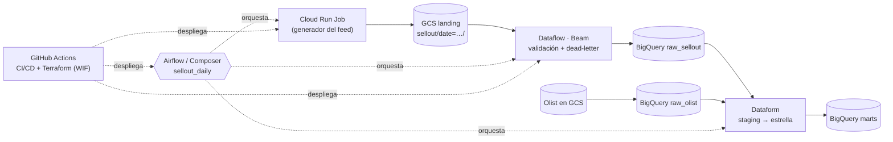

# GCP Data Engineering Lab

Guía y laboratorio práctico de **ingeniería de datos en Google Cloud**, pensado para preparar el puesto de *GCP Data Engineer* (mid-level).

Se construye, de punta a punta y en tu propio proyecto de GCP, el pipeline diario de un **feed de sell-out de retailers**:

## Cómo está organizado

| Carpeta | Qué hay |
|---|---|
| [`docs/`](docs) | **La guía**: qué es cada tecnología, para qué sirve, **cuándo sí y cuándo no**, lecciones de producción, glosario y preparación de entrevista (en inglés) |
| [`labs/`](labs) | **El hands-on**: 8 labs en orden, cada uno con pasos, checkpoint, costo y limpieza |
| `generator/` | Generador determinista del feed de sell-out (Python, Cloud Run Job) |
| `pipelines/sellout_beam/` | Pipeline de Apache Beam (Dataflow, Flex Template) |
| `definitions/`, `includes/`, `workflow_settings.yaml` | Proyecto de Dataform: el modelo dimensional |
| `orchestration/` | DAG de Airflow 3 y sus tests |
| `infra/` | Terraform, esquemas de las tablas "contrato" y bootstrap de WIF |
| `sql/lab02/` | SQL del lab de BigQuery |
| `.github/workflows/` | CI (en cada PR) y CD (en cada merge a `main`) |

## Ruta

| # | Lab | Doc | Tiempo | Costo |
|---|---|---|---|---|
| 0 | [Setup](labs/lab00-setup) | [Rol](docs/01-el-rol.md), [Fundamentos](docs/02-fundamentos-gcp.md) | 2 h | $0 |
| 1 | [Cloud Storage](labs/lab01-cloud-storage) | [03](docs/03-cloud-storage.md) | 1 h | ~$0 |
| 2 | [BigQuery](labs/lab02-bigquery) | [04](docs/04-bigquery.md) | 3 h | $0 (free tier) |
| 3 | [Modelado con Dataform](labs/lab03-modelado-dataform) | [05](docs/05-modelado-dimensional.md) | 4 h | $0 |
| 4 | [Cloud Run Job](labs/lab04-cloud-run-job) | [07](docs/07-cloud-run-functions.md) | 2 h | ~$0 |
| 5 | [Dataflow / Beam](labs/lab05-dataflow-beam) | [06](docs/06-dataflow-beam.md) | 4 h | centavos |
| 6 | [Airflow / Composer](labs/lab06-airflow-composer) | [08](docs/08-orquestacion-airflow.md) | 6 h | unos dólares (Composer, ≤ 2 h) |
| 7 | [CI/CD + Terraform](labs/lab07-cicd-terraform) | [10](docs/10-cicd-terraform.md) | 5 h | ~$0 |

Transversales:
- [Calidad, linaje y observabilidad](docs/09-calidad-linaje-observabilidad.md)
- [**Guía de decisiones**](docs/11-guia-de-decisiones.md)
- [Lecciones de producción](docs/12-lecciones-de-produccion.md)
- [Nombres nuevos de 2026](docs/13-nombres-2026.md)
- [Glosario](docs/glossary.md)
- [Entrevista](docs/interview)

**Empieza por [`docs/00-como-usar-este-repo.md`](docs/00-como-usar-este-repo.md).**

## Reglas del laboratorio

1. **Presupuesto primero.** La alerta de presupuesto se crea en el lab00. Composer solo vive durante su sesión del lab06.
2. **Sin llaves JSON.** Tú usas ADC; GitHub Actions usa Workload Identity Federation.
3. **Todo con variables.** `source .env.lab` y `scripts/preflight.sh` al inicio de cada sesión.
4. **Al terminar el curso:** `scripts/teardown.sh project`.

## Datos

- [Olist Brazilian E-Commerce](https://www.kaggle.com/datasets/olistbr/brazilian-ecommerce) (Kaggle), licencia CC BY-NC-SA 4.0. No se versiona: se descarga con `scripts/download_olist.sh`.
- El feed de sell-out, las tiendas y las marcas son **sintéticos** y deterministas.
