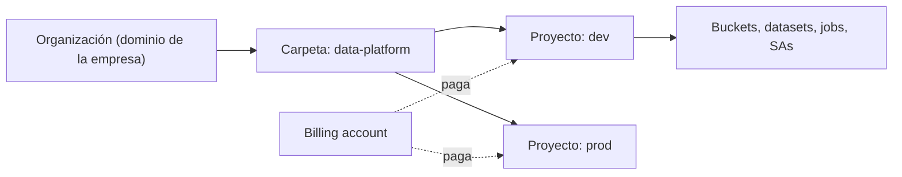
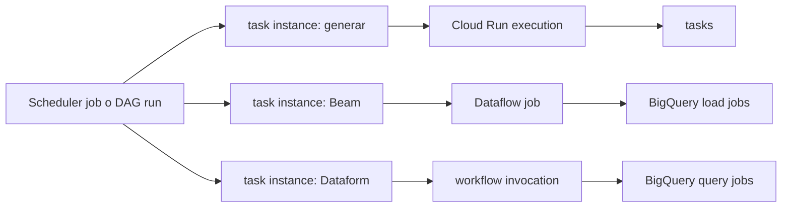

# Fundamentos de Google Cloud

> Lo que necesitas antes de tocar cualquier servicio: dónde viven los recursos (organización, proyecto, región), quién paga (billing), quién puede hacer qué (IAM y service accounts), cómo se autentica tu código (ADC) y qué significa "job" en cada servicio. **Lab relacionado:** `labs/lab00-setup`

## Qué es

### Jerarquía de recursos



- **Organización**: la raíz. Solo existe si la empresa usa Google Workspace o Cloud Identity. Con una cuenta personal de Gmail (como el free trial del lab) tus proyectos quedan en "Sin organización" y no hay políticas de organización encima.
- **Carpetas** (*folders*): agrupan proyectos por área o ambiente.
- **Proyecto**: la unidad donde se crean recursos, se habilitan APIs y se factura. Tiene un **ID** (único global, no cambia; es `$PROJECT_ID`), un **número** (lo usan los emails de los service agents) y un nombre visible.
- Las políticas de IAM **se heredan hacia abajo**: un rol dado en la carpeta aplica a todos sus proyectos.
- **Billing account** (cuenta de facturación): paga uno o varios proyectos. Un proyecto sin billing no puede usar servicios de pago. Una alerta de presupuesto **avisa, no corta el gasto**: la doc lo dice explícitamente.

### Región, zona y multi-región

| Concepto | Qué es | Ejemplo |
|---|---|---|
| Región | Área geográfica independiente, con varias zonas | `us-central1` (Iowa) |
| Zona | Área de despliegue dentro de una región; un dominio de falla | `us-central1-a` |
| Multi-región | Ubicación administrada por Google sobre varias regiones | `US` en BigQuery y Cloud Storage |

Los recursos son **zonales** (una VM), **regionales** (un job de Cloud Run, un bucket regional) o **globales**. En el lab todo vive en `us-central1`: buckets, datasets, Cloud Run, Dataflow y Managed Airflow. Así no pagas transferencia entre regiones y no chocas con las reglas de ubicación (por ejemplo, BigQuery exige que todas las tablas de una query estén en la misma ubicación).

### APIs

Cada servicio es una API que se **habilita por proyecto**. Habilitarla la asocia al proyecto y activa su cobro. Algunas vienen habilitadas por default (BigQuery, Cloud Storage, Dataform, entre otras).

```bash
gcloud services enable run.googleapis.com dataflow.googleapis.com \
  cloudscheduler.googleapis.com composer.googleapis.com \
  artifactregistry.googleapis.com iamcredentials.googleapis.com \
  --project="$PROJECT_ID"
```

`iamcredentials.googleapis.com` es la Service Account Credentials API: sin ella no funciona la impersonation. Deshabilitar una API **no borra los datos**: BigQuery y Cloud Storage siguen cobrando el storage. En cambio, deshabilitar la API de Cloud Run sí borra sus recursos.

## Para qué sirve

Todo lo demás se apoya aquí: el **proyecto** aísla ambientes y costos, la **región** decide latencia y cumplimiento, **IAM** decide quién toca qué, y los **labels** te dicen después cuánto costó cada cosa.

## Cuándo sí / cuándo no

| Decisión | Haz esto | Evita esto |
|---|---|---|
| Separar dev y prod | Un proyecto por ambiente | Un solo proyecto con prefijos en los nombres |
| Dar acceso a personas | Un grupo con un rol predefinido sobre el recurso más chico | Roles básicos (Editor, Owner) en el proyecto |
| Código que corre en GCP | Service account **adjunta** al recurso | Una llave JSON dentro del contenedor |
| Probar en tu laptop como una SA | **Impersonation** | Descargar una llave |
| CI/CD desde GitHub | Workload Identity Federation (lab07) | Una llave JSON como secreto del repo |
| Rol a la medida | Predefinido primero; custom solo si sobran muchos permisos | Custom para todo (hay que mantenerlos) |
| Atribuir costo | Labels | Confiar en los nombres de los recursos |
| Condicionar políticas | Tags | Labels (no sirven para políticas) |

## Cómo se usa

### IAM: quién puede hacer qué sobre cuál recurso

- **Principal**: quién. Un usuario, un grupo, una service account o un conjunto de identidades externas (`principalSet`, en WIF).
- **Permiso**: qué, con forma `servicio.recurso.verbo`, por ejemplo `bigquery.tables.getData`. No se otorga directo.
- **Rol**: un conjunto de permisos. Tres tipos:
  - **Básicos**: Admin, Writer y Reader. Owner, Editor y Viewer quedaron como *legacy*. Miles de permisos; no se usan en producción.
  - **Predefinidos**: los administra Google por servicio, como `roles/bigquery.dataViewer`.
  - **Custom**: los armas tú; hasta 300 por proyecto y 300 por organización.
- **Allow policy**: la lista de "principal + rol" pegada a un recurso (proyecto, bucket, dataset, tabla, SA).
- **Mínimo privilegio**: el rol más chico, sobre el recurso más chico. Mejor un dataset que el proyecto; mejor un bucket que todo Storage.

```bash
# Rol sobre un bucket, no sobre el proyecto
gcloud storage buckets add-iam-policy-binding "gs://${PROJECT_ID}-landing" \
  --member="serviceAccount:sa-generator@${PROJECT_ID}.iam.gserviceaccount.com" \
  --role="roles/storage.objectUser"
```

```sql
-- Rol sobre un dataset de BigQuery, desde SQL
GRANT `roles/bigquery.dataEditor` ON SCHEMA `PROJECT_ID`.raw_sellout
TO "serviceAccount:sa-dataflow@PROJECT_ID.iam.gserviceaccount.com";
```

### Service accounts

Una **service account** (SA) es una identidad para software, no para personas: `nombre@PROJECT_ID.iam.gserviceaccount.com`.

- **Adjunta** (*attached*): el recurso corre como la SA (un Cloud Run job, los workers de Dataflow, un entorno de Managed Airflow). Para adjuntarla necesitas `iam.serviceAccounts.actAs`, incluido en `roles/iam.serviceAccountUser`, **sobre esa SA**.
- **Impersonation** (suplantación): tú, ya autenticado, pides credenciales de corta vida de la SA. Requiere `iam.serviceAccounts.getAccessToken` (rol `roles/iam.serviceAccountTokenCreator`). El audit log registra a los dos: tú y la SA.
- **Service agents**: SAs que administra Google para que un servicio actúe en tu proyecto, como `service-PROJECT_NUMBER@gcp-sa-dataform.iam.gserviceaccount.com`. No son tuyas; a veces hay que darles un rol.
- **No uses la SA default de Compute Engine.** Dataflow la usa por default si no indicas otra, y suele tener permisos de más.

```bash
gcloud iam service-accounts create sa-dataflow --display-name="Workers de Dataflow"
# Probar exactamente lo que la SA puede hacer, sin llaves:
gcloud storage ls "gs://${PROJECT_ID}-landing" \
  --impersonate-service-account="sa-dataflow@${PROJECT_ID}.iam.gserviceaccount.com"
```

### Matriz IAM por componente del lab

Mínimo recomendado. La fuente de verdad es `infra/terraform/` (lab07).

| Componente | Identidad | Roles y sobre qué recurso | Quién necesita actuar como ella |
|---|---|---|---|
| Generador (Cloud Run job, lab04) | `sa-generator` | `roles/storage.objectUser` en `${PROJECT_ID}-landing` (escribe y reescribe un día completo, de forma idempotente) | Quien despliega el job: `roles/iam.serviceAccountUser` sobre `sa-generator`. Quien lo dispara: `roles/run.invoker` sobre el job, o `roles/run.jobsExecutorWithOverrides` si pasa la fecha como *override* |
| Workers de Dataflow (lab05) | `sa-dataflow` | `roles/dataflow.worker` (proyecto); `roles/storage.objectViewer` en landing; `roles/storage.objectUser` en temp; `roles/bigquery.dataEditor` en `raw_sellout`; `roles/bigquery.jobUser` (proyecto, para los load jobs de `FILE_LOADS`); lectura del repositorio de Artifact Registry con la imagen del Flex Template | Quien lanza el job: `roles/dataflow.developer` (proyecto) + `roles/iam.serviceAccountUser` sobre `sa-dataflow` |
| Dataform (lab03) | `sa-dataform` | `roles/bigquery.dataViewer` en `raw_olist` y `raw_sellout`; `roles/bigquery.dataEditor` en `staging` y `marts`; `roles/bigquery.jobUser` (proyecto) | El service agent de Dataform: `roles/iam.serviceAccountUser` y `roles/iam.serviceAccountTokenCreator` sobre `sa-dataform` (*strict act-as*), y `roles/secretmanager.secretAccessor` sobre el secreto con el token de Git. Quien crea invocaciones: `roles/iam.serviceAccountUser` sobre `sa-dataform` |
| Managed Airflow (lab06) | `sa-composer` | `roles/composer.worker` (proyecto); `roles/storage.objectUser` en landing y archive (sensor y movimiento a archive); `roles/run.jobsExecutorWithOverrides` sobre el job del generador; `roles/dataflow.developer`; `roles/dataform.editor`; `roles/bigquery.jobUser` y `roles/bigquery.dataEditor` en `ops` (cifras de control) | Además, `roles/iam.serviceAccountUser` sobre `sa-dataflow` y `sa-dataform`, porque lanza trabajos que corren como ellas |
| CI/CD (lab07) | `sa-deployer` | Lo que Terraform necesita para crear todo lo anterior. Es la identidad más poderosa | GitHub Actions vía WIF: `roles/iam.workloadIdentityUser` sobre `sa-deployer`, solo para el `principalSet` de **ese** repo. Detalle en [10-cicd-terraform](10-cicd-terraform.md) |
| Tú, en local | Tu usuario | Owner del proyecto desechable del lab | `roles/iam.serviceAccountTokenCreator` sobre cada SA, para probar como ella |

### ADC vs `gcloud auth login`

Son **dos juegos de credenciales distintos**:

| | `gcloud auth login` | `gcloud auth application-default login` |
|---|---|---|
| Lo usa | El CLI: `gcloud`, `bq` | Tu código: librerías cliente de Python, Beam, el provider de Terraform |
| Dónde queda | La configuración de `gcloud` | `~/.config/gcloud/application_default_credentials.json` (Linux y macOS) |

**ADC** (Application Default Credentials) busca credenciales en este orden: la variable `GOOGLE_APPLICATION_CREDENTIALS`, el archivo local de arriba y, si corre dentro de GCP, el **metadata server**, que entrega las credenciales de la SA adjunta. Por eso el mismo código funciona en tu laptop y en Cloud Run sin cambios:

```python
from google.cloud import bigquery

client = bigquery.Client(project="PROJECT_ID")   # ADC: no hay llaves en el código
n = list(client.query("SELECT COUNT(*) AS n FROM raw_olist.orders").result())[0].n
```

Para que tu código local actúe como una SA: `gcloud auth application-default login --impersonate-service-account=sa-dataflow@${PROJECT_ID}.iam.gserviceaccount.com`.

**Por qué no se crean llaves JSON de service account:**

- Quien tenga el archivo entra, sin contraseña ni segundo factor.
- El audit log solo muestra la SA, no quién usó la llave.
- Las llaves se filtran en repos, buckets públicos, correos y carpetas temporales.
- Las organizaciones creadas desde el 3 de mayo de 2024 bloquean la creación de llaves por default.
- Siempre hay alternativa: SA adjunta en GCP, impersonation en local y WIF en CI/CD.

### Herramientas

| Herramienta | Para qué |
|---|---|
| Consola web | Explorar, ver estados y logs. Nunca impersona: siempre eres tú |
| `gcloud` | Casi todo: proyectos, IAM, Cloud Run, `gcloud storage`, Managed Airflow |
| `bq` | BigQuery: `bq query`, `bq load`, `bq mk`, `bq head` |
| Librerías cliente | Python (`google-cloud-bigquery`, `google-cloud-storage`) dentro de tus jobs |
| Cloud Shell | Terminal en el navegador con `gcloud` instalado y 5 GB de disco persistente, sin costo |

En el lab, `scripts/preflight.sh` valida cuenta, proyecto y ADC antes de cualquier comando. Pasa siempre `--project` explícito.

### Labels para atribuir costos

Un label es un par clave-valor en un recurso (hasta 64 por recurso; minúsculas, números, `_` y `-`). Viajan al billing: puedes agrupar en los reportes y en el billing export a BigQuery. Convención del lab: `env=lab`, `pipeline=sellout_daily`, `component=generator`. Los jobs de BigQuery también llevan labels (`bq query --label pipeline:sellout_daily`). No pongas datos personales en labels. Ojo: los labels del **proyecto** no se pueden usar para filtrar el desglose de costos; etiqueta los recursos.

## ¿Qué es un job?

La palabra "job" significa cosas distintas en cada servicio. Confundirlas es un error típico en entrevistas y en diagnósticos de costo.

| Servicio | Qué es el "job" | Quién lo crea | Cuánto dura | Cómo ves su estado | Cómo se cobra |
|---|---|---|---|---|---|
| **BigQuery** | Cada operación asíncrona: **query, load, extract o copy** | Tú, Dataform, Airflow, Data Studio, Beam | Segundos a horas | `PENDING` → `RUNNING` → `DONE`. **`DONE` no es éxito**: revisa `errorResult`. Historial en `INFORMATION_SCHEMA.JOBS` | Query: TiB leídos (on-demand) o slots (editions). Load, extract y copy: gratis con el pool compartido. Paga el proyecto donde corre el job |
| **Dataflow** | Un pipeline en ejecución con sus workers | Tú o Airflow, al lanzar un programa Beam o un Flex Template | Batch: hasta terminar. Streaming: hasta que lo canceles o drenes | Consola de Dataflow (`JOB_STATE_RUNNING`, `JOB_STATE_DONE`, `JOB_STATE_FAILED`…) | vCPU, memoria, disco y Shuffle de los workers mientras viven |
| **Cloud Run** | **Job** = la definición (imagen, recursos, número de tasks). **Execution** = una corrida. **Task** = un contenedor de esa corrida | El job: el deploy. La execution: `gcloud run jobs execute`, Scheduler o Airflow | Cada task: 10 min por default, hasta 7 días. La execution termina cuando terminan todas sus tasks | Lista de executions; cada task reintenta (3 veces por default) | CPU y memoria mientras corren las tasks, con free tier mensual |
| **Airflow** | **DAG** = la definición. **DAG run** = una corrida para una fecha lógica. **Task instance** = una tarea dentro de esa corrida | El scheduler, un disparo manual o un backfill | Lo que tarden sus tareas | Airflow UI o DAG UI: estado del DAG run y de cada task instance (`success`, `failed`, `up_for_retry`…) | Managed Airflow cobra el **entorno** mientras existe, corran o no DAGs. El trabajo pesado lo cobra el servicio que la tarea dispara |
| **Dataform** | **Workflow invocation** = una ejecución de un resultado de compilación (tablas y assertions) | Una workflow configuration con cron, la API, un operador de Airflow o Cloud Build | Lo que tarden sus jobs de BigQuery | "Workflow execution logs" en Dataform; estados como `SUCCEEDED` | Dataform es gratis; pagas los jobs de BigQuery que lanza |
| **Cloud Scheduler** | Un **cron** que llama a un destino HTTP, Pub/Sub o App Engine | Tú o Terraform | Persiste; cada intento HTTP tiene hasta 30 minutos | Último resultado en la consola. Reintenta con backoff y entrega *at least once* | Por job definido al mes, no por ejecución. Confirma la tarifa en la página de precios |

Cómo se encadenan en el lab:



## En la práctica

- **Etiqueta los jobs.** Los labels en jobs y recursos permiten atribuir costo por pipeline en el billing export. Sin ellos, solo ves "BigQuery: tanto".
- **Una SA por componente.** Si algo falla o gasta de más, el audit log te dice qué componente fue, y un compromiso solo expone sus permisos.
- **IAM en IaC.** Un rol agregado a mano en la consola lo revierte el siguiente `terraform apply`, o peor, se queda sin que nadie sepa por qué existe.
- **Antes de mantener un pipeline caro, confirma con los audit logs que alguien lee la tabla.**
- **La alerta de presupuesto no apaga nada.** Revisa el billing a diario mientras haya recursos encendidos.

## Errores comunes

- Hacer `gcloud auth login` y esperar que tu script de Python se autentique: falta `gcloud auth application-default login`.
- Olvidar `--project` y trabajar en otro proyecto.
- Dar Editor u Owner a una service account "para que funcione".
- Dar roles en el proyecto cuando bastaba el dataset o el bucket.
- Crear una llave JSON "solo para probar".
- No habilitar `iamcredentials.googleapis.com` y no entender por qué falla la impersonation.
- Confundir el ID del proyecto con su número (los service agents usan el número).
- Leer `DONE` en un job de BigQuery como éxito.

## Autoevaluación

1. ¿Qué diferencia hay entre `gcloud auth login` y `gcloud auth application-default login`?
<details><summary>Respuesta</summary>

El primero autentica al CLI (`gcloud`, `bq`). El segundo deja credenciales en un archivo que usan las librerías cliente vía ADC. Son juegos distintos; tu código Python usa el segundo.
</details>

2. Tu Cloud Run job necesita escribir en un bucket. ¿Cómo le das acceso sin llaves?
<details><summary>Respuesta</summary>

Le adjuntas una SA dedicada (`sa-generator`) y le das un rol de objetos sobre ese bucket. En ejecución, la librería obtiene las credenciales del metadata server vía ADC.
</details>

3. ¿Qué rol necesitas para impersonar una SA y cuál para adjuntarla a un recurso?
<details><summary>Respuesta</summary>

Impersonar: `roles/iam.serviceAccountTokenCreator` (permiso `iam.serviceAccounts.getAccessToken`). Adjuntar: `roles/iam.serviceAccountUser` (permiso `iam.serviceAccounts.actAs`). Ambos sobre la SA.
</details>

4. En Cloud Run, ¿qué es un job, una execution y una task?
<details><summary>Respuesta</summary>

El job es la definición persistente (imagen, recursos, número de tasks). Una execution es una corrida del job. Una task es un contenedor dentro de esa execution; una execution puede tener muchas en paralelo.
</details>

5. Un job de BigQuery está en `DONE`. ¿Terminó bien?
<details><summary>Respuesta</summary>

No necesariamente. `DONE` solo significa que dejó de correr. Si `status.errorResult` existe, falló.
</details>

6. Configuraste una alerta de presupuesto de US$20 y el gasto llegó a US$35. ¿Por qué?
<details><summary>Respuesta</summary>

Las alertas de presupuesto solo notifican; no pausan servicios. Hay que reaccionar a mano o automatizar la respuesta (por ejemplo, con Pub/Sub).
</details>

7. ¿Por qué el lab pone todo en `us-central1`?
<details><summary>Respuesta</summary>

Para no pagar transferencia entre regiones y cumplir las reglas de ubicación: un load desde un bucket en otra ubicación cobra transferencia, y una query solo une tablas de la misma ubicación.
</details>

## Para profundizar

- [Geografía y regiones](https://docs.cloud.google.com/docs/geography-and-regions)
- [Habilitar y deshabilitar servicios](https://docs.cloud.google.com/service-usage/docs/enable-disable)
- [IAM: roles y permisos](https://docs.cloud.google.com/iam/docs/roles-overview)
- [Service account impersonation](https://docs.cloud.google.com/iam/docs/service-account-impersonation)
- [Buenas prácticas con service accounts](https://docs.cloud.google.com/iam/docs/best-practices-service-accounts)
- [Buenas prácticas con llaves de service account](https://docs.cloud.google.com/iam/docs/best-practices-for-managing-service-account-keys)
- [Application Default Credentials](https://docs.cloud.google.com/docs/authentication/application-default-credentials)
- [Labels](https://docs.cloud.google.com/resource-manager/docs/labels-overview)
- [Budgets y alertas](https://docs.cloud.google.com/billing/docs/how-to/budgets)
- [BigQuery: manage jobs](https://docs.cloud.google.com/bigquery/docs/managing-jobs)
- [Cloud Run: ejecutar jobs](https://docs.cloud.google.com/run/docs/execute/jobs)
- [Managed Airflow: ver DAGs, DAG runs y tareas](https://docs.cloud.google.com/composer/docs/composer-3/view-dags)
- [Dataform: programar ejecuciones](https://docs.cloud.google.com/dataform/docs/schedule-runs)
- [Cloud Scheduler: overview](https://docs.cloud.google.com/scheduler/docs/overview)
