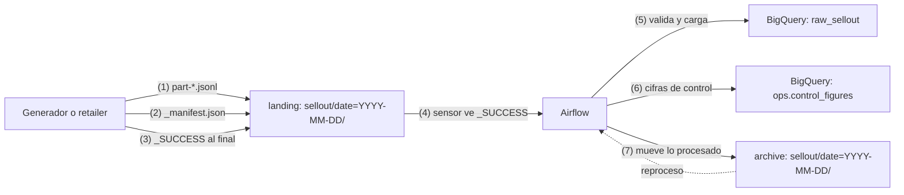

# Cloud Storage

> Almacenamiento de objetos (archivos) de Google Cloud. En un pipeline de datos es la zona de aterrizaje (*landing*) de lo que llega de fuera, el archivo histórico y el espacio temporal de Dataflow. Aquí ves clases, lifecycle, soft delete y cómo diseñar un landing que se pueda reprocesar. **Lab relacionado:** `labs/lab01-cloud-storage`

## Qué es

Un **bucket** (contenedor) guarda **objetos** (archivos con metadatos). Cuatro reglas que explican casi todo:

1. **Los objetos son inmutables.** No se editan ni se les agrega texto al final: se reemplazan completos. El reemplazo es atómico; cada versión tiene su número de *generation*.
2. **Las "carpetas" no existen** en un bucket normal (*flat namespace*). `sellout/date=2026-11-08/part-000.jsonl` es el nombre completo del objeto; la consola y `gcloud` simulan carpetas cortando por `/`. Renombrar una "carpeta" es copiar y borrar cada objeto. Existe el *hierarchical namespace* con carpetas reales, pero se elige al crear el bucket.
3. **El nombre del bucket es global y público.** Debe ser único en todo Google Cloud y cualquiera puede sondear si existe.
4. **La ubicación se fija al crear el bucket** y no cambia: región (`us-central1`), dual-región o multi-región.

**Clases de almacenamiento** (el precio de lista es "desde", por GiB al mes; confirma en la [página de precios](https://cloud.google.com/storage/pricing)):

| Clase | Duración mínima | Cobro por lectura (*retrieval*) | Úsala para | Precio orientativo |
|---|---|---|---|---|
| Standard | Ninguna | No | Datos que se leen seguido o viven poco (landing, temp) | Desde US$0.02 |
| Nearline | 30 días | Sí | Lo que lees ~1 vez al mes | Desde US$0.01 |
| Coldline | 90 días | Sí | Lo que lees ~1 vez al trimestre | Desde US$0.004 |
| Archive | 365 días | Sí | Respaldo legal o regulatorio, casi nunca se lee | Desde US$0.0012 |

Borrar un objeto antes de su duración mínima cobra el resto del periodo (*early deletion*). Todas las clases leen en milisegundos; ninguna es "cinta".

## Para qué sirve

- **Landing**: donde dejan sus archivos los retailers o el generador del lab (`${PROJECT_ID}-landing`).
- **Archive**: lo ya procesado, para auditoría y reprocesos (`${PROJECT_ID}-archive`).
- **Temp / staging**: archivos intermedios de Dataflow y de cargas (`${PROJECT_ID}-temp`).
- Infraestructura: el bucket de DAGs de Managed Airflow y el *state* de Terraform (lab07).

## Cuándo sí / cuándo no

| Usa Cloud Storage cuando… | No lo uses cuando… |
|---|---|
| Recibes archivos (CSV, JSONL, Parquet) de sistemas externos | Necesitas consultar con SQL una y otra vez: carga a BigQuery |
| Quieres guardar el crudo tal como llegó para reprocesar | Necesitas modificar registros sueltos: los objetos son inmutables |
| Compartes un archivo puntual con alguien sin cuenta de Google (signed URL) | Necesitas un filesystem POSIX con escrituras concurrentes al mismo archivo |
| Guardas respaldos o exportaciones baratas por años | Vas a reemplazar el mismo objeto más de una vez por segundo (hay límite) |

**GCS vs BigQuery vs disco:**

| | Cloud Storage | BigQuery | Disco (de una VM o contenedor) |
|---|---|---|---|
| Unidad | Objeto completo | Tabla, fila, columna | Bloques de un filesystem |
| Cómo se lee | API o HTTP, objeto por objeto | SQL | Como archivos locales |
| Se modifica | Se reemplaza el objeto entero | DML (`MERGE`, `UPDATE`) | En el lugar |
| Cobro principal | GiB al mes + operaciones + lectura en clases frías | GiB al mes + bytes o slots de cómputo | Capacidad aprovisionada, aunque esté vacía |
| Rol en el lab | Landing, archive, temp | Raw, staging, marts | Scratch efímero de un job |

## Cómo se usa

### Crear los buckets del lab

```bash
for b in landing archive temp; do
  gcloud storage buckets create "gs://${PROJECT_ID}-${b}" \
    --project="$PROJECT_ID" --location="$REGION" \
    --default-storage-class=STANDARD \
    --uniform-bucket-level-access \
    --public-access-prevention
done

# El temp no necesita soft delete: lo que se borra ahí es basura por diseño
gcloud storage buckets update "gs://${PROJECT_ID}-temp" --clear-soft-delete

gcloud storage cp ./sample.jsonl "gs://${PROJECT_ID}-landing/sellout/date=2026-11-08/"
gcloud storage ls "gs://${PROJECT_ID}-landing/sellout/**"     # comillas: que el shell no expanda el comodín
gcloud storage du -s "gs://${PROJECT_ID}-landing"
```

Usa `gcloud storage`, no `gsutil`. La doc llama a `gsutil` herramienta *legacy*, no soporta funciones nuevas como soft delete y deja de venir con el CLI después de marzo de 2027.

### Acceso: uniform bucket-level access y public access prevention

- **Uniform bucket-level access** (acceso uniforme a nivel de bucket) desactiva las ACL por objeto: el acceso se da **solo con IAM**. Es lo recomendado y es requisito para *managed folders*, condiciones de IAM en el bucket y Workload Identity Federation. Tras 90 días seguidos activo ya no se puede desactivar.
- **Public access prevention** bloquea `allUsers` y `allAuthenticatedUsers`, aunque alguien los agregue por error. No afecta a las signed URLs. Una organización puede forzarlo con la restricción `storage.publicAccessPrevention`.
- Roles típicos: `roles/storage.objectViewer` (leer), `roles/storage.objectCreator` (crear; no permite leer, borrar ni sobrescribir), `roles/storage.objectUser` (leer, crear, sobrescribir y borrar). Dalos **sobre el bucket**, no sobre el proyecto.

### Lifecycle (ciclo de vida)

Reglas que Cloud Storage aplica solo: borrar (`Delete`), cambiar de clase (`SetStorageClass`) o abortar subidas multiparte incompletas. Ejemplo para el bucket de archive:

```json
{
  "rule": [
    {"action": {"type": "SetStorageClass", "storageClass": "NEARLINE"},
     "condition": {"age": 30, "matchesStorageClass": ["STANDARD"]}},
    {"action": {"type": "Delete"}, "condition": {"age": 400}}
  ]
}
```

```bash
gcloud storage buckets update "gs://${PROJECT_ID}-archive" --lifecycle-file=lifecycle-archive.json
```

- Es **asíncrono**: un objeto que ya cumple la condición puede tardar en procesarse, y un cambio de reglas puede tardar hasta 24 horas en aplicarse.
- `SetStorageClass` no reescribe el objeto: no cobra *retrieval* ni *early deletion*, y el tiempo en la clase anterior cuenta para la duración mínima de la nueva. Sí es una operación Clase A: con objetos muy chicos puede costar más mover que lo que ahorras (usa `sizeAboveBytes`).
- En el temp, una regla `Delete` con `age: 1` limpia lo que Dataflow deja atrás.

### Versioning y soft delete

| | Object Versioning | Soft delete |
|---|---|---|
| Qué guarda | Versiones *noncurrent* (no actuales) al sobrescribir o borrar | Objetos y buckets borrados o sobrescritos |
| Se pueden leer | Sí | No; hay que restaurarlos (rol Storage Admin) |
| Cuánto tiempo | Hasta que los borres (o una regla de lifecycle) | Retención fija: 7 días por default, configurable de 7 a 90; 0 lo apaga |
| Default en buckets nuevos | Apagado | **Encendido, 7 días** |
| Cobro | Cada versión, como un objeto vivo | El objeto borrado, durante la retención |

Soft delete protege contra borrados accidentales, pero **cobra** todo lo borrado o sobrescrito durante la retención. Los objetos que borra el lifecycle también pasan a soft-deleted. En un bucket temporal, que por diseño borra todo, eso es puro costo: apágalo. En landing y archive, déjalo.

En el billing export, la etiqueta de sistema `storage.googleapis.com/object_state` distingue `live`, `noncurrent` y `soft_deleted`: así ves cuánto te cuesta.

### Signed URLs

Una signed URL da acceso temporal a un objeto a quien tenga el enlace, sin cuenta de Google. Caso de dominio: un retailer pequeño que no tiene integración sube su archivo de sell-out con un `PUT` a una URL firmada.

```bash
gcloud storage sign-url "gs://${PROJECT_ID}-landing/sellout/date=2026-11-08/r05.jsonl" \
  --http-verb=PUT --duration=1h --headers=content-type=application/json \
  --impersonate-service-account="sa-generator@${PROJECT_ID}.iam.gserviceaccount.com"
```

Firmando con impersonation la duración máxima es 12 horas; los 7 días solo se logran con una llave privada, que en este lab no creamos.

### Diseño de un bucket de landing

```text
gs://${PROJECT_ID}-landing/
└── sellout/
    └── date=2026-11-08/
        ├── part-000.jsonl     # datos
        ├── part-001.jsonl
        ├── _manifest.json     # qué archivos hay y cuántas filas trae cada uno
        └── _SUCCESS           # vacío, se escribe al final: "terminé"
```

El generador del lab deja también los snapshots de maestros (producto y tienda) con el mismo patrón de fecha; las rutas exactas están en el lab01 y el lab04.

- **`source/date=YYYY-MM-DD/`** (estilo Hive): cada día es un prefijo. Listar, reprocesar o borrar un día es una operación sobre un prefijo, y BigQuery y Spark reconocen `date=` como columna de partición en tablas externas.
- **`_SUCCESS` al final.** Cada objeto es atómico, pero un **conjunto** de archivos no. Si el consumidor lee mientras el productor escribe, procesa un día a medias. El marcador vacío dice "ya están todos". El sensor de Airflow del lab06 espera ese objeto.
- **`_manifest.json`.** Lista de archivos y conteos. El consumidor compara lo que cargó contra el manifiesto y guarda las cifras de control en `ops.control_figures`. Si no cuadran, falla en lugar de publicar datos incompletos.
- **Mover a archive** después de cargar. Así el landing solo tiene lo pendiente y un reproceso sale del archive. `gcloud storage mv` **no es atómico**: copia y luego borra cada objeto.



## En la práctica

- **Soft delete en buckets temporales.** Cobra los objetos borrados o sobrescritos durante su retención. En un bucket de staging que se vacía a diario, pagas 7 días de basura de forma permanente. Apágalo ahí y revísalo en el billing export.
- **El lifecycle vive en IaC.** Si alguien cambia una regla a mano en la consola, el siguiente `terraform apply` la revierte. Cualquier ajuste se hace en el código (lab07).
- **Labels en los buckets.** Con `env`, `pipeline` y `owner` puedes atribuir el costo de storage en el billing export.
- **Antes de mantener datos, confirma que alguien los lee.** Los audit logs de acceso a datos muestran lecturas; un archive de años que nadie toca puede bajar de clase o borrarse.
- **Mover en clases frías cuesta.** `mv` desde Nearline, Coldline o Archive cobra lectura y, si es antes de tiempo, *early deletion*.

## Errores comunes

- Crear el bucket en otra ubicación que el dataset de BigQuery: las cargas cobran transferencia o fallan. En el lab, todo en `us-central1`.
- Poner IDs de proyecto o datos personales en el nombre del bucket. La doc lo desaconseja porque los nombres son públicos. En el lab usamos `${PROJECT_ID}-…` por simplicidad, en un proyecto desechable; en una empresa usa una convención que no revele nada.
- Creer que las carpetas existen: "renombrar" un prefijo con miles de objetos son miles de copias y borrados.
- No poner comillas a `gs://…/*`: el shell intenta expandir el comodín y el comando falla con "not found".
- Una regla `Delete` en el temp con soft delete encendido: lo borrado se sigue cobrando 7 días.
- Usar Archive para datos que se leen cada mes: pagas *retrieval* en cada lectura.
- Dar `roles/storage.admin` a nivel proyecto a una service account que solo escribe en un bucket.

## Autoevaluación

1. ¿Por qué el productor escribe `_SUCCESS` al final y no al principio?
<details><summary>Respuesta</summary>

Porque cada objeto es atómico pero el conjunto no. `_SUCCESS` al final indica que todos los archivos del día ya están completos; si se escribiera primero, el consumidor podría leer un día a medias.
</details>

2. Un bucket temporal se vacía cada noche y su costo de storage es varias veces el volumen vivo. ¿Qué revisas?
<details><summary>Respuesta</summary>

Soft delete: con la retención por default de 7 días, cada objeto borrado se sigue cobrando una semana. En un bucket temporal se apaga con `gcloud storage buckets update gs://… --clear-soft-delete`. En el billing export lo confirmas con `object_state = soft_deleted`.
</details>

3. ¿Qué diferencia hay entre Object Versioning y soft delete?
<details><summary>Respuesta</summary>

Versioning conserva versiones *noncurrent* legibles hasta que las borres. Soft delete retiene lo borrado o sobrescrito durante un periodo fijo (7 a 90 días), no es legible y hay que restaurarlo. Soft delete viene encendido por default; versioning no.
</details>

4. Mueves un objeto de Coldline a Standard reescribiéndolo a los 20 días. ¿Qué te cobran además del storage?
<details><summary>Respuesta</summary>

*Retrieval* por leer de Coldline y *early deletion* por los 70 días que faltaban de su mínimo de 90.
</details>

5. Un retailer sin cuenta de Google debe subir su archivo diario. ¿Cómo, sin hacer público el bucket?
<details><summary>Respuesta</summary>

Con una signed URL de `PUT`, de corta duración, firmada por impersonation de una service account. Public access prevention no la bloquea.
</details>

6. ¿Por qué `date=YYYY-MM-DD` y no `2026/11/08/`?
<details><summary>Respuesta</summary>

El formato `clave=valor` (estilo Hive) permite que BigQuery y Spark detecten `date` como columna de partición en tablas externas. Además, un día completo es un solo prefijo fácil de listar, reprocesar o borrar.
</details>

## Para profundizar

- [Objetos y carpetas simuladas](https://docs.cloud.google.com/storage/docs/objects)
- [Storage classes](https://docs.cloud.google.com/storage/docs/storage-classes)
- [Soft delete](https://docs.cloud.google.com/storage/docs/soft-delete) y [cómo desactivarlo](https://docs.cloud.google.com/storage/docs/disable-soft-delete)
- [Object Lifecycle Management](https://docs.cloud.google.com/storage/docs/lifecycle)
- [Object Versioning](https://docs.cloud.google.com/storage/docs/object-versioning)
- [Uniform bucket-level access](https://docs.cloud.google.com/storage/docs/uniform-bucket-level-access)
- [Public access prevention](https://docs.cloud.google.com/storage/docs/public-access-prevention)
- [Signed URLs](https://docs.cloud.google.com/storage/docs/access-control/signed-urls)
- [`gcloud storage buckets create`](https://docs.cloud.google.com/sdk/gcloud/reference/storage/buckets/create)
- [Precios de Cloud Storage](https://cloud.google.com/storage/pricing)
