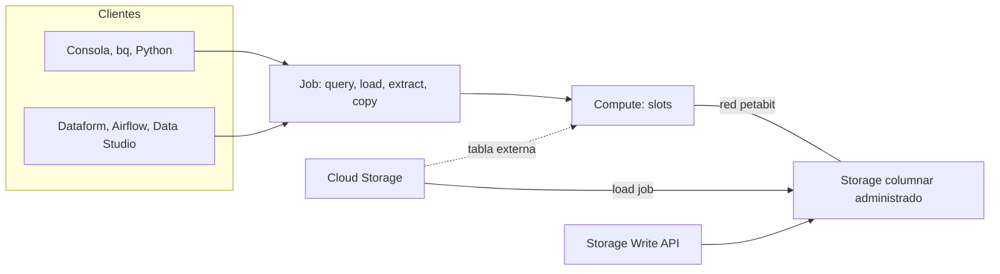

# BigQuery

> El data warehouse serverless de Google Cloud: guardas tablas, escribes SQL y pagas por bytes leídos o por capacidad reservada. Aquí ves cómo cobra, cómo se poda con partitioning (particionado) y clustering (agrupamiento), cómo se carga, cómo se protege y cómo se mide el costo. **Lab relacionado:** `labs/lab02-bigquery`

## Qué es

BigQuery separa **storage** (almacenamiento) y **compute** (cómputo); los une una red de petabits. El storage es columnar y está administrado por Google. El cómputo se mide en **slots**: un slot es una unidad virtual de CPU. Tú no eliges cuántos slots usa una query; BigQuery los asigna según el plan de ejecución.

Cada operación pesada (query, carga, exportación, copia) es un **job** asíncrono con estado `PENDING`, `RUNNING` o `DONE`. Ver la sección "¿Qué es un job?" de [02-fundamentos-gcp](02-fundamentos-gcp.md).



**Cómo cobra** (precios de lista, siempre confirma en la [página de precios](https://cloud.google.com/bigquery/pricing)):

| Concepto | Modelo | Orden de magnitud |
|---|---|---|
| Cómputo **on-demand** (default) | Por TiB escaneado. Hasta ~2,000 slots concurrentes por proyecto | Desde US$6.25 por TiB; el primer TiB del mes es gratis |
| Cómputo **editions** (Standard, Enterprise, Enterprise Plus) | Por slot-hora, con reservas (baseline + autoscaling, mínimo 50 slots) | Desde US$0.04 por slot-hora |
| Storage lógico (default) | Bytes sin comprimir; activo vs largo plazo | Ejemplo de la doc para `us-central1`: activo US$0.02/GiB, largo plazo US$0.01/GiB |
| Storage físico | Bytes comprimidos, más time travel y fail-safe | Ejemplo de la doc: activo US$0.04/GiB, largo plazo US$0.02/GiB |
| Free tier | Por billing account | 10 GiB de storage y 1 TiB de queries al mes |

Una tabla o partición que no se modifica en 90 días seguidos pasa a **largo plazo** y su storage baja ~50 %. Cada partición se evalúa por separado.

## Para qué sirve

- **Warehouse** del lab: `raw_olist`, `raw_sellout`, `staging`, `marts`, `ops` y `sandbox`.
- **ELT**: cargas crudo y transformas con SQL (Dataform en el lab03).
- **Servir a BI**: Looker y Data Studio leen de `marts`.
- **Auditar costo**: `INFORMATION_SCHEMA.JOBS` te dice quién gastó qué.

## Cuándo sí / cuándo no

| Usa BigQuery cuando… | No lo uses cuando… |
|---|---|
| Analizas millones o miles de millones de filas con SQL | Necesitas transacciones fila a fila (OLTP): usa Cloud SQL, AlloyDB o Spanner |
| Cargas por lotes o haces streaming hacia tablas analíticas | Haces muchos `INSERT` de una fila: la doc advierte que BigQuery no rinde como base relacional |
| Quieres separar costo de storage y de cómputo | Necesitas latencia de milisegundos por clave: usa Bigtable o una cache |
| Necesitas seguridad por fila, columna y vistas autorizadas | Guardas archivos binarios o crudos que nadie consulta: déjalos en Cloud Storage |

## Cómo se usa

### Datasets, tablas y ubicación

Jerarquía: proyecto → **dataset** → tabla, vista o rutina. La **ubicación** del dataset se fija al crearlo y no cambia. Todas las tablas de una query deben estar en la misma ubicación. El modelo de facturación de storage y la ventana de time travel también son del dataset.

```sql
CREATE SCHEMA IF NOT EXISTS `PROJECT_ID.sandbox`
OPTIONS (
  location = 'us-central1',
  default_table_expiration_days = 7,   -- los experimentos se borran solos
  max_time_travel_hours = 48,          -- mínimo 48, máximo 168 (default)
  labels = [('lab', 'lab02')]
);
```

Tipos de tabla:

| Tipo | Qué es | Detalle a recordar |
|---|---|---|
| Nativa (*standard*) | Datos en el storage de BigQuery | La única que admite partitioning, clustering y DML completos |
| Externa | Metadatos en BigQuery, datos en GCS | Solo lectura, sin clustering, más lenta; el dry-run puede reportar 0 bytes |
| Vista | Una query guardada | No guarda datos; cada consulta paga lo que lee la query de fondo |
| Vista materializada | Resultado precalculado | Se refresca de forma incremental cuando puede; el optimizador la usa solo |
| Snapshot y clone | Copias ligeras | Solo pagas el delta contra la tabla base |

### Partitioning

Divide la tabla en particiones por una sola columna:

- **Por columna de tiempo** (`DATE`, `TIMESTAMP`, `DATETIME`): hora, día, mes o año.
- **Por tiempo de ingesta**: pseudocolumnas `_PARTITIONTIME` y `_PARTITIONDATE`.
- **Por rango entero**: por ejemplo `customer_id` de 0 a 100 en saltos de 10.

Límites: 10,000 particiones por tabla y 4,000 particiones modificadas por job. No puedes convertir una tabla existente en particionada: se recrea con `CREATE TABLE … AS SELECT`.

```sql
-- Esquema simplificado; el real está en sql/lab02/
CREATE TABLE IF NOT EXISTS raw_sellout.sellout_lines (
  sale_date   DATE NOT NULL,
  retailer_id STRING NOT NULL,
  store_id    STRING,
  product_id  STRING,
  ean         STRING,      -- STRING, nunca INT64: perderías ceros a la izquierda
  units       INT64,
  net_sales   NUMERIC,
  source_file STRING,
  ingested_at TIMESTAMP
)
PARTITION BY sale_date
CLUSTER BY retailer_id, product_id
OPTIONS (require_partition_filter = TRUE);
```

### Clustering

Ordena los datos en bloques según hasta **4 columnas**; el orden importa (la primera manda). Al filtrar por esas columnas, BigQuery salta bloques (*block pruning*). La doc sugiere clustering para tablas o particiones de más de 64 MB y con filtros frecuentes sobre columnas de alta cardinalidad. BigQuery re-agrupa en segundo plano sin costo.

### Los límites de la poda (lo más preguntado)

1. **Filtro con subconsulta: no poda.** `WHERE sale_date >= (SELECT MAX(sale_date) FROM destino)` compara contra un valor dinámico y lee todas las particiones. Una ventana constante sí poda: `WHERE sale_date >= DATE_SUB(CURRENT_DATE(), INTERVAL 3 DAY)`.
2. **Funciones sobre la columna.** `DATE(ts)`, `TIMESTAMP_TRUNC` o `DATE_SUB` con argumentos constantes podan; `FORMAT_DATE(...)` o `ts + INTERVAL 1 DAY > …` no. Deja la columna sola de un lado.
3. **`OR` con otra columna** rompe la poda; usa `AND`.
4. **El dry-run muestra la poda de particiones, no la de clustering.** Para tablas con clustering el estimado es una cota superior. La poda real se ve después, en `total_bytes_billed`.
5. **`require_partition_filter`** hace fallar cualquier query (también sobre vistas) sin un predicado que use solo la columna de partición: `Cannot query over table … without a filter that can be used for partition elimination`.
6. **Mínimo facturable:** on-demand cobra al menos 10 MiB por tabla referenciada y 10 MiB por query, aunque la tabla pese KB.
7. **`LIMIT` no reduce bytes** en tablas sin clustering: pagas la tabla entera. Para mirar datos usa la vista previa de la consola o `bq head` (gratis).

En el lab02 mides esto sobre una tabla sintética de varios GB en `sandbox`: dry-run primero, ejecución después, y comparas contra JOBS.

```bash
bq query --use_legacy_sql=false --dry_run \
  'SELECT SUM(units) FROM sandbox.sellout_big
   WHERE sale_date = "2026-10-01" AND retailer_id = "R03"'
```

### Storage LOGICAL vs PHYSICAL

| | LOGICAL (default) | PHYSICAL |
|---|---|---|
| Qué mide | Bytes sin comprimir | Bytes comprimidos |
| Precio por GiB | Menor | Mayor (en el ejemplo de la doc, el doble) |
| Time travel (2–7 días) y fail-safe (7 días fijos) | Incluidos | Se cobran aparte, a tarifa de activo físico |
| Cambio | Por dataset; tarda 24 h en aplicar y no puedes volver a cambiar en 14 días | Igual |

Con datos que comprimen bien, PHYSICAL suele salir más barato. Con tablas que se reescriben completas a diario, lo reemplazado queda en time travel y fail-safe, y PHYSICAL puede salir más caro. La forma de decidir es la query de pronóstico de la doc sobre `INFORMATION_SCHEMA.TABLE_STORAGE_BY_PROJECT`. El costo de las queries on-demand siempre usa bytes lógicos, sin importar el modelo de storage.

### Formas de ingestar

| Método | Latencia | Costo | Cuándo |
|---|---|---|---|
| **Batch load** (`bq load`, load job desde GCS) | Minutos | Gratis con el pool compartido de slots (sin garantía de capacidad) | El default para archivos diarios: Olist en el lab02 y `FILE_LOADS` de Beam en el lab05 |
| **Storage Write API (gRPC)** | Segundos | Desde US$0.025/GiB; los primeros 2 TiB del mes gratis | Streaming nuevo; exactly-once con offsets; también modo batch (*pending*) |
| **Storage Write API (REST)**, antes *legacy streaming inserts* (`tabledata.insertAll`) | Segundos | US$0.01 por 200 MiB, mínimo 1 KB por fila | Solo código existente. Deduplicación *best-effort* y sin DML sobre lo recién escrito |
| **Tabla externa** | La de GCS | Pagas lo que lee cada query | Explorar archivos, o datos que cambian fuera de BigQuery |

Límites de carga útiles: 1,500 load jobs por tabla por día y hasta 15 TB por load job.

```bash
bq --location="$REGION" load --source_format=CSV --skip_leading_rows=1 --autodetect \
  "${PROJECT_ID}:raw_olist.orders" \
  "gs://${PROJECT_ID}-landing/olist/olist_orders_dataset.csv"   # ruta ilustrativa: la define el lab01
```

```sql
-- Tabla externa sobre el layout date=YYYY-MM-DD del landing (Hive partitioning)
CREATE OR REPLACE EXTERNAL TABLE sandbox.sellout_ext
WITH PARTITION COLUMNS
OPTIONS (
  format = 'NEWLINE_DELIMITED_JSON',
  uris = ['gs://PROJECT_ID-landing/sellout/*'],
  hive_partition_uri_prefix = 'gs://PROJECT_ID-landing/sellout',
  require_hive_partition_filter = TRUE
);
```

### DML: `MERGE`, `QUALIFY` y su costo

Deduplicar con `QUALIFY ROW_NUMBER()`, siempre con un filtro constante sobre la partición:

```sql
SELECT *
FROM raw_sellout.sellout_lines
WHERE sale_date >= DATE_SUB(CURRENT_DATE(), INTERVAL 3 DAY)
QUALIFY ROW_NUMBER() OVER (
  PARTITION BY sale_date, retailer_id, store_id, product_id
  ORDER BY ingested_at DESC) = 1;
```

Upsert idempotente con `MERGE` (el filtro sobre `T.sale_date` en el `ON` permite podar el destino):

```sql
MERGE staging.sellout_lines T
USING (
  SELECT * FROM raw_sellout.sellout_lines
  WHERE sale_date >= DATE_SUB(CURRENT_DATE(), INTERVAL 3 DAY)
  QUALIFY ROW_NUMBER() OVER (
    PARTITION BY sale_date, retailer_id, store_id, product_id
    ORDER BY ingested_at DESC) = 1
) S
ON  T.sale_date = S.sale_date AND T.retailer_id = S.retailer_id
AND T.store_id = S.store_id   AND T.product_id = S.product_id
AND T.sale_date >= DATE_SUB(CURRENT_DATE(), INTERVAL 3 DAY)
WHEN MATCHED THEN UPDATE SET units = S.units, net_sales = S.net_sales, ingested_at = S.ingested_at
WHEN NOT MATCHED THEN INSERT ROW;
```

**Cuánto cobra un DML on-demand** en una tabla particionada: `q'` (bytes de las columnas referenciadas en las particiones que escanea) más `t'` (tamaño **total**, con todas las columnas, de las particiones que modifica). `INSERT` y un `MERGE` con solo `INSERT` cobran `q'`; `UPDATE`, `DELETE` y un `MERGE` con `UPDATE` o `DELETE` cobran `q' + t'`. Un `WHEN NOT MATCHED BY SOURCE` obliga a leer todo el destino.

### Seguridad

- **IAM** en proyecto, dataset o tabla. Para consultar necesitas `roles/bigquery.jobUser` en el proyecto donde corre el job **y** `roles/bigquery.dataViewer` sobre los datos. Escribir: `dataEditor`.
- **Vista autorizada**: la vista vive en otro dataset; das a la **vista** acceso al dataset fuente y a los usuarios solo acceso al dataset de la vista. Ven el subconjunto, nunca la tabla. Alternativa para muchas vistas: *authorized datasets*.
- **Row-level security**:

```sql
CREATE ROW ACCESS POLICY solo_r01
ON marts.fct_sellout
GRANT TO ('group:analistas-r01@example.com')
FILTER USING (retailer_id = 'R01');
```

- **Column-level**: *policy tags* de una taxonomía; sin el rol Fine-Grained Reader la columna no se puede leer. **Data masking** devuelve null, un default o un hash a quien tenga Masked Reader. No se asignan con `CREATE TABLE`; van en el esquema (`bq`, API o consola).
- Ojo: en tablas con row-level security el dry-run devuelve 0 bytes y JOBS oculta los bytes facturados.

### Recuperar datos: time travel, snapshots y clones

```sql
-- Cómo estaba hace una hora (dentro de la ventana de time travel)
SELECT * FROM staging.sellout_lines
FOR SYSTEM_TIME AS OF TIMESTAMP_SUB(CURRENT_TIMESTAMP(), INTERVAL 1 HOUR);

-- Snapshot de solo lectura, se puede guardar más de 7 días
CREATE SNAPSHOT TABLE sandbox.sellout_lines_snap
CLONE staging.sellout_lines
FOR SYSTEM_TIME AS OF TIMESTAMP_SUB(CURRENT_TIMESTAMP(), INTERVAL 1 HOUR);

-- Clone escribible para probar un cambio sin tocar el original
CREATE TABLE sandbox.sellout_lines_clone CLONE staging.sellout_lines;
```

Pasado el time travel queda el fail-safe de 7 días, que solo recupera soporte de Google.

### Medir costo con `INFORMATION_SCHEMA.JOBS`

La vista exige calificador de región igual a la de tus datos (`region-us-central1`, no `region-us`), guarda 180 días y está particionada por `creation_time`: filtra siempre por esa columna. Excluye `statement_type = 'SCRIPT'` para no contar doble.

```sql
SELECT
  DATE(creation_time) AS dia,
  user_email,
  COUNT(*) AS jobs,
  ROUND(SUM(total_bytes_billed) / POW(1024, 4), 4) AS tib_facturados
FROM `region-us-central1`.INFORMATION_SCHEMA.JOBS
WHERE creation_time >= TIMESTAMP_SUB(CURRENT_TIMESTAMP(), INTERVAL 7 DAY)
  AND job_type = 'QUERY'
  AND statement_type != 'SCRIPT'
GROUP BY dia, user_email
ORDER BY tib_facturados DESC;
```

Multiplica los TiB por la tarifa vigente de tu región para estimar dólares; el free tier y los descuentos no aparecen aquí. Con `bq query --label pipeline:sellout_daily …` (o `labels` en la API) cada job lleva su etiqueta, visible en la columna `labels` de JOBS y en el billing export.

### Performance

- Lee solo las columnas que usas; `SELECT * EXCEPT (…)` si son casi todas.
- Filtra y agrega **antes** del `JOIN` grande.
- Prefiere tablas particionadas a tablas fragmentadas por fecha (`ventas_20261108`).
- Vistas materializadas para agregados que se consultan mucho.
- BI Engine acelera dashboards con cache en memoria (solo para saber que existe).
- `--maximum_bytes_billed` corta la query antes de ejecutar si el estimado excede el tope.

## En la práctica

- **Incrementales que no podan.** Un filtro `col >= (SELECT MAX(col) FROM destino)` lee todas las particiones en cada corrida. Una ventana constante (`DATE_SUB(CURRENT_DATE(), INTERVAL 3 DAY)`) poda y además re-procesa llegadas tardías.
- **Fuente sin partición.** Una carga incremental sobre una fuente sin partición lee la tabla entera cada vez, por más filtros que pongas.
- **Deduplicar sin filtro de partición.** Una ventana `ROW_NUMBER() OVER (PARTITION BY id …)` sobre una columna que no es la de partición no poda: acota primero con la fecha.
- **Clustering tardío.** Agregar clustering a una tabla existente solo ordena los datos nuevos; para los viejos hay que reescribir.
- **PHYSICAL no siempre gana.** Cobra más por GiB sobre datos comprimidos y además cobra time travel y fail-safe. Con recargas completas diarias puede salir más caro. Mide por dataset antes de cambiar.
- **El dry-run no refleja cuánto cobra un DML.** Mide con `total_bytes_billed` después de correrlo.
- **Etiqueta los jobs.** Los labels permiten atribuir costo por pipeline en el billing export.
- **¿Alguien lee la tabla?** Antes de mantener un pipeline caro, confirma con los audit logs (o con `referenced_tables` en JOBS) que alguien la consulta.

## Errores comunes

- Crear un dataset sin `location`: termina en la multi-región `US` y ya no se puede mover.
- Consultar `region-us` cuando los datos están en `us-central1`: no ves tus jobs.
- Guardar EAN o UPC como `INT64`.
- Usar `SELECT * … LIMIT 10` para "echar un vistazo".
- Tomar el dry-run como factura en tablas con clustering o en DML.
- Partición horaria sobre años de historia: chocas con el límite de 10,000 particiones.
- Hacer `UPDATE` sobre filas recién escritas con la Storage Write API (REST): falla durante unos 30 minutos.

## Autoevaluación

1. Tu query filtra `WHERE sale_date >= (SELECT MAX(sale_date) FROM staging.x)` y la tabla tiene 900 particiones. ¿Cuántas lee y cómo lo arreglas?
<details><summary>Respuesta</summary>

Las 900: un valor que sale de una subconsulta no es constante y no poda. Usa una ventana constante como `DATE_SUB(CURRENT_DATE(), INTERVAL 3 DAY)`, o calcula el valor antes y verifica la poda con `total_bytes_billed`.
</details>

2. El dry-run dice 40 GB y JOBS dice que se facturaron 3 GB. ¿Qué pasó?
<details><summary>Respuesta</summary>

La tabla tiene clustering. El dry-run da una cota superior que solo considera la poda por partición; la poda de bloques por clustering ocurre al ejecutar y solo se ve en `total_bytes_billed`.
</details>

3. ¿Por qué `SELECT * FROM t LIMIT 10` puede costar lo mismo que leer toda la tabla?
<details><summary>Respuesta</summary>

En tablas sin clustering, `LIMIT` no reduce los bytes leídos: on-demand cobra por las columnas escaneadas. Para ver datos usa la vista previa o `bq head`, que son gratis.
</details>

4. Un dataset recarga completas sus tablas cada noche. ¿LOGICAL o PHYSICAL?
<details><summary>Respuesta</summary>

Probablemente LOGICAL. En PHYSICAL lo reemplazado queda cobrado en time travel (hasta 7 días) y fail-safe (7 días). Si eliges PHYSICAL, baja el time travel a 48 horas. Decide con la query de pronóstico sobre `TABLE_STORAGE_BY_PROJECT`.
</details>

5. Un analista del retailer R01 solo debe ver sus filas y nunca la columna `net_sales`. ¿Qué combinas?
<details><summary>Respuesta</summary>

Una row access policy con `FILTER USING (retailer_id = 'R01')` y un policy tag sobre `net_sales` (o *data masking* si debe ver un valor enmascarado). Alternativa: una vista autorizada que exponga solo esas filas y columnas.
</details>

6. ¿Cuál es la forma más barata de cargar el JSONL diario que deja el generador en GCS?
<details><summary>Respuesta</summary>

Un batch load job: es gratis con el pool compartido de slots. Streaming solo se justifica si necesitas latencia de segundos.
</details>

7. Borraste filas por error hace dos horas. ¿Cómo las recuperas?
<details><summary>Respuesta</summary>

Con time travel: `SELECT … FOR SYSTEM_TIME AS OF TIMESTAMP_SUB(CURRENT_TIMESTAMP(), INTERVAL 2 HOUR)` y reinsertas, o creas un snapshot o clone a ese momento. Funciona dentro de la ventana de time travel del dataset (2 a 7 días).
</details>

## Para profundizar

- [BigQuery overview](https://docs.cloud.google.com/bigquery/docs/introduction)
- [Precios de BigQuery](https://cloud.google.com/bigquery/pricing)
- [Query partitioned tables (buenas prácticas de poda)](https://docs.cloud.google.com/bigquery/docs/querying-partitioned-tables)
- [Introduction to clustered tables](https://docs.cloud.google.com/bigquery/docs/clustered-tables)
- [Estimate and control costs](https://docs.cloud.google.com/bigquery/docs/best-practices-costs)
- [Storage billing models](https://docs.cloud.google.com/bigquery/docs/datasets-intro#dataset_storage_billing_models)
- [Time travel y fail-safe](https://docs.cloud.google.com/bigquery/docs/time-travel)
- [DML: cálculo de bytes on-demand](https://docs.cloud.google.com/bigquery/docs/reference/standard-sql/dml-syntax)
- [Storage Write API](https://docs.cloud.google.com/bigquery/docs/write-api-intro)
- [Authorized views](https://docs.cloud.google.com/bigquery/docs/authorized-views)
- [Column-level access control](https://docs.cloud.google.com/bigquery/docs/column-level-security-intro)
- [INFORMATION_SCHEMA.JOBS](https://docs.cloud.google.com/bigquery/docs/information-schema-jobs)
- [Quotas and limits](https://docs.cloud.google.com/bigquery/quotas)
