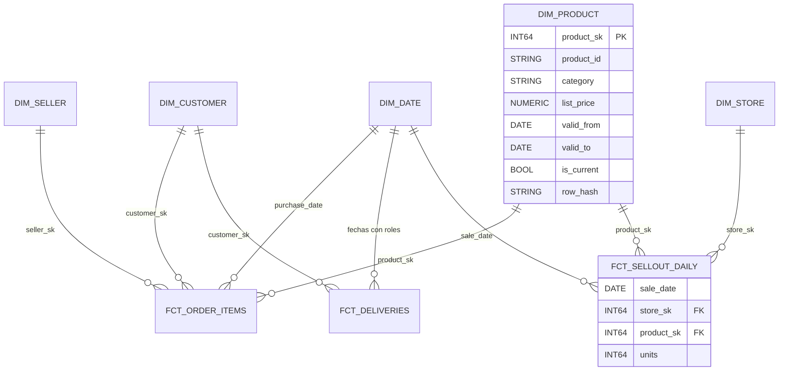

# Modelado dimensional con Kimball, BigQuery y Dataform

> Cómo convertir datos crudos de e-commerce y de sell-out en estrellas que responden preguntas de negocio sin ambigüedad: grano, hechos, dimensiones, historia con SCD2 y su implementación en Dataform sobre BigQuery. **Lab relacionado:** `labs/lab03-modelado-dataform`

## Qué es

El **modelado dimensional** (dimensional modeling) organiza los datos analíticos en dos tipos de tabla:

- **Hechos** (fact tables): una fila por medición de un proceso de negocio. Tienen métricas numéricas (unidades, importe, días de entrega) y llaves hacia las dimensiones.
- **Dimensiones** (dimension tables): el contexto de la medición. Responden quién, qué, dónde y cuándo (cliente, producto, tienda, fecha).

La metodología de Kimball se resume en cuatro decisiones, en este orden: el proceso de negocio, el **grano**, las dimensiones y los hechos.

**Dataform** es el servicio de Google Cloud para escribir transformaciones SQL sobre BigQuery como código versionado. Cada archivo `.sqlx` declara una tabla, sus dependencias, sus pruebas y su documentación.

## Para qué sirve

- **Consultas simples**: un analista une un hecho con 3 o 4 dimensiones sin conocer el modelo de la fuente.
- **Métricas consistentes**: "unidades vendidas" significa lo mismo en todos los reportes porque vive en un solo hecho con un grano declarado.
- **Historia**: con SCD tipo 2 se sabe qué categoría tenía un producto el día de la venta, no solo la de hoy.
- **Comparar canales**: con dimensiones conformadas se compara e-commerce (Olist) contra sell-out de tiendas físicas por la misma categoría y el mismo mes. Es el día a día de un equipo de Commerce y Sell-Out.

## Cuándo sí / cuándo no

| Situación | ¿Modelo dimensional? | Por qué |
|---|---|---|
| Reportes recurrentes de ventas, entregas o sell-out | Sí | Preguntas estables, muchos consumidores, métricas que deben cuadrar |
| Necesitas el valor de un atributo en la fecha del evento | Sí, con SCD2 | La fuente solo guarda el valor actual |
| Exploración puntual de un archivo nuevo | No todavía | Primero `sandbox`; se modela cuando la pregunta se repite |
| Datos operacionales de una aplicación (OLTP) | No | Ahí se normaliza y se optimiza para escrituras |
| Un tablero que siempre lee las mismas columnas | Estrella + OBT encima | La estrella es la fuente de verdad; la tabla ancha es una vista de consumo |

## Cómo se usa

> Los nombres de columnas de los ejemplos son ilustrativos; el lab define los definitivos.

### 1. Declara el grano antes que nada

El **grano** (grain) dice qué representa exactamente una fila. Si no está escrito, cada persona asume uno distinto y las sumas no cuadran.

| Hecho | Grano | Tipo |
|---|---|---|
| `fct_order_items` | un ítem de una orden de Olist | Transaccional |
| `fct_deliveries` | una orden | Accumulating snapshot |
| `fct_sellout_daily` | día × tienda × producto | Periódico (actividad diaria), incremental |

Regla del lab: la descripción de cada tabla en Dataform empieza con su grano.

### 2. Los tres tipos de hecho

- **Transaccional** (transaction fact): una fila por evento; se inserta y no se actualiza. Ejemplo: `fct_order_items`.
- **Periodic snapshot** (foto periódica): una fila por entidad y periodo. Ejemplos típicos: inventario al cierre del día, saldo mensual. `fct_sellout_daily` se comporta así: los retailers reportan unidades por día, tienda y producto.
- **Accumulating snapshot** (foto acumulativa): una fila por instancia de un proceso con hitos. La fila se **actualiza** a medida que se cumplen.

`fct_deliveries` es el accumulating snapshot del lab. Sus hitos son compra → aprobación → entrega al carrier → entrega al cliente, comparados contra la fecha estimada:

```sqlx
config { type: "table", schema: "marts", assertions: { uniqueKey: ["order_id"] },
         description: "Accumulating snapshot de entregas. Grano: una fila por orden." }
SELECT
  o.order_id, c.customer_sk,
  DATE(o.order_purchase_timestamp)      AS purchase_date,
  DATE(o.order_approved_at)             AS approved_date,
  DATE(o.order_delivered_carrier_date)  AS carrier_date,
  DATE(o.order_delivered_customer_date) AS delivered_date,
  DATE(o.order_estimated_delivery_date) AS estimated_date,
  -- NULL mientras la orden no se entrega: "todavía no sabemos"
  DATE(o.order_delivered_customer_date) <= DATE(o.order_estimated_delivery_date) AS is_on_time
FROM ${ref("stg_orders")} AS o
LEFT JOIN ${ref("dim_customer")} AS c USING (customer_id)
```

Las cinco fechas apuntan a la misma `dim_date`: es una **dimensión con roles** (role-playing dimension).

### 3. Dimensiones: estrella vs copo de nieve

- **Estrella** (star schema): cada dimensión es una sola tabla desnormalizada. `dim_product` trae categoría y marca en columnas propias.
- **Copo de nieve** (snowflake): la dimensión se normaliza en subtablas (`dim_product` → `dim_category`).

En BigQuery conviene la **estrella** casi siempre. El almacenamiento columnar abarata la redundancia, cada join extra cuesta y las herramientas de BI esperan estrellas. El copo de nieve se justifica cuando una subdimensión es grande, cambia con otra frecuencia o la mantiene otro equipo.

### 4. Dimensiones conformadas

Una **dimensión conformada** (conformed dimension) tiene las mismas llaves y atributos en todos los hechos que la usan. En el lab, `dim_product` la comparten `fct_order_items` y `fct_sellout_daily`. Eso permite el **drill-across**: agregar cada hecho por separado a un atributo común y después unir los resultados.

```sql
WITH ecommerce AS (
  SELECT p.category, DATE_TRUNC(f.purchase_date, MONTH) AS month, SUM(f.price) AS revenue
  FROM marts.fct_order_items f JOIN marts.dim_product p USING (product_sk) GROUP BY 1, 2
), retail AS (
  SELECT p.category, DATE_TRUNC(f.sale_date, MONTH) AS month, SUM(f.units) AS units
  FROM marts.fct_sellout_daily f JOIN marts.dim_product p USING (product_sk) GROUP BY 1, 2
)
SELECT * FROM ecommerce FULL JOIN retail USING (category, month)
```

Nunca se unen dos hechos directamente: sus granos son distintos y las filas se multiplican.

### 5. Llaves subrogadas, naturales y miembro desconocido

- **Llave natural** (natural key): la de la fuente (`product_id`, `store_id`). Puede repetirse entre sistemas y no distingue versiones.
- **Llave subrogada** (surrogate key): la genera el warehouse (`product_sk`). En SCD2 cada versión tiene la suya.

BigQuery no tiene secuencias autoincrementales. Usa un hash determinista para que re-correr produzca la misma llave: `FARM_FINGERPRINT(CONCAT(product_id, '|', CAST(valid_from AS STRING)))`. `GENERATE_UUID()` cambia en cada corrida y rompe la idempotencia.

**Miembro desconocido** (unknown member): cada dimensión tiene una fila con `sk = -1` ("Desconocido"). Sirve para las **late-arriving dimensions**: la venta llega antes que el alta de la tienda en el maestro. El hecho se carga con `-1` en lugar de perderse en un `INNER JOIN`, y se re-asigna cuando llega la dimensión:

```sql
SELECT ..., COALESCE(s.store_sk, -1) AS store_sk
FROM ${ref("stg_sellout_lines")} l
LEFT JOIN ${ref("dim_store")} s USING (store_id)
```

### 6. Fan-out: por qué no se unen pagos e ítems

En Olist una orden tiene varios ítems y puede tener varios pagos (cuotas, vouchers). Si se unen `order_items` y `order_payments` por `order_id`, una orden con 3 ítems y 2 pagos produce 6 filas: `SUM(price)` se duplica y `SUM(payment_value)` se triplica. Eso es **fan-out**.

Soluciones: cada proceso en su propio hecho y con su grano o, si hace falta en la misma tabla, **pre-agregar** los pagos a nivel orden antes de unir.

### 7. SCD tipo 1 vs tipo 2

Una **SCD** (slowly changing dimension, dimensión de cambio lento) define qué hacer cuando cambia un atributo.

| | Tipo 1 | Tipo 2 |
|---|---|---|
| Qué hace | Sobrescribe | Cierra la versión vigente e inserta una nueva |
| Historia | No | Sí |
| En el lab | `dim_store` (formato de tienda) | `dim_product` (precio de lista y marca) |
| Columnas extra | ninguna | `valid_from`, `valid_to`, `is_current`, `row_hash` |

Convención del lab: intervalo **cerrado** `[valid_from, valid_to]`. La versión vigente tiene `valid_to = DATE '9999-12-31'` e `is_current = TRUE`. Al cerrar una versión, su `valid_to` es el **día anterior** al `valid_from` de la siguiente; el join usa `BETWEEN`. `row_hash` resume los atributos rastreados para detectar cambios con una sola comparación. `TO_JSON_STRING` convierte los `NULL` en texto y evita que `NULL != NULL` oculte cambios.

**Dos formas de construir una SCD2:**

| | Reconstruir desde el historial (la del lab) | MERGE incremental |
|---|---|---|
| Qué hace | Cada corrida recalcula todas las versiones a partir de **todos** los snapshots guardados | Compara "lo que llegó hoy" con "lo vigente" y cierra o inserta |
| Orden de proceso | **No importa**: backfills, re-procesos y corridas simultáneas dan la misma tabla | **Importa**: procesar una fecha vieja después de una nueva corrompe la historia |
| Costo | Lee todo el historial de snapshots en cada corrida | Lee solo el snapshot del día |
| Cuándo | Dimensiones chicas o medianas (miles a pocos millones de filas) | Dimensiones enormes, con el orden de carga garantizado |

**La versión del lab** ([`definitions/marts/dim_product.sqlx`](../definitions/marts/dim_product.sqlx)) usa funciones de ventana:

```sql
-- 1) hash de los atributos versionados en cada snapshot
-- 2) LAG(row_hash): un snapshot abre versión si es el primero del producto o si el hash cambió
-- 3) valid_from = fecha del snapshot (la 1ª versión arranca en 1900-01-01: cubre el pasado)
-- 4) valid_to   = LEAD(valid_from) - 1 día, o 9999-12-31 si es la vigente
SELECT product_id, brand, list_price,
       IF(rn = 1, DATE '1900-01-01', snapshot_date) AS valid_from,
       COALESCE(DATE_SUB(LEAD(...) OVER (PARTITION BY product_id ORDER BY ...), INTERVAL 1 DAY),
                DATE '9999-12-31') AS valid_to
FROM changes
WHERE prev_hash IS NULL OR prev_hash != row_hash
```

**El MERGE incremental** (patrón de dos ramas) está completo y comentado en [`docs/snippets/scd2_merge_incremental.sql`](snippets/scd2_merge_incremental.sql). El lab lo usó primero y funcionó procesando los días en orden. Se cambió porque un backfill en Airflow 3 no garantiza el orden (ver "En la práctica"):
- La fuente se duplica con `UNION ALL`.
- La rama A trae la llave natural: cierra la versión vigente si el hash cambió e inserta los productos nuevos.
- La rama B trae llave **nula**: nunca hace match y fuerza el `INSERT` de la versión nueva.
- Re-correr el **mismo** día no cambia nada (es idempotente). Re-correr un día **viejo** sí rompe la historia.

### 8. Join point-in-time contra la SCD2

Para asignar a cada venta la versión del producto vigente **en la fecha de la venta**:

```sql
SELECT l.sale_date, l.store_id, l.units, COALESCE(p.product_sk, -1) AS product_sk
FROM ${ref("stg_sellout_lines")} AS l
LEFT JOIN ${ref("dim_product")} AS p
  ON  p.product_id = l.product_id
  AND l.sale_date BETWEEN p.valid_from AND p.valid_to   -- intervalo cerrado (convención del lab)
```

Si el join usa `is_current = TRUE`, las ventas de 2025 aparecen con la categoría de hoy. Ese es el error que SCD2 existe para evitar.

### 9. One Big Table (OBT)

Una **OBT** es una tabla ancha con el hecho y los atributos de sus dimensiones ya unidos. BigQuery la hace viable: solo se leen las columnas consultadas, hay `STRUCT` y `ARRAY` para anidar y el almacenamiento es barato. Sirve para tableros con un patrón de consulta fijo.

Las estrellas siguen siendo necesarias: son la fuente de verdad con el grano declarado y de ellas se reconstruye la OBT. Además, SCD2 y las dimensiones conformadas viven en las dimensiones, y mezclar granos en una OBT reintroduce el fan-out.

### 10. Capas: raw → staging → marts

| Capa del lab | Equivalente medallion | Contenido |
|---|---|---|
| `raw_olist`, `raw_sellout` | bronze | Tal como llegó, más rechazos con su razón. Se puede re-procesar |
| `staging` (`stg_*`) | silver | Tipado, limpio y deduplicado (`stg_sellout_lines` usa `QUALIFY`) |
| `marts` (`dim_*`, `fct_*`) | gold | Estrellas para consumo |
| `ops` | — | Cifras de control y metadatos de corridas |
| `sandbox` | — | Exploración; nada productivo depende de aquí |

### 11. Dataform

**SQLX** es SQL con un bloque `config {}` y expresiones JavaScript `${...}`. Los tipos de `config`:

| `type` | Qué crea | Uso en el lab |
|---|---|---|
| `table` | `CREATE OR REPLACE TABLE` en cada corrida | `dim_store`, `fct_deliveries` |
| `incremental` | Se crea una vez; después inserta o hace MERGE | `fct_sellout_daily` |
| `view` | Vista | `stg_*` livianos |
| `operations` | SQL arbitrario (MERGE, DDL) | el SCD2 incremental de `docs/snippets/` |
| `assertion` | Consulta que debe devolver 0 filas | Reglas de calidad propias |
| `declaration` | Registra una tabla que Dataform no crea | `raw_sellout.sellout_lines` |

`${ref("x")}` resuelve el nombre completo de la tabla y **crea la dependencia**; Dataform ordena la ejecución con esas referencias. `${self()}` es la tabla actual. Las **assertions** van en el `config` (`uniqueKey`, `uniqueKeys`, `nonNull`, `rowConditions`) o en un archivo `type: "assertion"`; si devuelven filas, la acción falla.

Las **variables de compilación** se definen en `workflow_settings.yaml` y se leen con `dataform.projectConfig.vars`:

```yaml
defaultProject: my-lab-project
defaultLocation: us-central1
defaultDataset: staging
vars:
  run_date: "2026-11-09"
```

Incremental con `when(incremental(), ...)`: la primera corrida (o `--full-refresh`) usa la rama no incremental; después solo procesa el día de `run_date`. `uniqueKey` convierte el insert en MERGE y `updatePartitionFilter` limita las particiones que lee el MERGE en el destino:

```sqlx
config {
  type: "incremental",
  schema: "marts",
  description: "Sell-out diario. Grano: día × tienda × producto.",
  uniqueKey: ["sale_date", "store_sk", "product_sk"],
  bigquery: {
    partitionBy: "sale_date", clusterBy: ["store_sk", "product_sk"],
    updatePartitionFilter: "sale_date >= DATE_SUB(DATE '${dataform.projectConfig.vars.run_date}', INTERVAL 31 DAY)"
  },
  columns: { product_sk: "Versión del producto vigente en sale_date (SCD2)" },
  assertions: { nonNull: ["sale_date", "store_sk", "product_sk"] }
}
SELECT l.sale_date, COALESCE(s.store_sk, -1) AS store_sk,
       COALESCE(p.product_sk, -1) AS product_sk, SUM(l.units) AS units
FROM ${ref("stg_sellout_lines")} l
LEFT JOIN ${ref("dim_store")} s USING (store_id)
LEFT JOIN ${ref("dim_product")} p
  ON p.product_id = l.product_id AND l.sale_date >= p.valid_from AND l.sale_date < p.valid_to
${when(incremental(), `WHERE l.sale_date = DATE '${dataform.projectConfig.vars.run_date}'`)}
GROUP BY 1, 2, 3
```

`description` y `columns` llegan a BigQuery como descripciones de tabla y de columna, y las ven el catálogo y las herramientas de BI.

Una **release configuration** fija qué commit de Git se compila, con qué overrides (proyecto, sufijo de esquema, prefijo de tabla) y con qué valores de variables; produce un *compilation result*. Una **workflow configuration** programa con cron la ejecución de ese resultado, completo o filtrado por tags. El lab no las usa: Airflow crea el *compilation result* con `vars.run_date = {{ ds }}` y lo invoca (ver `08-orquestacion-airflow.md`). Desde la terminal, con el CLI 3.1.4:

```bash
dataform compile --vars=run_date=2026-11-09
dataform run --dry-run --vars=run_date=2026-11-09
dataform run --vars=run_date=2026-11-09
```

**Dataform vs dbt**

| Tema | Dataform | dbt |
|---|---|---|
| Archivo | `.sqlx` con `config {}` | `.sql` con `{{ config() }}` + YAML |
| Dependencias | `${ref("x")}` | `{{ ref('x') }}` |
| Fuentes | `type: "declaration"` | `sources:` + `{{ source() }}` |
| Incremental | `${when(incremental(), ...)}` y `${self()}` | `` y `{{ this }}` |
| Pruebas | assertions | tests (`unique`, `not_null`, singulares) |
| SCD2 | Sin tipo nativo: MERGE en `operations` | `snapshots` nativos |
| Variables | `vars` → `dataform.projectConfig.vars` | `vars` → `{{ var('x') }}` |
| Ejecución gestionada | Servicio de GCP, IAM y BigQuery nativos | Producto aparte o ejecución propia; multi-warehouse |

### Diagrama de la estrella del lab



## En la práctica

- **Cifras de control en cada capa.** Por día: filas en la fuente (manifiesto), en raw, en rechazos y en staging. Fuente = raw + rechazos; raw − duplicados = staging. Se guardan en `ops.control_figures`. Un modelo elegante con conteos que no cuadran no sirve.
- **Restatements de retailers.** Un retailer reenvía días pasados corregidos. Con `uniqueKey` el MERGE actualiza filas, pero **no borra** las que desaparecieron del reenvío. Si eso importa, borra e inserta la partición: `pre_operations` con `${when(incremental(), "DELETE FROM ... WHERE sale_date = ...")}`.
- **Los filtros de partición con subconsulta no podan.** `WHERE sale_date = (SELECT MAX(sale_date) FROM ...)` lee todas las particiones, porque BigQuery solo poda con expresiones constantes. Usa la variable de compilación o un `DECLARE` en `pre_operations` y filtra con esa variable.
- **Una SCD2 incremental exige orden; una reconstruida, no.** Con MERGE, procesar el 9 de noviembre antes que el 8 deja intervalos incorrectos. En Airflow 3 eso pasa sin querer: un backfill y las corridas programadas tienen límites de concurrencia separados, y despausar un DAG crea al instante la corrida del último horario. Por eso el lab reconstruye la SCD2 desde el historial de snapshots. Si usas MERGE, fuerza el orden con `depends_on_past=True` y `--max-active-runs 1`.

## Errores comunes

- No escribir el grano y mezclar en un hecho filas por orden con filas por ítem.
- `INNER JOIN` contra dimensiones: las ventas de tiendas que aún no están en el maestro desaparecen sin aviso. Usa `LEFT JOIN` y el miembro `-1`.
- Unir pagos con ítems (fan-out) y sumar importes.
- Join contra `is_current = TRUE` cuando la pregunta es histórica.
- Llaves subrogadas con `GENERATE_UUID()` o `ROW_NUMBER()` sin orden estable: cambian al re-correr.
- En Olist, usar `customer_id` como cliente: es una llave por orden. La persona es `customer_unique_id`.
- Reenvío corregido del mismo día de un maestro: la versión anterior queda con `valid_from = valid_to`. Fíltrala (`valid_from < valid_to`) o borra la versión del día antes del MERGE.
- Agregar columnas a un `incremental` sin `--full-refresh` ni `onSchemaChange`: las columnas nuevas no aparecen.

## Autoevaluación

1. ¿Qué es el grano y por qué se declara antes de elegir métricas?

<details><summary>Respuesta</summary>

Es el significado exacto de una fila (por ejemplo, "un ítem de una orden"). Determina qué métricas son aditivas y qué dimensiones aplican. Sin grano, dos personas suman cosas distintas y los números no cuadran.

</details>

2. ¿Por qué `fct_deliveries` es un accumulating snapshot y no un hecho transaccional?

<details><summary>Respuesta</summary>

Tiene una fila por orden con varios hitos (aprobación, carrier, entrega) que se completan con el tiempo. La fila se actualiza en lugar de insertar una fila por evento.

</details>

3. En el MERGE de SCD2, ¿para qué sirve la rama con llave nula y por qué el patrón es idempotente?

<details><summary>Respuesta</summary>

Una sola fila fuente no puede cerrar la versión vigente (MATCHED) e insertar la nueva (NOT MATCHED). La copia con `merge_key = NULL` nunca hace match y fuerza el `INSERT`. Es idempotente porque, al re-correr, la versión vigente ya tiene el `row_hash` nuevo: la rama A no actualiza y la rama B no trae filas. La llave subrogada también es determinista.

</details>

4. Llegan ventas de una tienda que todavía no existe en `dim_store`. ¿Qué haces?

<details><summary>Respuesta</summary>

`LEFT JOIN` y `COALESCE(store_sk, -1)` para asignarlas al miembro desconocido sin perder unidades. Cuando llegue la tienda, se reprocesan esas fechas. La cifra de control muestra cuántas filas quedaron en `-1`.

</details>

5. ¿Qué diferencia hay entre `uniqueKey` en el `config` de un `incremental` y la assertion `uniqueKey`?

<details><summary>Respuesta</summary>

En el nivel superior del `config` de un `incremental`, `uniqueKey` cambia la estrategia de escritura a MERGE por esas columnas. Dentro de `assertions`, solo **verifica** que no haya duplicados y falla si los hay.

</details>

6. ¿Qué trae dbt de forma nativa para SCD2 y cómo lo resuelves en Dataform?

<details><summary>Respuesta</summary>

dbt tiene `snapshots`, que mantienen SCD2 con columnas de vigencia automáticas. En Dataform se escribe el MERGE de dos ramas en una acción `type: "operations"` con `hasOutput: true`, para que otras tablas la referencien con `ref()`.

</details>

## Para profundizar

- [Dataform: tablas, incrementales y documentación](https://docs.cloud.google.com/dataform/docs/create-tables)
- [Dataform: assertions](https://docs.cloud.google.com/dataform/docs/test-data)
- [Dataform: release configurations y variables de compilación](https://docs.cloud.google.com/dataform/docs/configure-compilation)
- [Dataform: workflow_settings.yaml y variables](https://docs.cloud.google.com/dataform/docs/manage-repository)
- [Dataform: CLI](https://docs.cloud.google.com/dataform/docs/use-dataform-cli)
- [Referencia de Dataform core](https://docs.cloud.google.com/dataform/docs/reference/dataform-core-reference)
- [BigQuery: cargar y sobrescribir particiones](https://docs.cloud.google.com/bigquery/docs/load-data-partitioned-tables)
- [dbt snapshots (para comparar SCD2)](https://docs.getdbt.com/docs/build/snapshots)
