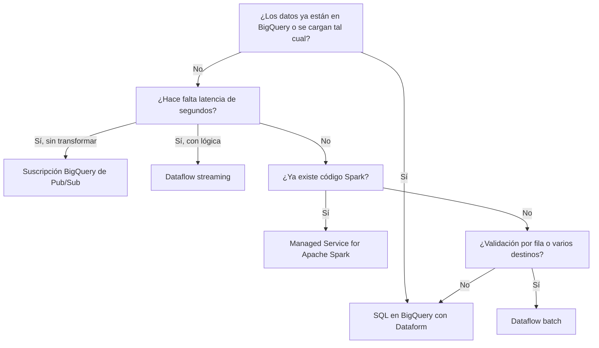

# Dataflow y Apache Beam

> Apache Beam es el modelo de programación; Dataflow es el servicio de Google Cloud que lo ejecuta sin servidores que administrar. Aquí ves el modelo, el pipeline batch del lab (validación con side input, rechazos con tagged outputs y carga a BigQuery), las Flex Templates, los costos y cuándo **no** usar Dataflow. **Lab relacionado:** `labs/lab05-dataflow-beam`

## Qué es

- **Apache Beam**: un SDK (Python, Java, Go) para describir un pipeline de datos una sola vez y correrlo en batch o en streaming.
- **Runner**: el motor que ejecuta ese pipeline. **DirectRunner** corre en tu máquina; **DataflowRunner** lo manda a Dataflow.
- **Dataflow**: el runner gestionado de Google Cloud. Crea las VMs (workers), reparte el trabajo, escala y las apaga al terminar.

## Para qué sirve

- Validar y transformar registros **uno por uno** antes de que entren al warehouse: parsear JSON, rechazar filas malas con su razón, enrutar a varios destinos.
- Procesar **streaming** (eventos casi en tiempo real) con ventanas y manejo de datos tardíos.
- Mover volúmenes grandes entre sistemas (GCS, Pub/Sub, BigQuery, bases de datos) con paralelismo automático.

En el lab, el pipeline `pipelines/sellout_beam/` lee el JSONL del día, valida cada línea y separa válidas de rechazadas. Después escribe ambas en BigQuery.

## Cuándo sí / cuándo no

| Necesidad | Mejor opción | Por qué |
|---|---|---|
| Transformar datos que ya están en BigQuery (joins, agregados, SCD) | **SQL en BigQuery (ELT)** con Dataform | Sin infraestructura, sin arranque, paga por bytes o slots |
| Validar por fila, parsear formatos sucios, dead-letter con razón | **Dataflow batch** | Lógica por elemento en Python, salidas múltiples |
| Eventos continuos con latencia de segundos | **Dataflow streaming** | Ventanas, watermarks y estado gestionado |
| Pub/Sub a BigQuery sin transformación | **Suscripción BigQuery de Pub/Sub** | Ni siquiera hace falta Dataflow |
| Código Spark existente, librerías del ecosistema Spark, notebooks de ciencia de datos | **Managed Service for Apache Spark** (antes Dataproc) | Reusar código y equipo; clusters o serverless |
| Archivo chico y una regla simple | **SQL** (carga a raw y `SAFE_CAST` en staging) | Dataflow tarda minutos solo en arrancar |



## Cómo se usa

### 1. El modelo de Beam

| Concepto | Qué es |
|---|---|
| `Pipeline` | El grafo completo. Se construye en el driver y se ejecuta en el runner |
| `PCollection` | Colección **inmutable** y distribuida. *Bounded* (batch) o *unbounded* (streaming) |
| `PTransform` | Una operación: recibe PCollections y produce PCollections |
| `ParDo` + `DoFn` | Procesamiento por elemento; el `DoFn` define `process()` y puede emitir 0, 1 o N salidas |
| `Map` / `FlatMap` / `Filter` | Atajos de `ParDo`: 1→1, 1→N y conservar o descartar |
| `GroupByKey` | Junta todos los valores de cada llave; obliga a un **shuffle** (mover datos entre workers) |
| `CombinePerKey` | Agrega por llave con combinación parcial en cada worker **antes** del shuffle |

`CombinePerKey(sum)` mueve un subtotal por llave y por worker; `GroupByKey` + suma mueve todos los valores. Con llaves muy frecuentes, la diferencia es grande.

### 2. Side inputs y tagged outputs: la validación del lab

- Un **side input** es una PCollection chica que cada worker recibe completa, como diccionario o lista. Aquí: las tiendas válidas del maestro del día.
- Los **tagged outputs** son salidas múltiples del mismo `DoFn`. Aquí: `valid` y `rejected`.

```python
import json
from datetime import date
import apache_beam as beam
from apache_beam import pvalue

VALID, REJECTED = "valid", "rejected"

def reject(raw, reason, run_date):
    return {"run_date": run_date, "reason": reason, "raw_line": raw}

class ValidateLine(beam.DoFn):
    def process(self, raw, valid_stores, run_date):
        try:
            rec = json.loads(raw)
        except json.JSONDecodeError:
            yield pvalue.TaggedOutput(REJECTED, reject(raw, "json_invalido", run_date))
            return
        try:
            ok_date = date.fromisoformat(rec.get("sale_date", "")).isoformat() == run_date
        except ValueError:
            ok_date = False
        if not ok_date:
            yield pvalue.TaggedOutput(REJECTED, reject(raw, "fecha_invalida", run_date))
        elif rec.get("store_id") not in valid_stores:
            yield pvalue.TaggedOutput(REJECTED, reject(raw, "tienda_desconocida", run_date))
        elif rec.get("units", 0) < 0:
            yield pvalue.TaggedOutput(REJECTED, reject(raw, "unidades_negativas", run_date))
        else:
            yield rec                                   # salida principal: válidas
```

Los duplicados pasan a propósito: se deduplican en `stg_sellout_lines` con `QUALIFY` (ver `05-modelado-dimensional.md`). Rechazar duplicados exige agrupar por llave, y eso cuesta un shuffle.

### 3. El pipeline completo y el patrón dead-letter

**Dead-letter** (cola de mensajes muertos): las filas malas no tumban el job. Van a una tabla de rechazo con la **razón** y la línea original, para revisarlas o reprocesarlas.

```python
def run(argv=None):
    opts = SelloutOptions(argv)          # PipelineOptions propias: --run_date, --landing_bucket
    d, base = opts.run_date, f"gs://{opts.landing_bucket}"
    part = d.replace("-", "")
    with beam.Pipeline(options=opts) as p:
        stores = (p
            | "LeerTiendas" >> beam.io.ReadFromText(f"{base}/masters/date={d}/stores.jsonl")
            | "ATupla" >> beam.Map(lambda l: (json.loads(l)["store_id"], True)))
        out = (p
            | "LeerFeed" >> beam.io.ReadFromText(f"{base}/sellout/date={d}/*.jsonl")
            | "Validar" >> beam.ParDo(ValidateLine(),
                                      valid_stores=beam.pvalue.AsDict(stores),
                                      run_date=d).with_outputs(REJECTED, main=VALID))
        common = dict(method=beam.io.WriteToBigQuery.Method.FILE_LOADS,
                      write_disposition=beam.io.BigQueryDisposition.WRITE_TRUNCATE,
                      create_disposition=beam.io.BigQueryDisposition.CREATE_NEVER)
        out[VALID] | "Validas" >> beam.io.WriteToBigQuery(
            f"{opts.project}:raw_sellout.sellout_lines${part}", **common)
        out[REJECTED] | "Rechazos" >> beam.io.WriteToBigQuery(
            f"{opts.project}:raw_sellout.sellout_rejects${part}", **common)
```

Por qué así:

- `AsDict` da búsquedas O(1). Con `AsList`, cada `in` recorre la lista.
- `FILE_LOADS` es el método por defecto en batch: escribe archivos temporales en GCS y lanza un **load job** de BigQuery, que es gratis con el pool compartido de slots.
- `WRITE_TRUNCATE` sobre `tabla$YYYYMMDD` reemplaza **solo esa partición**, así que re-correr el día no duplica. El decorador exige que todas las filas caigan en esa partición. Por eso las fechas que no son del día se rechazan antes.
- `CREATE_NEVER`: el esquema, la partición por `sale_date` y el clustering los define la infraestructura, no el pipeline. La tabla de rechazos debe estar particionada por `run_date` para que el decorador aplique.

**La Storage Write API (gRPC)** (`Method.STORAGE_WRITE_API`) desde Python es una transformación **cross-language**: la implementa el SDK de Java y Python la invoca mediante un servicio de expansión. Necesita Java en el entorno que lanza el pipeline, incluida la imagen de la Flex Template. En batch, `FILE_LOADS` evita esa dependencia; en streaming, la Storage Write API es la recomendada.

### 4. DirectRunner y DataflowRunner

```bash
# Local: rápido para iterar; igual escribe en BigQuery real y necesita temp_location
python -m sellout_beam.main --runner=DirectRunner \
  --project=$PROJECT_ID --run_date=2026-11-09 \
  --landing_bucket=${PROJECT_ID}-landing --temp_location=gs://${PROJECT_ID}-temp/beam

# En Dataflow, con el límite del free trial en mente
python -m sellout_beam.main --runner=DataflowRunner \
  --project=$PROJECT_ID --region=us-central1 --run_date=2026-11-09 \
  --landing_bucket=${PROJECT_ID}-landing --temp_location=gs://${PROJECT_ID}-temp/beam \
  --service_account_email=sa-dataflow@${PROJECT_ID}.iam.gserviceaccount.com \
  --max_num_workers=2 --worker_machine_type=e2-standard-2 --setup_file=./setup.py
```

Versión del lab: `apache-beam[gcp]==2.77.0`.

### 5. Ventanas, watermarks y triggers (solo teoría: el lab es batch)

- **Ventana** (window): divide un flujo infinito en grupos finitos. *Fixed* (cada 5 min), *sliding* (5 min cada 1 min) o *session* (actividad separada por inactividad).
- **Event time vs processing time**: cuándo ocurrió el evento vs cuándo llegó. Las ventanas usan event time.
- **Watermark**: la estimación del sistema de "ya llegó todo hasta el tiempo T". Lo que llega después es **dato tardío**; `allowed_lateness` define cuánto se espera.
- **Trigger**: cuándo emitir el resultado de una ventana (al pasar el watermark, antes con resultados tempranos, otra vez con tardíos). *Accumulating* reemite el total; *discarding* emite solo lo nuevo.

### 6. Rendimiento: fusion, Reshuffle, hot keys y escalado

- **Fusion**: Dataflow junta pasos consecutivos en una etapa para no materializar PCollections intermedias. Si un paso con poco paralelismo (leer 5 archivos) se fusiona con uno que multiplica elementos, todo corre en pocos hilos. Se rompe con `beam.Reshuffle()` (o `Redistribute`) después del paso que expande.
- **Hot key**: una llave con una fracción enorme de los datos (por ejemplo, `store_id` nulo). Todo va a un solo hilo. Se mitiga con `CombinePerKey` en lugar de `GroupByKey`, o con *salting* (agregar un sufijo aleatorio a la llave y agregar en dos etapas).
- **Autoscaling**: Dataflow ajusta el número de workers entre `num_workers` y `max_num_workers`.
- **Dataflow Shuffle** (batch) y **Streaming Engine** (streaming): mueven el shuffle y el estado de las VMs al backend del servicio. Los workers quedan más livianos y escalan mejor.

### 7. Plantillas: classic vs Flex Templates

- **Classic template**: el grafo se serializa al crear la plantilla; los parámetros de runtime son limitados.
- **Flex Template**: una **imagen Docker** con el código y sus dependencias en Artifact Registry, más un **spec JSON** en GCS que apunta a esa imagen y declara parámetros. Al lanzarla, una **VM launcher** construye el grafo con los parámetros reales y crea el job.

```bash
gcloud dataflow flex-template build gs://${PROJECT_ID}-temp/templates/sellout_beam.json \
  --image-gcr-path "us-central1-docker.pkg.dev/${PROJECT_ID}/${AR_REPO}/sellout-beam:2026.11.09" \
  --sdk-language PYTHON --flex-template-base-image PYTHON3 \
  --metadata-file metadata.json --py-path . \
  --env FLEX_TEMPLATE_PYTHON_PY_FILE=main.py \
  --env FLEX_TEMPLATE_PYTHON_REQUIREMENTS_FILE=requirements.txt

gcloud dataflow flex-template run "sellout-20261109" --region us-central1 \
  --template-file-gcs-location gs://${PROJECT_ID}-temp/templates/sellout_beam.json \
  --parameters run_date=2026-11-09,landing_bucket=${PROJECT_ID}-landing \
  --service-account-email sa-dataflow@${PROJECT_ID}.iam.gserviceaccount.com \
  --max-workers 2 --worker-machine-type e2-standard-2
```

Airflow la lanza con `DataflowStartFlexTemplateOperator`. Le pasa un `body` con `launchParameter` (`jobName`, `containerSpecGcsPath`, `parameters` con `{{ ds }}`, `environment`) y espera en modo deferrable (ver `08-orquestacion-airflow.md`).

### 8. Costos

- Dataflow factura **vCPU por hora, memoria por GB-hora y disco** de los workers, más los datos procesados por **Dataflow Shuffle** o Streaming Engine. No se citan precios aquí: usa la calculadora oficial.
- En jobs chicos domina el **arranque**: crear VMs, descargar la imagen e instalar dependencias tarda varios minutos. Un archivo de pocos MB cuesta más en arranque que en proceso.
- **Free trial**: el proyecto tiene un máximo de 8 vCPU. Con `max_num_workers=2` y `e2-standard-2` (2 vCPU cada uno) quedan 4 vCPU para workers, más el launcher de la Flex Template, que suele ser `e2-standard-2`.
- **Logs**: cada línea que escriben los workers se ingiere en Cloud Logging y se paga. El nivel por defecto en Python es INFO; se ajusta con `--default_sdk_harness_log_level=WARNING`.

### 9. Pub/Sub en dos minutos (sin lab)

- **Qué es**: mensajería asíncrona. Los productores publican en un **topic** y cada **subscription** recibe una copia de cada mensaje.
- **Entrega at-least-once**: un mensaje puede llegar más de una vez, así que el consumidor debe ser idempotente o deduplicar.
- **Retención**: por defecto una suscripción guarda los mensajes no confirmados (*unacked*) 7 días; se configura entre 10 minutos y 31 días. Al pasar ese plazo, el mensaje se descarta.
- **Cuándo**: eventos casi en tiempo real (ventas de e-commerce, cambios de inventario) hacia **Dataflow streaming** si hay lógica, o hacia una **suscripción BigQuery** si basta con escribir el mensaje en una tabla.

### 10. Pruebas con `TestPipeline` y `assert_that`

```python
from apache_beam.testing.test_pipeline import TestPipeline
from apache_beam.testing.util import assert_that, equal_to

def test_separa_validas_y_rechazos():
    lines = ['{"store_id":"S1","sale_date":"2026-11-09","units":3}',
             '{"store_id":"SX","sale_date":"2026-11-09","units":1}',
             '{roto']
    with TestPipeline() as p:
        stores = p | "Tiendas" >> beam.Create([("S1", True)])
        out = (p | "Lineas" >> beam.Create(lines)
                 | beam.ParDo(ValidateLine(), valid_stores=beam.pvalue.AsDict(stores),
                              run_date="2026-11-09").with_outputs(REJECTED, main=VALID))
        assert_that(out[VALID] | "Ids" >> beam.Map(lambda r: r["store_id"]),
                    equal_to(["S1"]), label="validas")
        assert_that(out[REJECTED] | "Razones" >> beam.Map(lambda r: r["reason"]),
                    equal_to(["tienda_desconocida", "json_invalido"]), label="rechazos")
```

`equal_to` no depende del orden. Cada `assert_that` necesita un `label` distinto. Corre con DirectRunner en CI, sin tocar GCP.

## En la práctica

- **Un streaming que loguea cada mensaje en INFO** paga la ingesta de Cloud Logging por cada evento, todo el día. Loguea en DEBUG lo que es por elemento, sube el nivel por defecto a WARNING y usa métricas de Beam (contadores) para conteos.
- **Flex Templates configurables** (las reglas de validación en un JSON de parámetros) permiten muchos pipelines sin código nuevo. Pero si la plantilla descarga y ejecuta código en runtime, cualquiera que pueda editar ese archivo ejecuta código con la service account del job. Las reglas deben ser **datos**, no código.
- **Cifras de control**: líneas leídas = válidas + rechazadas, por día. Se comparan contra el `_manifest.json` del generador y se registran en `ops.control_figures`.
- **Streaming inserts legacy** (`STREAMING_INSERTS`, hoy llamada Storage Write API (REST)) en pipelines nuevos: más caros y con deduplicación de mejor esfuerzo. Usa la Storage Write API (gRPC).
- **Una suscripción de Pub/Sub atrasada pierde mensajes en silencio** cuando superan la retención. Alerta sobre la antigüedad del mensaje más viejo sin confirmar, no solo sobre errores.

## Errores comunes

- Usar Dataflow para un join o un agregado que BigQuery resuelve en SQL en segundos.
- Poner lógica con efectos secundarios (llamadas a APIs, escrituras) en un `DoFn` sin idempotencia: Dataflow reintenta bundles y la llamada se repite.
- Llamar a una API o abrir una conexión en `process()` por cada elemento. Se hace una vez en `setup()`.
- Cargar un side input enorme: se replica completo en cada worker.
- `--flex-template-base-image PYTHON3` toma siempre la última imagen base. Para builds reproducibles, fija la ruta completa con versión.
- Exceder la cuota de vCPU del free trial con `max_num_workers` por defecto: el job queda esperando recursos o falla.
- Escribir con `WRITE_TRUNCATE` a la tabla **sin** decorador: borra todas las particiones, no solo la del día.

## Autoevaluación

1. ¿Qué diferencia hay entre `GroupByKey` y `CombinePerKey(sum)` en costo de shuffle?

<details><summary>Respuesta</summary>

`CombinePerKey` hace una combinación parcial en cada worker antes del shuffle y solo mueve subtotales. `GroupByKey` mueve todos los valores de cada llave. Con llaves calientes, `CombinePerKey` es mucho más barato.

</details>

2. ¿Por qué el pipeline rechaza las filas cuya fecha no es el `run_date`?

<details><summary>Respuesta</summary>

Porque escribe con `WRITE_TRUNCATE` en `sellout_lines$YYYYMMDD`. En una tabla particionada por columna, todas las filas deben pertenecer a la partición del decorador; si no, la carga falla. Además, una fecha que no es del día es un error del feed.

</details>

3. ¿Qué problema resuelve `beam.Reshuffle()`?

<details><summary>Respuesta</summary>

Rompe la *fusion*. Si un paso con poco paralelismo (pocos archivos) se fusiona con uno que genera muchos elementos, todo corre en pocos hilos. `Reshuffle` redistribuye los elementos entre los workers disponibles.

</details>

4. ¿Qué contiene una Flex Template y quién construye el grafo?

<details><summary>Respuesta</summary>

Una imagen Docker en Artifact Registry con el código y las dependencias, más un spec JSON en GCS que apunta a la imagen y declara los parámetros. Una VM launcher arranca esa imagen, construye el grafo con los parámetros reales y crea el job.

</details>

5. ¿Por qué el lab usa `FILE_LOADS` y no la Storage Write API?

<details><summary>Respuesta</summary>

Es batch: `FILE_LOADS` es el método por defecto, usa load jobs gratuitos con el pool compartido y permite `WRITE_TRUNCATE` por partición. La Storage Write API desde Python es cross-language y exige Java en el entorno de lanzamiento.

</details>

6. Un archivo de 5 MB al día, con validaciones simples. ¿Dataflow?

<details><summary>Respuesta</summary>

Probablemente no. El arranque de varios minutos domina el costo y el tiempo. Cargar a raw y validar con `SAFE_CAST` y reglas en SQL (staging) resuelve el caso. Dataflow se justifica con lógica por fila compleja, volumen grande o streaming.

</details>

7. ¿Qué pasa si un consumidor de una suscripción de Pub/Sub se cae 10 días con la retención por defecto?

<details><summary>Respuesta</summary>

Los mensajes sin confirmar con más de 7 días se descartan. Se pierden sin error visible, salvo que haya una alerta sobre la antigüedad del mensaje más viejo o retención en el topic.

</details>

## Para profundizar

- [Beam Programming Guide](https://beam.apache.org/documentation/programming-guide/)
- [Beam: BigQuery I/O (incluye Storage Write API desde Python)](https://beam.apache.org/documentation/io/built-in/google-bigquery/)
- [Dataflow: escribir a BigQuery](https://docs.cloud.google.com/dataflow/docs/guides/write-to-bigquery)
- [Dataflow: Flex Templates](https://docs.cloud.google.com/dataflow/docs/guides/templates/using-flex-templates)
- [Dataflow: configurar Flex Templates](https://docs.cloud.google.com/dataflow/docs/guides/templates/configuring-flex-templates)
- [Dataflow: ciclo de vida del pipeline y fusion](https://docs.cloud.google.com/dataflow/docs/pipeline-lifecycle)
- [Dataflow: paralelismo, fan-out y hot keys](https://docs.cloud.google.com/dataflow/docs/concepts/parallelism)
- [Dataflow: logs y niveles de log](https://docs.cloud.google.com/dataflow/docs/guides/logging)
- [Dataflow: cuotas y límites (free trial)](https://docs.cloud.google.com/dataflow/quotas)
- [Pub/Sub: propiedades de suscripción y retención](https://docs.cloud.google.com/pubsub/docs/subscription-properties)
