# Orquestación con Airflow 3 y Composer

> Airflow decide **qué** corre, **cuándo** y **en qué orden**, reintenta y deja historial por fecha lógica; el procesamiento lo hacen BigQuery, Dataflow y Cloud Run. Aquí ves los conceptos, la idempotencia por partición, los cambios de Airflow 3, Composer (Managed Service for Apache Airflow) Gen 3 y el DAG `sellout_daily` del lab. **Lab relacionado:** `labs/lab06-airflow-composer`

## Qué es

**Apache Airflow** es un orquestador de flujos de trabajo escritos en Python. Un flujo es un **DAG** (directed acyclic graph, grafo dirigido sin ciclos) de tareas con dependencias.

**Composer**, hoy **Managed Service for Apache Airflow** (Managed Airflow), es el Airflow gestionado de Google Cloud. El lab usa Gen 3 con la imagen `composer-3-airflow-3.3.1-build.5` (Airflow 3.3.1, Python 3.11).

## Para qué sirve

- Encadenar pasos heterogéneos (Cloud Run → GCS → BigQuery → Dataflow → Dataform) con dependencias explícitas, y reintentar una tarea sin repetir todo el flujo.
- Re-procesar fechas pasadas (**backfill**) con exactamente la misma lógica.
- Dar un historial auditable: qué corrió, para qué fecha, cuánto tardó y por qué falló.

## Cuándo sí / cuándo no

| Necesidad | Opción |
|---|---|
| Varias tareas dependientes, sensores, backfill por fecha, una vista central de corridas | **Composer / Airflow** |
| Un paso a una hora fija | **Cloud Scheduler + Cloud Run job** |
| Pocas llamadas encadenadas a APIs de Google, sin backfill | **Workflows** |
| Solo transformaciones SQL en Dataform | **Workflow configurations de Dataform** (cron nativo) |
| Una consulta SQL periódica aislada | **Scheduled queries de BigQuery** |
| Procesar datos | **Nunca dentro de Airflow**: BigQuery, Dataflow o Cloud Run |

## Cómo se usa

### 1. Conceptos

| Concepto | Qué es |
|---|---|
| **DAG** | El flujo: tareas, dependencias, `schedule`, `start_date` y parámetros |
| **Task** | Un nodo del DAG; cada corrida crea una *task instance* |
| **Operator** | Plantilla de tarea (`BigQueryInsertJobOperator`, `CloudRunExecuteJobOperator`) |
| **Sensor** | Operator que espera una condición (que exista `_SUCCESS`) |
| **Hook** | Cliente de bajo nivel hacia un sistema externo; los operators lo usan por dentro |
| **Connection** | Credenciales y endpoint de un sistema (`google_cloud_default`) |
| **Variable** | Configuración clave-valor guardada en Airflow |
| **XCom** | Paso de **metadatos chicos** entre tareas (un id de job, un nombre de archivo). Vive en la base de Airflow: nunca datos |
| **schedule** | Cuándo se crean corridas: cron, preset (`@daily`), timetable o Assets |
| **logical_date** | La fecha que la corrida **representa** (no cuándo corre). `{{ ds }}` es esa fecha en `YYYY-MM-DD` |
| **Data interval** | El periodo que cubre la corrida (`data_interval_start`, `data_interval_end`) |

**Catchup**: al activar un DAG, crear las corridas pendientes desde `start_date`. **Backfill**: crear corridas para un rango de fechas a pedido.

**Robustez**: `retries`, `retry_delay`, `retry_exponential_backoff` y `max_retry_delay` dan reintentos por tarea con espera creciente. `on_failure_callback` se llama al fallar (alerta, ticket). Los **pools** son cupos compartidos entre DAGs; por ejemplo, un solo job de Dataflow a la vez por la cuota del free trial. `max_active_runs=1` permite una corrida del DAG a la vez y es obligatorio con SCD2, que exige procesar las fechas en orden.

**Sensores: `poke`, `reschedule` y deferrable.** En `poke`, la tarea ocupa un slot de worker todo el tiempo. En `reschedule`, libera el slot entre chequeos y el scheduler la vuelve a encolar. En **deferrable** (`deferrable=True`), la espera pasa al **triggerer**, un proceso asíncrono que vigila cientos de esperas sin ocupar workers. En Composer, deferrable exige al menos un triggerer en el entorno.

**Assets** (antes Datasets) programan por datos en lugar de por reloj. **TaskFlow** convierte funciones en tareas:

```python
from airflow.sdk import Asset, DAG, task
FCT_SELLOUT = Asset("fct_sellout_daily")      # el productor declara outlets=[FCT_SELLOUT]
with DAG(dag_id="reporte_sellout", schedule=[FCT_SELLOUT]):
    @task
    def refrescar_extracto(): ...             # solo lógica liviana; nada de pandas con datos
    refrescar_extracto()
```

### 2. Idempotencia: re-correr no duplica

Una tarea es **idempotente** si correrla una o cinco veces deja el mismo resultado. Reglas del lab:

1. **Cada corrida procesa exactamente su partición**: `{{ ds }}`, nunca `CURRENT_DATE()` ni "lo último que llegó".
2. **Escritura por partición**, de dos formas:

| Técnica | Cómo | Cuándo |
|---|---|---|
| Overwrite de partición | Load o query con `WRITE_TRUNCATE` a `tabla$YYYYMMDD` | El día se recalcula completo (raw, rechazos, snapshots de maestros) |
| `MERGE` por llave | `uniqueKey` en Dataform o `MERGE` explícito | Upserts (dimensiones, hechos con correcciones parciales) |

3. **Nombres derivados de la fecha lógica**, no del reloj: `sellout-{{ ds_nodash }}`, `date={{ ds }}`.
4. **Restatements de retailers**: si un retailer reenvía el día 3, se re-corre el DAG para el día 3. Cada tarea reemplaza su partición, sin borrar a mano. Un `MERGE` no elimina filas que desaparecieron del reenvío; el overwrite de partición sí.

### 3. Airflow orquesta; no procesa

Los workers de Airflow son pocos y compartidos, y están dimensionados para lanzar y vigilar trabajos. Un `PythonOperator` que baja un CSV, lo procesa con pandas y lo sube compite por memoria con todas las demás tareas. Además, no escala y deja los datos en XCom o en disco local. En el lab, **cada tarea delega**: Cloud Run genera, BigQuery carga y consulta, Dataflow valida, Dataform transforma y GCS mueve archivos con copias del lado del servidor.

### 4. El DAG `sellout_daily`

```mermaid
flowchart LR
    generate_feed["generate_feed (Cloud Run Job)"] --> wait_for_success_flag["wait_for_success_flag (sensor deferrable)"]
    wait_for_success_flag --> load_masters["load_masters (BigQuery load)"]
    load_masters --> run_dataflow["run_dataflow (Flex Template)"]
    run_dataflow --> dataform_compile["dataform_compile"]
    dataform_compile --> dataform_invoke["dataform_invoke (asíncrono)"]
    dataform_invoke --> wait_dataform["wait_dataform (sensor)"]
    wait_dataform --> control_figures["control_figures (BigQuery)"]
    control_figures --> archive_files["archive_files (GCS a archive)"]
```



```python
import os
from datetime import timedelta

import pendulum
from airflow.sdk import DAG, TaskGroup
from airflow.providers.google.cloud.operators.bigquery import BigQueryInsertJobOperator
from airflow.providers.google.cloud.operators.cloud_run import CloudRunExecuteJobOperator
from airflow.providers.google.cloud.operators.dataflow import DataflowStartFlexTemplateOperator
from airflow.providers.google.cloud.operators.dataform import (
    DataformCreateCompilationResultOperator, DataformCreateWorkflowInvocationOperator)
from airflow.providers.google.cloud.sensors.dataform import DataformWorkflowInvocationStateSensor
from airflow.providers.google.cloud.sensors.gcs import GCSObjectExistenceSensor
from airflow.providers.google.cloud.transfers.gcs_to_gcs import GCSToGCSOperator
from google.cloud.dataform_v1 import WorkflowInvocation

PROJECT_ID = os.environ["LAB_PROJECT_ID"]   # variable de entorno: cero I/O al parsear
REGION, LANDING = "us-central1", PROJECT_ID + "-landing"
DATAFORM_REPO = "sellout-dataform"          # nombre ilustrativo

def notify_failure(context):
    ti = context["ti"]
    print(f"FALLO {ti.dag_id}.{ti.task_id} run_id={context['run_id']}")  # aquí iría la alerta

with DAG(
    dag_id="sellout_daily",
    schedule="0 6 * * *",
    start_date=pendulum.datetime(2026, 11, 1, tz="UTC"),
    catchup=False,
    max_active_runs=1,
    default_args={"retries": 2, "retry_delay": timedelta(minutes=2),
                  "retry_exponential_backoff": True, "on_failure_callback": notify_failure},
    tags=["sellout", "lab06"],
):
    generate_feed = CloudRunExecuteJobOperator(
        task_id="generate_feed", project_id=PROJECT_ID, region=REGION,
        job_name="sellout-generator", deferrable=True,
        overrides={"container_overrides": [{"args": ["--date={{ ds }}"]}]})

    wait_for_success_flag = GCSObjectExistenceSensor(
        task_id="wait_for_success_flag", bucket=LANDING,
        object="sellout/date={{ ds }}/_SUCCESS", deferrable=True, timeout=3600)

    with TaskGroup("load_masters") as load_masters:
        for entity in ("product", "store"):
            BigQueryInsertJobOperator(
                task_id="load_" + entity, location=REGION,
                configuration={"load": {
                    "sourceUris": ["gs://" + LANDING + "/masters/date={{ ds }}/" + entity + "s.jsonl"],
                    "sourceFormat": "NEWLINE_DELIMITED_JSON",
                    "destinationTable": {"projectId": PROJECT_ID, "datasetId": "raw_sellout",
                                         "tableId": entity + "_snapshot${{ ds_nodash }}"},
                    "writeDisposition": "WRITE_TRUNCATE", "createDisposition": "CREATE_NEVER"}})

    run_dataflow = DataflowStartFlexTemplateOperator(
        task_id="run_dataflow", project_id=PROJECT_ID, location=REGION,
        deferrable=True, pool="dataflow_free_trial",
        body={"launchParameter": {
            "jobName": "sellout-{{ ds_nodash }}",
            "containerSpecGcsPath": "gs://" + PROJECT_ID + "-temp/templates/sellout_beam.json",
            "parameters": {"run_date": "{{ ds }}", "landing_bucket": LANDING},
            "environment": {"serviceAccountEmail": "sa-dataflow@" + PROJECT_ID + ".iam.gserviceaccount.com",
                            "maxWorkers": 2, "machineType": "e2-standard-2"}}})

    dataform_compile = DataformCreateCompilationResultOperator(
        task_id="dataform_compile", project_id=PROJECT_ID, region=REGION,
        repository_id=DATAFORM_REPO,
        compilation_result={"git_commitish": "main",
                            "code_compilation_config": {"vars": {"run_date": "{{ ds }}"}}})

    dataform_invoke = DataformCreateWorkflowInvocationOperator(
        task_id="dataform_invoke", project_id=PROJECT_ID, region=REGION,
        repository_id=DATAFORM_REPO, asynchronous=True,
        workflow_invocation={
            "compilation_result": "{{ ti.xcom_pull(task_ids='dataform_compile')['name'] }}"})

    wait_dataform = DataformWorkflowInvocationStateSensor(
        task_id="wait_dataform", project_id=PROJECT_ID, region=REGION,
        repository_id=DATAFORM_REPO, mode="reschedule", poke_interval=60,
        workflow_invocation_id="{{ ti.xcom_pull(task_ids='dataform_invoke')['name'].split('/')[-1] }}",
        expected_statuses={WorkflowInvocation.State.SUCCEEDED},
        failure_statuses={WorkflowInvocation.State.FAILED, WorkflowInvocation.State.CANCELLED})

    control_figures = BigQueryInsertJobOperator(
        task_id="control_figures", location=REGION,
        configuration={"query": {"useLegacySql": False,
                                 "query": ""}})

    archive_files = GCSToGCSOperator(
        task_id="archive_files", source_bucket=LANDING,
        source_object="sellout/date={{ ds }}/*",
        destination_bucket=PROJECT_ID + "-archive",
        destination_object="sellout/date={{ ds }}/", move_object=True)

    (generate_feed >> wait_for_success_flag >> load_masters >> run_dataflow
     >> dataform_compile >> dataform_invoke >> wait_dataform >> control_figures >> archive_files)
```

Notas sobre las tareas:

- Deferrable en `generate_feed`, `wait_for_success_flag` y `run_dataflow`: el triggerer espera; los workers quedan libres. El sensor tiene `timeout` para no esperar para siempre.
- `load_masters`: el decorador `$YYYYMMDD` más `WRITE_TRUNCATE` reemplazan solo la partición del día. El `location` de cada job de BigQuery debe coincidir con el del dataset.
- `run_dataflow`: el pool `dataflow_free_trial` tiene 1 slot (`airflow pools set dataflow_free_trial 1 "free trial"`).
- Dataform: compila `main` con `run_date = ds`, invoca sin bloquear (`asynchronous=True`) y el sensor espera el estado final; con `failure_statuses` falla en cuanto la invocación falla.
- `control_figures`: el script borra e inserta las filas del día en `ops.control_figures`, las compara con el manifiesto y termina con `ASSERT (...) AS 'Cifras no cuadran para {{ ds }}'`, que hace fallar el job. El `include` de Jinja lee el archivo al ejecutar, no al parsear.
- `archive_files`: `move_object=True` copia del lado del servidor y borra el origen. Re-procesar un día archivado funciona porque `generate_feed` es determinista y va primero.

### 5. De Airflow 2 a Airflow 3

| Tema | Airflow 2 | Airflow 3 |
|---|---|---|
| Programación | `schedule_interval=` | Solo `schedule=` |
| Catchup por defecto | `True` | `False` (`catchup_by_default`) |
| Cron y `ds` | `CronDataIntervalTimetable`: la corrida del día 9 procesa el 8 | `CronTriggerTimetable` por defecto: `data_interval_start == data_interval_end == logical_date`; `ds` es el día del disparo |
| Backfill | `airflow dags backfill` corre en el cliente | `airflow backfill create` crea las corridas y **el scheduler** las ejecuta; visible en UI y API |
| SLA | `sla=` | Eliminadas; las reemplazan las **Deadline Alerts** (`DeadlineAlert`, `DeadlineReference`, experimentales desde 3.1) |
| Imports de autoría | `airflow.models`, `airflow.decorators` | `from airflow.sdk import DAG, task, Asset, TaskGroup` |
| Datasets | `Dataset` | `Asset` |
| Run manual | Siempre tenía `execution_date` | Puede crearse sin `logical_date`; entonces `{{ ds }}` no existe y la plantilla falla |

Por eso en el lab los runs manuales y los backfills llevan fecha explícita. `--run-backwards` existe, pero no se usa con SCD2, que exige orden cronológico:

```bash
airflow dags trigger sellout_daily --logical-date 2026-11-09T06:00:00+00:00
airflow backfill create --dag-id sellout_daily --from-date 2026-11-01 --to-date 2026-11-07 \
  --reprocess-behavior completed --max-active-runs 1
```

### 6. Composer (Managed Service for Apache Airflow) Gen 3

**Arquitectura**:

- El **bucket del entorno** vive en tu proyecto. Tiene `dags/`, `plugins/`, `data/` y logs. Lo que subes a `dags/` se sincroniza con los componentes de Airflow.
- Scheduler, DAG processor, triggerer, workers, web server y la base de datos (Cloud SQL) corren en un **proyecto tenant** gestionado por Google, no en el tuyo.
- Las tareas usan la **service account del entorno** (`sa-composer`), que necesita permisos para ejecutar el job de Cloud Run, lanzar Dataflow, invocar Dataform y leer y escribir en BigQuery y GCS.

**Presets** (punto de partida; después se ajusta cada componente):

| Preset | DAGs | Corridas concurrentes | Tareas concurrentes |
|---|---|---|---|
| Small | 50 | 15 | 18 |
| Medium | 250 | 60 | 100 |
| Large | 1000 | 250 | 400 |
| Extra Large | 3000 | 750 | 2250 |

**Costo**: el entorno se cobra **24/7**, corra o no corra algo, porque scheduler, base de datos y web server están siempre arriba. Para el lab: primero `composer-dev` en local; después una sesión corta de Composer real y se borra. El **modo desarrollo hibernable** (solo Gen 3 con Airflow 3, tamaño Small fijo, no apto para producción) baja a cero la mayoría de los costos mientras está hibernado. Al reanudar, ojo con el catchup del periodo hibernado.

```bash
gcloud beta composer environments create lab-composer --location us-central1 \
  --image-version composer-3-airflow-3.3.1-build.5 \
  --service-account sa-composer@${PROJECT_ID}.iam.gserviceaccount.com \
  --env-variables LAB_PROJECT_ID=${PROJECT_ID} --enable-development-mode
gcloud beta composer environments hibernate lab-composer --location us-central1
gcloud beta composer environments resume lab-composer --location us-central1
gcloud composer environments delete lab-composer --location us-central1   # al terminar
```

**`composer-dev`** (Composer Local Development CLI) corre en Docker **la misma imagen** del entorno, con tus DAGs montados. No copia conexiones, variables ni valores de entorno. Las llamadas a GCP salen con **tu** cuenta de gcloud, no con la service account del entorno.

```bash
composer-dev create lab-local --from-image-version composer-3-airflow-3.3.1-build.5 \
  --project ${PROJECT_ID} --port 8081 --dags-path ./dags
# Definir LAB_PROJECT_ID en ./composer/lab-local/variables.env
composer-dev start lab-local
composer-dev run-airflow-cmd lab-local dags trigger sellout_daily --logical-date 2026-11-09T06:00:00+00:00
```

**Despliegue de DAGs**: CI valida (lint, `python -c "import ..."`, prueba de que el DAG carga sin errores) y sincroniza la carpeta con el bucket. Nadie sube a mano.

```bash
DAGS=$(gcloud composer environments describe lab-composer --location us-central1 \
  --format="value(config.dagGcsPrefix)")
gcloud storage rsync dags/ "$DAGS" --recursive --delete-unmatched-destination-objects
```

### 7. DAG factory desde YAML

Configuración como código: un YAML describe N feeds y un solo archivo Python genera N DAGs iguales en estructura.

```yaml
# dags/config/feeds.yaml
feeds:
  - {name: retailer_a, schedule: "0 6 * * *", job_name: fetch-retailer-a, dataset: raw_sellout}
  - {name: retailer_b, schedule: "30 6 * * *", job_name: fetch-retailer-b, dataset: raw_sellout}
```

```python
import pathlib, pendulum, yaml
from airflow.sdk import DAG

CONFIG = yaml.safe_load((pathlib.Path(__file__).parent / "config" / "feeds.yaml").read_text())

for feed in CONFIG["feeds"]:
    with DAG(dag_id=f"ingest_{feed['name']}", schedule=feed["schedule"],
             start_date=pendulum.datetime(2026, 11, 1, tz="UTC"), catchup=False):
        build_ingest_tasks(feed)       # función que crea las tareas con los valores del feed
```

- **Nada de `eval`** ni de construir código desde el YAML: quien edita la configuración ejecutaría código con la service account de Composer. Usa `yaml.safe_load` y valida el esquema (claves permitidas, tipos).
- **Nada de I/O al parsear**: el archivo se parsea cada pocos segundos. Leer un YAML local versionado junto al DAG está bien; consultar BigQuery, GCS, una API o `Variable.get()` en el nivel superior, no.
- Un error en el YAML rompe **todos** los DAGs generados. CI debe cargarlos antes de desplegar.

## En la práctica

- **Composer tiene costo fijo 24/7.** Dev y qa del mismo tamaño que prod es desperdicio. Se dimensiona por **tareas concurrentes** (la tabla de presets). Un entorno de dev se crea y se destruye por horario, o se usa el modo desarrollo hibernable.
- **Cloud Run jobs efímeros lanzados desde el DAG** para traer archivos de fuentes externas: Airflow pasa la fecha y espera en modo deferrable. Ningún worker descarga datos.
- **SQL formateado con `str.format` al nivel del módulo**, leyendo un archivo o una tabla para armarlo: es I/O en cada parseo y además abre la puerta a inyección. Se usan plantillas Jinja (`{{ ds }}`, ``) que se renderizan al ejecutar la tarea.
- **`eval` sobre un YAML de configuración**: ejecución de código arbitrario. Se reemplaza por `safe_load` y un mapeo explícito de nombres a funciones permitidas.
- **Imágenes `latest`** en el job o en la Flex Template: el DAG de hoy corre código distinto al de ayer sin un despliegue visible.
- **Cifras de control** como tarea del DAG: si no cuadran, el DAG falla antes de archivar. Nadie consume datos incompletos.

## Errores comunes

- `datetime.now()` o `CURRENT_DATE()` dentro de la lógica: el backfill del día 3 procesa hoy.
- `start_date` dinámico (`datetime.now() - timedelta(days=1)`): el scheduler nunca encuentra un intervalo estable.
- Pasar DataFrames por XCom, o sensores en `poke` con `timeout` largo que ocupan workers por horas.
- `catchup=True` con `start_date` de hace un año: 365 corridas al activar.
- Olvidar `max_active_runs=1` en un DAG con SCD2: dos fechas se procesan en paralelo y fuera de orden.
- Asumir que, en Airflow 3, `{{ ds }}` de un cron diario es "ayer": con `CronTriggerTimetable` es el día del disparo.
- Disparar desde la UI o la API sin fecha lógica y que las plantillas con `{{ ds }}` fallen.

## Autoevaluación

1. ¿Qué diferencia hay entre `logical_date` y la hora en que corre la tarea?

<details><summary>Respuesta</summary>

`logical_date` es la fecha que la corrida **representa** y la que usan las plantillas (`{{ ds }}`). La hora real de ejecución puede ser cualquiera: hoy, en un reintento o en un backfill de meses atrás. Por eso la lógica depende de `ds` y nunca del reloj.

</details>

2. ¿Cómo garantizas que re-correr `sellout_daily` para el 9 de noviembre no duplica datos?

<details><summary>Respuesta</summary>

Cada tarea escribe solo la partición del día: `WRITE_TRUNCATE` sobre `tabla$20261109` en raw y snapshots, `uniqueKey`/MERGE o borrado e inserción por fecha en Dataform y en `ops.control_figures`. El generador es determinista y los nombres salen de `ds`.

</details>

3. ¿Qué cambió en Airflow 3 respecto al valor de `{{ ds }}` en un DAG con cron diario?

<details><summary>Respuesta</summary>

`create_cron_data_intervals` pasó a `False`, así que se usa `CronTriggerTimetable`. El intervalo de datos colapsa en el instante del disparo y `ds` es el día en que corre. En Airflow 2, con `CronDataIntervalTimetable`, la corrida del día 9 tenía `ds` = día 8. Si necesitas "ayer", usa `macros.ds_add(ds, -1)` o el timetable de intervalos explícito.

</details>

4. ¿Por qué el lab dispara los runs manuales con `--logical-date`?

<details><summary>Respuesta</summary>

En Airflow 3 un run manual puede no tener `logical_date`. Sin ella no existen `ds` ni `ds_nodash` y las plantillas fallan. Dar la fecha explícita hace el run reproducible y equivalente al programado.

</details>

5. ¿Qué riesgos tiene un DAG factory y cómo los mitigas?

<details><summary>Respuesta</summary>

Ejecución de código si se usa `eval` o se construye código desde el YAML; I/O en el parseo si la configuración se lee de red o de Variables; y un error en el YAML que rompe todos los DAGs. Se mitiga con `yaml.safe_load`, validación de esquema, archivo local versionado y una prueba de carga en CI.

</details>

6. En Composer Gen 3, ¿dónde corren el scheduler y la base de datos, y qué queda en tu proyecto?

<details><summary>Respuesta</summary>

Los componentes de Airflow y la base de datos (Cloud SQL) corren en un proyecto tenant gestionado por Google. En tu proyecto quedan el bucket del entorno (`dags/`, `plugins/`, `data/`, logs), además de Logging y Monitoring.

</details>

## Para profundizar

- [Composer Gen 3: arquitectura del entorno](https://docs.cloud.google.com/composer/docs/composer-3/environment-architecture)
- [Composer Gen 3: presets y escalado](https://docs.cloud.google.com/composer/docs/composer-3/scale-environments)
- [Composer Gen 3: modo desarrollo e hibernación](https://docs.cloud.google.com/composer/docs/composer-3/hibernate-environments)
- [Composer Gen 3: entorno local con composer-dev](https://docs.cloud.google.com/composer/docs/composer-3/run-local-airflow-environments)
- [Composer Gen 3: migrar a Airflow 3](https://docs.cloud.google.com/composer/docs/composer-3/migrate-airflow-3)
- [Composer Gen 3: operators deferrables](https://docs.cloud.google.com/composer/docs/composer-3/use-deferrable-operators)
- [Dataform: programar con Airflow](https://docs.cloud.google.com/dataform/docs/schedule-runs)
- [Airflow: actualizar a Airflow 3](https://airflow.apache.org/docs/apache-airflow/stable/installation/upgrading_to_airflow3.html)
- [Airflow: DAG runs, catchup y data intervals](https://airflow.apache.org/docs/apache-airflow/stable/core-concepts/dag-run.html)
- [Airflow: backfill](https://airflow.apache.org/docs/apache-airflow/stable/core-concepts/backfill.html)
- [Airflow: Deadline Alerts](https://airflow.apache.org/docs/apache-airflow/stable/howto/deadline-alerts.html)
