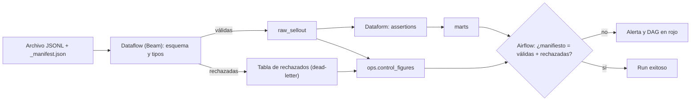

# Calidad, linaje y observabilidad

> Un pipeline que "terminó en verde" no garantiza que los datos estén bien. Este documento explica qué medir (las seis dimensiones de calidad), en qué capa conviene validar cada una y cómo enterarte de que algo falló antes de que te avise el usuario del dashboard. También cubre lo que cobra por debajo: scans de calidad, linaje y logs.
> **Labs relacionados:** `labs/lab03-modelado-dataform` (assertions), `labs/lab05-dataflow-beam` (dead-letter), `labs/lab06-airflow-composer` (checks y cifras de control).

## Por qué importa

En sell-out cada retailer manda su archivo con su propio formato y sus propios errores: EAN que no existen, fechas en el futuro, tiendas nuevas que nadie dio de alta, archivos duplicados o que no llegan. Si el pipeline carga todo sin mirar, el error aparece semanas después en un reporte de ventas, y para entonces ya nadie sabe de qué archivo vino.

La calidad no es un paso al final: es un conjunto de controles repartidos en cada capa. Cada uno detecta un tipo de error distinto, cerca de donde nace.

## Las seis dimensiones de calidad

| Dimensión | Pregunta | Ejemplo en sell-out | Dónde se valida en este lab |
|---|---|---|---|
| **Completitud** | ¿Están todas las filas y columnas que deberían? | Falta `store_id` en un renglón; el retailer mandó 3 de sus 40 tiendas | Beam (campos obligatorios), `nonNull` en Dataform |
| **Unicidad** | ¿Hay duplicados? | El mismo archivo se cargó dos veces; la misma venta aparece dos veces | `uniqueKey` en Dataform; idempotencia de la carga |
| **Validez** | ¿Los valores cumplen formato y rango? | EAN con 12 dígitos, fecha en el futuro, unidades no numéricas | Esquema en Beam; `rowConditions` en Dataform |
| **Consistencia** | ¿Cuadra con otras tablas o con la fuente? | Un EAN que no existe en el maestro de producto; la suma de unidades no cuadra con el manifiesto | Assertions custom (integridad referencial); cifras de control |
| **Frescura** | ¿Los datos están al día? | Hoy no llegó el archivo del retailer X | Sensor con timeout en Airflow; check de `MAX(fecha)` |
| **Volumen** | ¿La cantidad es razonable? | Llegaron 200 filas cuando lo normal son 50 000 | Check en Airflow contra el histórico |

Regla práctica: valida **la forma** (esquema, tipos) lo más temprano posible, en la ingesta; valida **el significado** (unicidad, integridad, reglas de negocio) donde ya tienes las tablas modeladas; valida **el proceso** (frescura, volumen, cifras de control) en el orquestador, que es quien ve el run completo.



## Dónde se valida cada cosa

### 1. En la ingesta: Beam valida el esquema y separa lo malo

El pipeline de Beam lee cada línea, intenta parsearla y validar tipos y campos obligatorios. Lo que falla **no se descarta ni rompe el job**: se manda a una salida aparte (dead-letter) con el motivo del rechazo y la línea original.

```python
class ValidateRecord(beam.DoFn):
    def process(self, line):
        try:
            record = json.loads(line)
            errors = validate(record)  # tipos, obligatorios, formato de EAN, fecha
        except json.JSONDecodeError as exc:
            record, errors = None, [f"json_invalido: {exc}"]
        if errors:
            yield beam.pvalue.TaggedOutput("rejected", {"raw": line, "errors": errors})
        else:
            yield record

results = lines | beam.ParDo(ValidateRecord()).with_outputs("rejected", main="valid")
```

Por qué así:
- **Un registro malo no tumba 50 000 buenos.** Si el job fallara completo, un solo renglón corrupto dejaría al retailer sin datos del día.
- **El rechazo queda auditable.** Puedes devolverle al retailer la lista exacta de renglones malos y por qué.
- **El conteo de rechazados alimenta las cifras de control** (más abajo).

### 2. En la transformación: assertions de Dataform

Una assertion es una consulta que busca filas que violan una regla; si devuelve filas, falla. Dataform las corre cada vez que actualiza el workflow y crea vistas con los resultados en el dataset de assertions para que puedas inspeccionarlas ([Test data with assertions](https://docs.cloud.google.com/dataform/docs/test-data)).

Las integradas van en el bloque `config`:

```sqlx
config {
  type: "incremental",
  schema: "marts",
  description: "Ventas diarias al consumidor por tienda y producto (sell-out).",
  assertions: {
    uniqueKey: ["sale_date", "retailer_id", "store_id", "product_id"],
    nonNull: ["sale_date", "retailer_id", "store_id", "product_id"],
    rowConditions: [
      "sale_date <= CURRENT_DATE()",
      "units BETWEEN -10000 AND 100000"  -- las devoluciones son negativas
    ]
  }
}
```

- `uniqueKey` / `uniqueKeys`: ninguna combinación de esas columnas se repite. Es tu prueba de **grano**.
- `nonNull`: las columnas nunca son nulas.
- `rowConditions`: expresiones SQL que toda fila debe cumplir.

Las **custom** van en su propio archivo con `type: "assertion"`. La más útil en un modelo estrella es la integridad referencial:

```sqlx
config { type: "assertion" }
-- Hechos que apuntan a un producto que no existe en la dimensión
SELECT f.product_key
FROM ${ref("fct_sellout_daily")} AS f
LEFT JOIN ${ref("dim_product")} AS d USING (product_key)
WHERE d.product_key IS NULL
```

Dos detalles que suelen preguntar:
- Puedes hacer que una tabla **solo se construya si pasan las assertions de sus dependencias** con `includeDependentAssertions: true` ([Dependencies](https://docs.cloud.google.com/dataform/docs/dependencies)). Así un `dim_product` roto no contamina los marts.
- Los resultados de las assertions se publican solos en el *data quality scorecard* de Knowledge Catalog.

### 3. Cifras de control: lo que entró tiene que cuadrar

Es el control más viejo de la ingeniería de datos y el que más errores atrapa. La idea: la fuente declara cuántas filas mandó (el `_manifest.json` del generador), y tú compruebas que

```
filas del manifiesto = filas válidas cargadas + filas rechazadas
```

Si no cuadra, se perdieron o duplicaron filas en algún punto, aunque cada paso individual haya terminado en verde. El lab registra el resultado de cada run en `ops.control_figures`. Un esquema ilustrativo (el del lab puede variar en detalles):

```sql
CREATE TABLE IF NOT EXISTS ops.control_figures (
  run_date      DATE NOT NULL,      -- fecha lógica del feed
  source        STRING NOT NULL,    -- 'sellout'
  retailer_id   STRING,
  manifest_rows INT64,              -- lo que declara _manifest.json
  valid_rows    INT64,              -- lo que llegó a raw_sellout
  rejected_rows INT64,              -- lo que fue a dead-letter
  balanced      BOOL,               -- manifest_rows = valid_rows + rejected_rows
  dag_run_id    STRING,
  recorded_at   TIMESTAMP
)
PARTITION BY run_date;
```

Guardarlo en una tabla, y no solo en el log del DAG, te da historia: puedes ver qué retailer manda más basura y si va mejorando, y tienes evidencia para una auditoría.

### 4. En la orquestación: checks de Airflow

El orquestador es el único que ve el run completo, así que ahí van los checks de **proceso**:
- **Frescura:** el sensor que espera `_SUCCESS` tiene un `timeout`; si vence, la tarea falla y alerta.
- **Cifras de control:** una tarea tipo `BigQueryCheckOperator` corre una consulta como `SELECT LOGICAL_AND(balanced) FROM ops.control_figures WHERE run_date = '{{ ds }}'`. Si el primer renglón tiene un valor falso, la tarea falla.
- **Volumen:** comparar el conteo del día contra el histórico (por ejemplo, contra la mediana de las últimas semanas del mismo día de la semana). El proveedor de Google para Airflow también trae operadores que comparan una métrica contra días anteriores.

## Knowledge Catalog: scans de calidad y de perfilado

Knowledge Catalog (antes Dataplex) ofrece dos tipos de scan sobre tablas de BigQuery:

- **Auto data quality:** defines reglas (no nulos, rangos, unicidad, expresiones SQL) y el servicio las corre con un calendario o bajo demanda, y publica el resultado junto a la tabla ([About auto data quality](https://docs.cloud.google.com/knowledge-catalog/docs/auto-data-quality-overview)).
- **Data profile:** calcula estadísticas por columna (nulos, distintos, min/max, distribución) y permite ver su tendencia entre corridas ([About data profiling](https://docs.cloud.google.com/knowledge-catalog/docs/data-profiling-overview)).

**Lo que hay que saber antes de prenderlos: cobran.** Usan el SKU de *premium processing*, medido en DCU-hora ([precios](https://cloud.google.com/products/knowledge-catalog/pricing)). Y como no emiten métricas a Cloud Monitoring, el costo solo se ve en el billing export, filtrando por las etiquetas `goog-dataplex-datascan-*` ([Monitor DCU costs](https://docs.cloud.google.com/knowledge-catalog/docs/monitoring)). Las palancas para controlarlo:

| Palanca | Qué hace |
|---|---|
| **Alcance incremental** | Cada corrida valida solo lo nuevo, usando una columna de fecha (idealmente la de partición) |
| **Muestreo** | Validas un porcentaje de filas; la documentación sugiere porcentajes bajos para tablas grandes |
| **Filtro de filas** | Una cláusula `WHERE` que limita qué se escanea |
| **Frecuencia** | Diaria, semanal o bajo demanda. No todo necesita correr cada día |
| **Identidad de ejecución propia** | Con una service account propia, el procesamiento se cobra como BigQuery y no como el SKU premium |

Antes de crear un scan, hazte tres preguntas: **¿quién va a mirar el resultado?, ¿qué hará cuando falle?, ¿no lo cubre ya una assertion de Dataform?** Un scan con reglas genéricas en todas las columnas, al 100 % de muestreo y diario, puede costar más que el pipeline que vigila, y a veces nadie abre los resultados (ver la lección 13 en `12-lecciones-de-produccion.md`).

## Linaje

El linaje responde "¿de dónde sale esta tabla y qué se rompe si la cambio?". La Data Lineage API registra automáticamente los jobs de BigQuery (consultas, copias, cargas) y se integra con Dataflow, con Managed Service for Apache Airflow y con Managed Service for Apache Spark ([About data lineage](https://docs.cloud.google.com/knowledge-catalog/docs/about-data-lineage)).

Lo que conviene saber:
- **Se activa por proyecto, no por servicio.** Al habilitar la API, se registra el linaje de todos los servicios compatibles del proyecto.
- **Cobra** con el mismo SKU premium (DCU). En el billing aparece con la etiqueta `goog-dataplex-workload-type = LINEAGE`.
- **Apagar la API de Dataplex no apaga el linaje.** Para dejar de pagar hay que deshabilitar la Data Lineage API ([Troubleshoot lineage](https://docs.cloud.google.com/knowledge-catalog/docs/troubleshooting-lineage)).
- **Tarda en aparecer:** según el volumen, entre 30 minutos y 24 horas después del job.
- **Se guarda 30 días.**
- **El linaje por columna tiene huecos:** no se registra para load jobs ni para scripts multi-sentencia. Eso incluye las tablas incrementales de Dataform, que se compilan a procedimientos temporales.

Conclusión: actívalo **con intención**, en el proyecto donde alguien de verdad lo va a consultar (por ejemplo, prod), y no "por si acaso" en dev.

## Metadatos y documentación

- **Descripciones desde el código:** en Dataform, `description` (tabla) y `columns` (columnas) en el bloque `config` se escriben como descripciones en BigQuery ([Create tables](https://docs.cloud.google.com/dataform/docs/create-tables)). La documentación vive en el repo, pasa por PR y no se desactualiza a mano.
- **Glosario de negocio:** Knowledge Catalog permite definir términos ("sell-out", "unidades netas", "tienda activa") y ligarlos a tablas y columnas ([Manage glossaries](https://docs.cloud.google.com/knowledge-catalog/docs/manage-glossaries)). Sirve cuando dos áreas usan la misma palabra para cosas distintas, algo muy común con "venta".

## Observabilidad

### Cloud Logging: qué se loguea y cuánto cuesta

- **Severidad:** `DEBUG` < `INFO` < `NOTICE` < `WARNING` < `ERROR` < `CRITICAL`. En producción, lo normal es `INFO` para hitos del job (inicio, fin, conteos) y `WARNING`/`ERROR` para lo que requiere atención.
- **La ingesta cobra por volumen.** Loguear cada registro procesado en un pipeline de alto volumen es la forma más rápida de inflar la factura; la documentación de Dataflow lo desaconseja explícitamente ([Optimize costs](https://docs.cloud.google.com/dataflow/docs/optimize-costs)).
- **Exclusiones:** un filtro de exclusión en el sink `_Default` evita que se ingieran ciertos logs. Ejemplo de la documentación de Dataflow, que descarta lo de severidad baja salvo en jobs cuyo nombre termina en `debug` ([Filter logs](https://docs.cloud.google.com/dataflow/docs/guides/filter-logs)):

```
resource.type="dataflow_step"
AND labels."dataflow.googleapis.com/job_name"!~".*debug"
AND severity=(DEFAULT OR DEBUG OR INFO OR NOTICE)
```

Las métricas basadas en logs que tú definas siguen contando las entradas excluidas, así que puedes dejar de almacenar un log y seguir graficando cuántas veces aparece.

### Cloud Monitoring: alertas que sí sirven

Una alerta útil es accionable: si suena, alguien sabe qué hacer. Las mínimas para este lab:

| Alerta | Señal |
|---|---|
| Job de Dataflow fallido | La métrica *Failed* del job, que vale 1 si el job termina con error ([Use Cloud Monitoring for Dataflow](https://docs.cloud.google.com/dataflow/docs/guides/using-cloud-monitoring)) |
| DAG fallido | Métricas del recurso *Cloud Composer Workflow* (runs por estado) o un `on_failure_callback` en el DAG ([Monitor environments](https://docs.cloud.google.com/composer/docs/composer-3/monitor-environments)) |
| Cifras de control descuadradas | La tarea de check falla, y con ella el DAG |
| Archivo que no llegó | El sensor vence su timeout |

Las alertas llegan por **notification channels**: correo, Slack, PagerDuty, webhooks o Pub/Sub ([Alerting overview](https://docs.cloud.google.com/monitoring/alerts)). Además de las alertas por métrica existen las **alertas basadas en logs**, que disparan cuando aparece un mensaje concreto.

### `INFORMATION_SCHEMA.JOBS`: costo y uso de BigQuery

Cada consulta, carga o copia es un job, y la vista `INFORMATION_SCHEMA.JOBS` guarda sus metadatos: quién lo corrió, bytes procesados, `total_bytes_billed`, slots y etiquetas ([JOBS view](https://docs.cloud.google.com/bigquery/docs/information-schema-jobs)). Costo de la última semana por pipeline:

```sql
SELECT
  (SELECT value FROM UNNEST(labels) WHERE key = 'pipeline') AS pipeline,
  COUNT(*) AS jobs,
  ROUND(SUM(total_bytes_billed) / POW(1024, 4), 3) AS tib_facturados
FROM `region-us-central1`.INFORMATION_SCHEMA.JOBS
WHERE creation_time >= TIMESTAMP_SUB(CURRENT_TIMESTAMP(), INTERVAL 7 DAY)
  AND job_type = 'QUERY'
  AND statement_type != 'SCRIPT'   -- evita contar dos veces padre e hijos
GROUP BY pipeline
ORDER BY tib_facturados DESC;
```

### Labels: del job al billing export

Las etiquetas (`pipeline=sellout`, `layer=marts`, `env=dev`) son la única forma de responder "¿cuánto cuesta el pipeline X?" sin adivinar:
- **BigQuery:** las etiquetas de un job se incluyen en los datos de facturación ([Adding labels](https://docs.cloud.google.com/bigquery/docs/adding-labels)). Se ponen al enviar el job; después no se pueden cambiar.
- **Dataflow:** la opción `labels` del pipeline aparece en el billing export ([Pipeline options](https://docs.cloud.google.com/dataflow/docs/reference/pipeline-options)).
- **Recursos** (buckets, Cloud Run, etc.): las etiquetas se exportan con el uso del recurso ([Labels overview](https://docs.cloud.google.com/resource-manager/docs/labels-overview)).

### Audit logs: ¿quién lee esta tabla?

| Tipo | Qué registra | ¿Se puede apagar? |
|---|---|---|
| **Admin Activity** | Cambios de configuración y metadatos: crear una tabla, cambiar IAM | No; siempre se escriben |
| **Data Access** | Lecturas de metadatos y lecturas/escrituras de datos | Apagados por defecto en casi todos los servicios, **excepto BigQuery**, donde vienen activos |

Fuente: [Cloud Audit Logs](https://docs.cloud.google.com/logging/docs/audit). En BigQuery, cada lectura de una tabla genera un evento `TableDataRead` en el stream de Data Access ([BigQuery audit logs](https://docs.cloud.google.com/bigquery/docs/reference/auditlogs)). Filtro para Logs Explorer:

```
logName="projects/PROJECT_ID/logs/cloudaudit.googleapis.com%2Fdata_access"
protoPayload.metadata.tableDataRead:*
protoPayload.resourceName="projects/PROJECT_ID/datasets/marts/tables/fct_sellout_daily"
```

Para análisis de varios meses, crea un sink que mande estos logs a un dataset de BigQuery. Un matiz: las consultas servidas desde la caché de resultados **no** generan `TableDataRead`. Si un dashboard lee siempre de caché, cruza también con `referenced_tables` en `INFORMATION_SCHEMA.JOBS`.

## Frescura y SLAs: "¿llegó el archivo de hoy?"

Para cada fuente, escribe su acuerdo en una línea: *"el feed del retailer X llega antes de las 06:00 y los marts están listos a las 08:00"*. Con eso, los controles se vuelven obvios:

1. **Sensor con timeout:** el DAG espera `_SUCCESS` en `gs://${PROJECT_ID}-landing/sellout/date={{ ds }}/` en modo *deferrable* (no ocupa un worker mientras espera) y falla si vence el timeout. Un archivo que no llegó tiene que verse como un **fallo**, no como un día sin ventas.
2. **Frescura en la tabla:** un check o assertion que compara `MAX(sale_date)` del mart contra la fecha esperada.
3. **Registro de archivos:** una tabla con qué archivo llegó, cuándo, cuántas filas y con qué resultado. Responde en segundos "¿qué pasó con el retailer X el martes?".

No dependas de un mecanismo de SLA implícito del orquestador, porque cambia entre versiones. Un timeout explícito y un check explícito son fáciles de leer, de probar y de explicar en una entrevista.

## Autoevaluación

1. Un retailer manda 10 000 filas; cargas 9 990 y rechazas 5. Todas las tareas terminaron en verde. ¿Qué control lo detecta y qué pudo pasar?
<details><summary>Respuesta</summary>Las cifras de control: 9 990 + 5 ≠ 10 000. Faltan 5 filas que ni se cargaron ni se rechazaron; por ejemplo, un filtro silencioso en el pipeline o líneas vacías que el parser saltó sin contarlas. Sin este control, nadie se entera.</details>

2. ¿Por qué validar el esquema en Beam y la unicidad en Dataform, y no todo en el mismo lugar?
<details><summary>Respuesta</summary>El esquema se valida temprano para separar renglones corruptos sin tumbar el job y dejar evidencia por renglón. La unicidad y la integridad referencial necesitan ver la tabla completa y las dimensiones, que existen después del modelado. Cada control va donde tiene la información para decidir.</details>

3. Activaste el linaje y una hora después no ves nada en la consola. ¿Está roto?
<details><summary>Respuesta</summary>No necesariamente: el linaje puede tardar de 30 minutos a 24 horas en aparecer. Revisa también que la Data Lineage API esté habilitada en el proyecto donde corre el job y en el que consultas, y que tengas el rol de lector de linaje.</details>

4. Apagaste la API de Dataplex para ahorrar y el cargo de "premium processing" sigue. ¿Por qué?
<details><summary>Respuesta</summary>Porque el linaje se cobra con ese SKU, pero depende de otra API (Data Lineage API). Hay que deshabilitar esa. En el billing se identifica con la etiqueta `goog-dataplex-workload-type = LINEAGE`.</details>

5. ¿Cómo sabes si alguien lee `marts.fct_sellout_daily` antes de decidir apagar el pipeline que la alimenta?
<details><summary>Respuesta</summary>Con los audit logs de Data Access de BigQuery (eventos `TableDataRead`), que vienen activos por defecto, idealmente exportados a BigQuery para ver varios meses. Se complementa con `referenced_tables` en `INFORMATION_SCHEMA.JOBS`, porque las lecturas desde caché no generan `TableDataRead`.</details>

6. ¿Qué tres palancas reducen el costo de un scan de calidad de Knowledge Catalog?
<details><summary>Respuesta</summary>Alcance incremental (solo lo nuevo), muestreo (un porcentaje de filas) y frecuencia (no todo necesita correr diario). También un filtro de filas y, si aplica, una identidad de ejecución propia para que se cobre como BigQuery.</details>

7. *(English)* Why is "the DAG finished successfully" not proof that the data is correct?
<details><summary>Respuesta</summary>Because task success only means the code ran without raising errors. Rows can be silently dropped or duplicated, a source can send partial data, or a file can be missing and be treated as a day with zero sales. You need data-level checks: control totals, assertions, freshness and volume checks.</details>

## Para profundizar

- Dataform: [Test data with assertions](https://docs.cloud.google.com/dataform/docs/test-data) · [Dependencies](https://docs.cloud.google.com/dataform/docs/dependencies) · [Create tables (descripciones)](https://docs.cloud.google.com/dataform/docs/create-tables)
- Knowledge Catalog: [Auto data quality](https://docs.cloud.google.com/knowledge-catalog/docs/auto-data-quality-overview) · [Use auto data quality](https://docs.cloud.google.com/knowledge-catalog/docs/use-auto-data-quality) · [Data profiling](https://docs.cloud.google.com/knowledge-catalog/docs/data-profiling-overview) · [Monitor DCU costs](https://docs.cloud.google.com/knowledge-catalog/docs/monitoring) · [Precios](https://cloud.google.com/products/knowledge-catalog/pricing)
- Linaje: [About data lineage](https://docs.cloud.google.com/knowledge-catalog/docs/about-data-lineage) · [Use lineage](https://docs.cloud.google.com/knowledge-catalog/docs/use-lineage) · [Troubleshoot lineage](https://docs.cloud.google.com/knowledge-catalog/docs/troubleshooting-lineage)
- Observabilidad: [Dataflow + Cloud Monitoring](https://docs.cloud.google.com/dataflow/docs/guides/using-cloud-monitoring) · [Filtrar logs de Dataflow](https://docs.cloud.google.com/dataflow/docs/guides/filter-logs) · [Alerting](https://docs.cloud.google.com/monitoring/alerts) · [Monitor Composer 3](https://docs.cloud.google.com/composer/docs/composer-3/monitor-environments)
- BigQuery: [INFORMATION_SCHEMA.JOBS](https://docs.cloud.google.com/bigquery/docs/information-schema-jobs) · [Labels en jobs](https://docs.cloud.google.com/bigquery/docs/adding-labels) · [Audit logs de BigQuery](https://docs.cloud.google.com/bigquery/docs/reference/auditlogs) · [Cloud Audit Logs](https://docs.cloud.google.com/logging/docs/audit)
