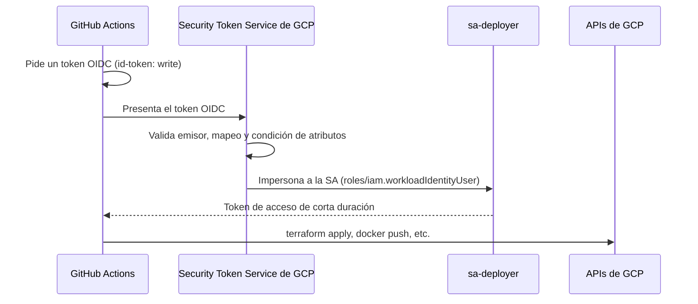
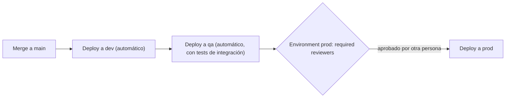
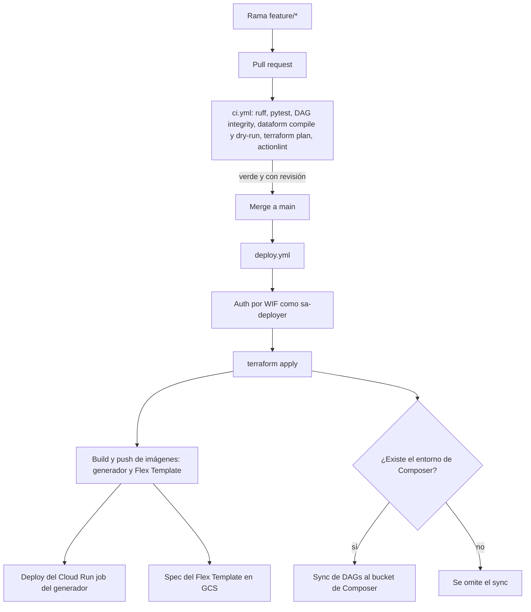

# CI/CD y Terraform

> Cómo un cambio pasa de tu rama a producción sin que nadie despliegue a mano: Git con PRs, CI que valida código, SQL e infraestructura, CD que se autentica en GCP sin llaves (Workload Identity Federation), y Terraform como la única fuente de verdad de la infraestructura.
> **Lab relacionado:** `labs/lab07-cicd-terraform`

## Git: el flujo mínimo

- **Ramas cortas** que salen de `main` y vuelven pronto (`feature/sellout-dead-letter`). Una rama que vive semanas acumula conflictos y PRs imposibles de revisar.
- **Pull request y revisión:** nada entra a `main` sin que otra persona lo lea y sin que la CI pase. La revisión no es burocracia: es el control que evita que un `DROP TABLE` llegue a prod.
- **Conventional commits:** `tipo(área): descripción`. Por ejemplo, `feat(beam): add dead-letter output`, `fix(dataform): correct dim_product grain`, `chore: bump ruff`. Hacen el historial legible y permiten generar changelogs.
- **Un commit, una intención.** Mezclar un refactor con un cambio de lógica hace imposible revisar (y revertir) uno sin el otro.

## CI vs CD

| | CI (integración continua) | CD (entrega o despliegue continuo) |
|---|---|---|
| **Cuándo corre** | En cada PR | Al hacer merge a `main` (o con un disparo manual) |
| **Qué hace** | Valida: lint, tests, compilación, `plan` | Cambia el mundo: `apply`, publica imágenes, sube DAGs |
| **Permisos en GCP** | Mínimos, de solo lectura si se puede | Los de desplegar, a través de `sa-deployer` |
| **Si falla** | El PR no se puede mergear | El despliegue se detiene y alerta |

## Qué validar en un repo de datos

Un repo de datos tiene más tipos de código que un repo de aplicación, y cada uno se rompe a su manera:

| Check | Qué detecta | Cómo |
|---|---|---|
| **Lint (ruff)** | Errores de sintaxis, imports sin usar, estilo | `ruff check .` |
| **Unit tests de transforms de Beam** | Que `ValidateRecord` mande lo malo a dead-letter y lo bueno a la salida principal | `pytest` con `TestPipeline` y `assert_that` (DirectRunner, sin GCP) |
| **DAG integrity test** | DAGs que no importan, ciclos, imports faltantes | Cargar todos los DAGs y fallar si hay errores de importación |
| **`dataform compile`** | Referencias rotas (`ref()` a algo que no existe), ciclos, errores de SQLX | Sin tocar BigQuery |
| **`dataform run --dry-run`** | SQL inválido contra las tablas reales | Hace un dry-run de cada acción en BigQuery; necesita permisos ([Dataform CLI](https://docs.cloud.google.com/dataform/docs/use-dataform-cli)) |
| **Dry-run de SQL suelto** | Errores de sintaxis y bytes estimados | `bq query --dry_run` |
| **`terraform fmt -check` / `validate` / `plan`** | Formato, configuración inválida, y qué cambiaría en la infra | `plan` necesita leer el state y la API: requiere credenciales |
| **actionlint** | Errores en los propios workflows de GitHub Actions | `actionlint` |

El **DAG integrity test** es el más barato y el que más incidentes evita: un DAG que no importa simplemente desaparece del scheduler. Versión mínima:

```python
from airflow.models import DagBag

def test_no_import_errors():
    bag = DagBag(dag_folder="orchestration/dags", include_examples=False)
    assert not bag.import_errors, bag.import_errors
    assert "sellout_daily" in bag.dags
```

## GitHub Actions en diez minutos

- **Workflow:** un archivo YAML en `.github/workflows/`. Este lab tiene dos: `ci.yml` y `deploy.yml`.
- **Trigger (`on:`):** `pull_request` (al abrir o actualizar un PR), `push` (por ejemplo, a `main`) y `workflow_dispatch` (botón manual con parámetros).
- **Job:** un conjunto de pasos que corre en una máquina limpia (`runs-on: ubuntu-latest`). Los jobs corren en paralelo salvo que declares `needs:`.
- **Step:** un comando (`run:`) o una action reutilizable (`uses:`).
- **Variables vs secrets:** `vars.X` es configuración no sensible y visible (el ID del provider de WIF, el nombre de la SA). `secrets.X` va cifrado y se enmascara en los logs. Con WIF, **no necesitas ningún secret para GCP**.

Esqueleto de `ci.yml`:

```yaml
name: ci
on:
  pull_request:
    branches: [main]

permissions:
  contents: read

jobs:
  python:
    runs-on: ubuntu-latest
    steps:
      - uses: actions/checkout@v7
      - run: pip install ruff pytest
      - run: ruff check .
      - run: pytest generator pipelines/sellout_beam orchestration

  terraform-plan:
    runs-on: ubuntu-latest
    permissions:
      contents: read
      id-token: write          # necesario para pedir el token OIDC
    steps:
      - uses: actions/checkout@v7
      - uses: google-github-actions/auth@v3
        with:
          workload_identity_provider: ${{ vars.WIF_PROVIDER }}
          service_account: ${{ vars.DEPLOYER_SA }}
      - uses: hashicorp/setup-terraform@v4
      - run: terraform -chdir=infra/terraform init -input=false
      - run: terraform -chdir=infra/terraform plan -input=false
```

Este es un ejemplo reducido. Los workflows reales del lab están en [`.github/workflows/ci.yml`](../.github/workflows/ci.yml) y [`deploy.yml`](../.github/workflows/deploy.yml).

Buenas prácticas: fija las actions por versión (mejor aún, por SHA del commit), declara `permissions` explícitos y mínimos, y no imprimas variables de entorno en los logs.

## Workload Identity Federation (WIF)

### El antipatrón: llaves JSON en un secret

La forma vieja de conectar CI con GCP era crear una llave JSON de una service account y pegarla en un secret. Los problemas:
- **Es una credencial de larga vida.** Por defecto no expira; quien la copie tiene los permisos de la SA hasta que alguien la borre ([Best practices for managing service account keys](https://docs.cloud.google.com/iam/docs/best-practices-for-managing-service-account-keys)).
- **Se filtra con facilidad:** un log, un fork, una laptop.
- **No hay no repudio:** en los audit logs solo ves "la SA hizo X", no quién usó la llave.
- **Hay que rotarla**, y casi nadie lo hace.

Google recomienda no usar llaves cuando hay alternativa, y en organizaciones recientes la creación de llaves viene bloqueada por política ([Best practices for service accounts](https://docs.cloud.google.com/iam/docs/best-practices-service-accounts)).

### Cómo funciona WIF

GitHub Actions puede emitir, en cada corrida, un **token OIDC** firmado que dice "soy el workflow X del repo Y, en la rama Z". GCP confía en ese emisor y cambia el token por credenciales de corta duración de `sa-deployer`. No hay nada que guardar ni rotar.



Las piezas ([WIF con pipelines de despliegue](https://docs.cloud.google.com/iam/docs/workload-identity-federation-with-deployment-pipelines)):
- **Workload identity pool:** el contenedor de identidades externas.
- **Provider OIDC:** apunta al emisor `https://token.actions.githubusercontent.com`.
- **Attribute mapping:** traduce los claims del token a atributos de Google. Como mínimo, `google.subject=assertion.sub`.
- **Attribute condition:** una expresión CEL que **rechaza** cualquier token que no venga de tu repo.

### La condición va por IDs numéricos, no por nombres

GitHub usa el mismo emisor para todos sus usuarios. Si tu condición dice `assertion.repository_owner == 'mi-usuario'` y algún día borras esa cuenta u organización, alguien puede registrar el mismo nombre y su workflow pasaría la condición. La documentación de Google lo advierte y recomienda los campos numéricos `repository_owner_id` y `repository_id`, que son únicos y no se reutilizan.

```bash
# IDs numéricos del repo y su dueño
gh api repos/OWNER/REPO --jq '.id, .owner.id'

gcloud iam workload-identity-pools create github \
  --project="$PROJECT_ID" --location=global --display-name="GitHub Actions"

gcloud iam workload-identity-pools providers create-oidc github-repo \
  --project="$PROJECT_ID" --location=global --workload-identity-pool=github \
  --issuer-uri="https://token.actions.githubusercontent.com/" \
  --attribute-mapping="google.subject=assertion.sub,attribute.repository_id=assertion.repository_id,attribute.repository_owner_id=assertion.repository_owner_id,attribute.ref=assertion.ref" \
  --attribute-condition="assertion.repository_owner_id=='OWNER_ID' && assertion.repository_id=='REPO_ID'"

# Solo identidades de ESE repo pueden impersonar a sa-deployer
gcloud iam service-accounts add-iam-policy-binding \
  "sa-deployer@${PROJECT_ID}.iam.gserviceaccount.com" \
  --role=roles/iam.workloadIdentityUser \
  --member="principalSet://iam.googleapis.com/projects/${PROJECT_NUMBER}/locations/global/workloadIdentityPools/github/attribute.repository_id/REPO_ID"
```

Del lado del workflow solo hacen falta dos cosas: `permissions: id-token: write` en el job y el paso `google-github-actions/auth` con `workload_identity_provider` y `service_account`.

## Ambientes: dev, qa y prod

- **Un proyecto de GCP por ambiente** (`lab-dev`, `lab-qa`, `lab-prod`). El proyecto es la frontera más fuerte de IAM, de cuotas y de billing: un error en dev no puede tocar prod si están en proyectos distintos.
- **El mismo código, distinta configuración:** Terraform con un directorio o un archivo de variables por ambiente; nunca copiar y pegar.
- **GitHub Environments:** permiten secrets y variables por ambiente y reglas de protección, como *required reviewers* (alguien aprueba antes de que el job corra) y restricción de ramas.

**Limitación importante para este lab:** con GitHub Free, los Environments solo se pueden configurar en repos **públicos**; en repos privados se necesita GitHub Pro o Team ([Managing environments](https://docs.github.com/en/actions/managing-workflow-runs-and-deployments/managing-deployments/managing-environments-for-deployment)). Este repo es privado y gratuito, así que el lab usa **un solo ambiente** y simula la "promoción a prod" con un `workflow_dispatch` manual. En una empresa harías esto:



### Separación de funciones

En entornos regulados (y en cualquier equipo serio), **quien escribe el código no es quien aprueba su despliegue a producción**. GitHub lo implementa con revisión obligatoria en el PR y con *required reviewers* en el environment de prod. GCP lo complementa: las personas no tienen permisos de escritura en prod; solo `sa-deployer`, y solo a través del pipeline. Si alguien necesita cambiar algo en prod, abre un PR.

## Terraform

### Conceptos

| Concepto | Qué es | Ejemplo en el lab |
|---|---|---|
| **Provider** | Plugin que habla con una API | `hashicorp/google ~> 8.10` |
| **Resource** | Algo que Terraform crea y administra | `google_storage_bucket.landing` |
| **Data source** | Algo que Terraform solo lee | `data.google_project.this` (para el número de proyecto) |
| **Variable / output** | Entradas y salidas de un módulo | `var.project_id`, `output.landing_bucket` |
| **Módulo** | Carpeta reutilizable de recursos | Un módulo `dataset` que crea el dataset con sus labels e IAM |
| **State** | El mapa entre tu código y los recursos reales | Archivo en `gs://${PROJECT_ID}-tfstate` |

### State remoto en Cloud Storage

Por defecto el state es un archivo local, lo que no sirve para un equipo ni para CI. El backend `gcs` lo guarda en un bucket, **soporta locking** (dos `apply` simultáneos no corrompen el state) y se recomienda activar **object versioning** en el bucket para recuperar versiones anteriores ([backend gcs](https://developer.hashicorp.com/terraform/language/backend/gcs), [Store state in Cloud Storage](https://docs.cloud.google.com/docs/terraform/resource-management/store-state)).

```hcl
terraform {
  required_version = "= 1.17.1"
  required_providers {
    google = {
      source  = "hashicorp/google"
      version = "~> 8.10"
    }
  }
  backend "gcs" {
    # El bloque backend no acepta variables: el bucket se pasa con
    # terraform init -backend-config="bucket=${PROJECT_ID}-tfstate"
    prefix = "lab"
  }
}
```

El state puede contener valores sensibles: el bucket va con acceso uniforme, sin acceso público y legible solo por el pipeline y unos pocos administradores ([Security best practices](https://docs.cloud.google.com/docs/terraform/best-practices/security)).

### Plan vs apply

- `terraform plan` compara el código con el state y con la realidad, y muestra qué haría: `+` crear, `~` modificar, `-/+` reemplazar, `-` destruir. **No cambia nada.**
- `terraform apply` ejecuta el plan.
- En CI, el `plan` se corre en el PR para que el revisor vea el impacto; el `apply` solo corre después del merge. Un `-/+` sobre un dataset o un bucket con datos merece una segunda lectura.

### Drift: lo que se cambia a mano, se revierte

*Drift* es la diferencia entre lo que dice el código y lo que hay en la nube. Si alguien cambia a mano el lifecycle de un bucket desde la consola, el siguiente `apply` lo **revierte** al valor del código, sin preguntar. Por eso:
- Todo cambio de infraestructura se hace por PR. La consola es para mirar.
- Puedes detectar drift con un workflow programado que corra `terraform plan -detailed-exitcode` (sale con código 2 si hay cambios pendientes) y alerte.

### Adoptar lo que se creó a mano: bloques `import {}`

En los labs 01 a 06 creaste buckets, datasets y service accounts con `gcloud` y `bq`. En el lab07, en vez de borrarlos y recrearlos, los **adoptas** en el state con bloques `import`. El import ocurre durante el `apply`, y `terraform plan -generate-config-out=...` puede proponer el bloque `resource` correspondiente ([Import](https://developer.hashicorp.com/terraform/language/import)).

```hcl
import {
  to = google_storage_bucket.landing
  id = "${var.project_id}-landing"
}

resource "google_storage_bucket" "landing" {
  name                        = "${var.project_id}-landing"
  location                    = "US-CENTRAL1"
  uniform_bucket_level_access = true
  labels                      = { env = "lab", layer = "landing" }
}
```

Después del primer `apply`, el plan debe quedar en "No changes". Si propone cambios, tu bloque `resource` no describe la realidad: ajústalo antes de seguir.

### La capa de bootstrap

Hay tres cosas que Terraform no puede crear para sí mismo con el mismo state:
1. **El bucket del state** (`${PROJECT_ID}-tfstate`): el backend tiene que existir antes del `init`.
2. **El pool y el provider de WIF.**
3. **`sa-deployer`** y sus permisos: es la identidad con la que corre el pipeline.

Esas piezas se crean una vez, con un script o con una configuración de Terraform aparte y state local (en este repo, `scripts/bootstrap_tfstate.sh` e `infra/bootstrap/`). Así evitas el problema del huevo y la gallina, y el pipeline no puede borrar la identidad con la que se autentica.

### Lock file multiplataforma y versiones fijadas

`terraform init` genera `.terraform.lock.hcl` con los checksums de los providers. Si lo generas en una Mac con Apple Silicon, solo trae los checksums de `darwin_arm64` y la CI en Linux puede fallar. Genera los dos y súbelo al repo ([providers lock](https://developer.hashicorp.com/terraform/cli/commands/providers/lock)):

```bash
terraform providers lock -platform=darwin_arm64 -platform=linux_amd64
```

Fija también la versión de Terraform (`required_version`, la imagen `hashicorp/terraform:1.17.1` en local) y la del provider (`~> 8.10`: acepta parches, no saltos de versión mayor). Google recomienda fijar los providers a una versión menor en los root modules ([Root modules](https://docs.cloud.google.com/docs/terraform/best-practices/root-modules)). Todas las versiones del lab están en `VERSIONS.md`.

## Docker: imágenes, tags y digests

- Una **imagen** es un paquete inmutable con tu código, sus dependencias y el sistema base. El generador (Cloud Run job) y el Flex Template de Dataflow corren como imágenes guardadas en Artifact Registry.
- Un **tag** (`:v1.4.0`, `:latest`) es una etiqueta **móvil**: mañana puede apuntar a otra imagen.
- Un **digest** (`@sha256:...`) identifica **exactamente** una imagen y nunca cambia.

Regla: tus imágenes se etiquetan con el SHA del commit (`generator:3f9c2ab`) y lo que despliegas queda registrado con su digest. Las imágenes base del `Dockerfile` se fijan por digest. `latest` en producción significa "no sé qué está corriendo" (ver la lección 16 en `12-lecciones-de-produccion.md`).

## El flujo completo del lab



## Autoevaluación

1. ¿Por qué la condición de atributos de WIF usa `repository_id` y no `repository`?
<details><summary>Respuesta</summary>Porque los nombres de repos y de cuentas se pueden liberar y volver a registrar. Si borras tu cuenta, otra persona podría crear una con el mismo nombre y su workflow cumpliría una condición basada en nombres. Los IDs numéricos son únicos y no se reutilizan.</details>

2. Alguien cambió a mano el lifecycle del bucket `-temp` desde la consola. ¿Qué pasa en el siguiente deploy?
<details><summary>Respuesta</summary>El `terraform apply` detecta el drift y deja el lifecycle como dice el código, sin preguntar. Si el cambio era correcto, había que hacerlo por PR en Terraform.</details>

3. ¿Por qué el bucket del state y `sa-deployer` no viven en el mismo state que el resto de la infra?
<details><summary>Respuesta</summary>El backend tiene que existir antes de `terraform init`, y `sa-deployer` es la identidad con la que corre el pipeline. Si estuvieran en el mismo state, un error en el código podría borrar el bucket del state o la propia SA, y el pipeline se quedaría sin poder recuperarse. Van en una capa de bootstrap aparte.</details>

4. La CI falla en Linux con un error de checksum del provider, pero en tu Mac funciona. ¿Qué pasó?
<details><summary>Respuesta</summary>El `.terraform.lock.hcl` se generó solo para `darwin_arm64`. Hay que regenerarlo con `terraform providers lock -platform=darwin_arm64 -platform=linux_amd64` y subirlo.</details>

5. ¿Qué diferencia hay entre `dataform compile` y `dataform run --dry-run` en CI?
<details><summary>Respuesta</summary>`compile` valida el grafo (referencias, ciclos, SQLX) sin tocar BigQuery y no necesita credenciales. `run --dry-run` además hace un dry-run de cada acción contra BigQuery, así que detecta SQL inválido contra las tablas reales, pero necesita autenticación y permisos.</details>

6. ¿Por qué este lab no usa GitHub Environments con aprobación para prod, y cómo lo harías en una empresa?
<details><summary>Respuesta</summary>Porque en GitHub Free los Environments solo existen en repos públicos, y este repo es privado. En una empresa (Team o Enterprise) habría un environment `prod` con *required reviewers*, de modo que el deploy espere la aprobación de alguien distinto del autor, y un proyecto de GCP separado por ambiente.</details>

7. *(English)* What does `permissions: id-token: write` do, and why is it needed?
<details><summary>Respuesta</summary>It allows the job to request an OIDC token from GitHub. Workload Identity Federation exchanges that token for short-lived Google credentials, so without it the auth step cannot get credentials, and you do not need any stored key.</details>

## Para profundizar

- WIF: [Workload Identity Federation with deployment pipelines](https://docs.cloud.google.com/iam/docs/workload-identity-federation-with-deployment-pipelines) · [Best practices for WIF](https://docs.cloud.google.com/iam/docs/best-practices-for-using-workload-identity-federation) · [google-github-actions/auth](https://github.com/google-github-actions/auth)
- Service accounts: [Best practices for service accounts](https://docs.cloud.google.com/iam/docs/best-practices-service-accounts) · [Managing service account keys](https://docs.cloud.google.com/iam/docs/best-practices-for-managing-service-account-keys)
- Terraform en Google Cloud: [Store state in Cloud Storage](https://docs.cloud.google.com/docs/terraform/resource-management/store-state) · [Security best practices](https://docs.cloud.google.com/docs/terraform/best-practices/security) · [Root modules](https://docs.cloud.google.com/docs/terraform/best-practices/root-modules)
- Terraform: [backend gcs](https://developer.hashicorp.com/terraform/language/backend/gcs) · [Import](https://developer.hashicorp.com/terraform/language/import) · [providers lock](https://developer.hashicorp.com/terraform/cli/commands/providers/lock)
- GitHub: [Managing environments for deployment](https://docs.github.com/en/actions/managing-workflow-runs-and-deployments/managing-deployments/managing-environments-for-deployment)
- Composer: [Test DAGs](https://docs.cloud.google.com/composer/docs/composer-3/test-dags) · Dataform: [Use the Dataform CLI](https://docs.cloud.google.com/dataform/docs/use-dataform-cli)
