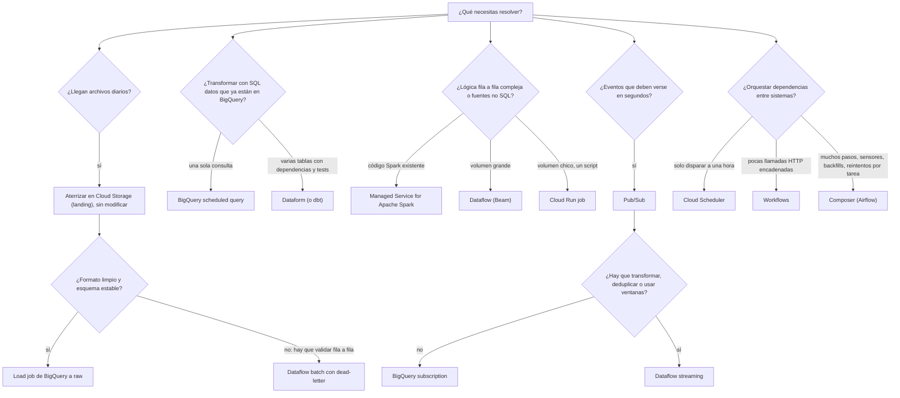
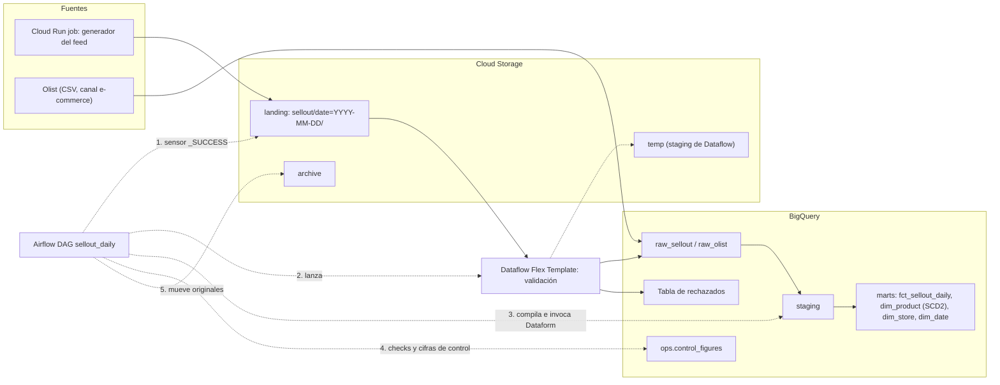
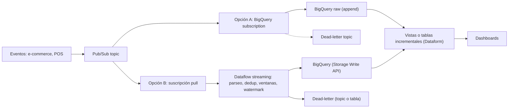

# Guía de decisiones

> El documento más importante para la entrevista. Un Data Engineer mid-level no se mide por saber usar cada servicio, sino por saber **cuál elegir y por qué**, y por saber decir "aquí no lo usaría". Aquí están la matriz de cuándo sí y cuándo no, un árbol de decisión y dos arquitecturas de referencia con el porqué de cada pieza.
> **Lab relacionado:** todos; la arquitectura batch es la que construyes de `lab01` a `lab07`.

## Cómo usar esta guía

1. Antes de la entrevista, lee la matriz y tapa las columnas "cuándo no" y "alternativa": intenta decirlas en voz alta.
2. Practica el árbol con casos inventados ("un retailer manda un Excel semanal", "la app manda eventos de carrito").
3. Aprende a dibujar las dos arquitecturas de memoria y a justificar cada caja en una frase.

Principio general: **elige la herramienta más simple que resuelva el problema**, y súbele de nivel solo cuando un requisito concreto lo pida (latencia, volumen, lógica, dependencias). Cada servicio extra es algo más que operar, monitorear y pagar.

## Matriz: cuándo sí, cuándo no, alternativa

| Servicio | Cuándo sí | Cuándo no | Alternativa |
|---|---|---|---|
| **Cloud Storage** | Aterrizar archivos tal cual llegan (landing), archivar los originales, staging temporal de Dataflow, intercambio con terceros | Como base de datos que se consulta fila a fila o con SQL frecuente | BigQuery para consultar; tablas externas solo para exploración o volúmenes chicos |
| **BigQuery (SQL / ELT)** | Transformar datos que ya están en BigQuery: joins, agregaciones, `MERGE`, deduplicación. Escala sin servidores que administrar | Lógica fila a fila muy compleja, llamadas a APIs externas por registro, latencia de milisegundos (no es OLTP) | Dataflow para lógica compleja o fuentes no SQL; Cloud SQL o AlloyDB para transacciones |
| **Dataform** | Muchas transformaciones SQL con dependencias, tests (assertions), documentación y CI. Nativo de GCP y sin servidores extra | Una sola consulta programada; equipos ya estandarizados en otra herramienta | Scheduled query para una consulta; dbt si el equipo ya lo usa |
| **dbt** | Mismo problema que Dataform; ecosistema grande de paquetes; equipos multi-nube o que ya lo conocen | Si quieres cero infraestructura extra en GCP y el equipo no lo conoce | Dataform |
| **Dataflow batch** | Archivos que hay que validar fila a fila, separar lo malo (dead-letter), parsear formatos no tabulares, enriquecer con side inputs. Volúmenes grandes con autoscaling | Transformaciones que se expresan bien en SQL sobre datos que ya están en BigQuery; volúmenes chicos (el arranque de workers pesa) | BigQuery SQL; un Cloud Run job para volúmenes chicos |
| **Dataflow streaming** | Eventos que deben procesarse en segundos con ventanas, deduplicación, datos tardíos (watermarks) o joins entre flujos | Si basta con aterrizar los mensajes tal cual; si "near-real-time" en realidad significa "cada hora" | BigQuery subscription de Pub/Sub; micro-batch con Dataflow batch o una consulta programada |
| **Pub/Sub** | Desacoplar productores y consumidores de eventos; absorber picos; repartir el mismo evento a varios consumidores | Transferir archivos grandes; como almacenamiento de largo plazo (la retención es limitada) | Cloud Storage para archivos; BigQuery para historia |
| **Spark (Managed Service for Apache Spark)** | Código Spark o Hadoop existente que migrar; equipos con experiencia en Spark; librerías del ecosistema Spark | Pipelines nuevos de SQL que BigQuery resuelve; si nadie en el equipo conoce Spark | BigQuery SQL o Dataflow |
| **Cloud Run jobs** | Tareas en contenedor que corren y terminan: el generador del lab, llamar a una API y dejar un archivo, scripts de mantenimiento. Paralelizable por tareas | Procesamiento distribuido de grandes volúmenes; servir peticiones HTTP | Dataflow para volumen; Cloud Run services para HTTP |
| **Cloud Run services** | Exponer una API o un webhook (recibir notificaciones de un tercero) | Trabajo batch que no responde peticiones | Cloud Run jobs |
| **Cloud Run functions** | Lógica corta disparada por un evento: "llegó un objeto a GCS, avisa" o "valida un JSON" | Procesos largos o con muchas dependencias; orquestar un pipeline completo dentro de una función | Cloud Run jobs; un orquestador |
| **Cloud Scheduler** | Disparar algo a una hora fija: un Cloud Run job, un workflow, un endpoint | Cadenas de pasos con dependencias, reintentos por paso y backfills | Workflows o Composer |
| **Workflows** | Encadenar pocas llamadas a APIs o servicios (HTTP) con reintentos y condiciones; serverless y se paga por paso ejecutado | Pipelines de datos con muchas tareas, backfills y re-ejecución de tareas sueltas | Composer |
| **Composer / Airflow** | Muchos pipelines con dependencias entre sistemas, reintentos por tarea, backfills, sensores, visibilidad central; equipos que escriben Python | Un solo cron o dos pasos encadenados: cobra por capacidad aprovisionada aunque no corra nada | Cloud Scheduler o Workflows |
| **BigQuery scheduled queries** | Una consulta SQL recurrente sin dependencias (un resumen diario, una limpieza) | Varias consultas que dependen entre sí; necesidad de tests y revisión por PR | Dataform |
| **Terraform** | Toda la infraestructura que debe ser reproducible, revisable y igual entre ambientes | Exploración puntual que vas a borrar en una hora; datos (Terraform administra recursos, no filas) | Consola o gcloud para explorar; después, a Terraform |
| **Knowledge Catalog (calidad y linaje)** | Reglas de calidad sobre tablas que no controlas desde Dataform; perfilado para conocer una fuente nueva; linaje donde alguien lo consulte | Duplicar lo que ya cubren tus assertions; activarlo en todos los proyectos y tablas "por si acaso": cobra | Assertions de Dataform y checks del orquestador |

## Árbol de decisión

## Arquitectura de referencia 1: batch diaria de sell-out

Es la arquitectura del lab. Los retailers (aquí, el generador sintético) dejan cada día un archivo de ventas, los maestros de producto y tienda, un `_manifest.json` con los conteos y un `_SUCCESS` cuando terminaron.

Por qué cada pieza:

| Pieza | Por qué está | Por qué no otra cosa |
|---|---|---|
| **GCS landing** con `date=YYYY-MM-DD/` | Guarda el archivo **tal cual llegó**: si hay que reprocesar o reclamar al retailer, el original existe. El prefijo por fecha hace idempotente el reproceso de un día | Cargar directo a BigQuery pierde el original y mezcla la llegada con la transformación |
| **`_manifest.json` y `_SUCCESS`** | El `_SUCCESS` dice "terminé de escribir" (no procesar archivos a medias); el manifiesto da los conteos para las cifras de control | Sin ellos, el pipeline adivina cuándo está completo el día |
| **Dataflow batch** | El feed trae errores inyectados: hay que validar fila a fila y separar lo malo sin tumbar el job | Un load job directo fallaría completo o aceptaría basura; SQL no sirve para parsear JSON corrupto |
| **Flex Template** | El pipeline se empaqueta como imagen versionada y Airflow lo lanza con parámetros (la fecha), sin instalar Beam en Composer | Correr Beam dentro del worker de Airflow mezcla dependencias y consume los recursos del orquestador |
| **Escritura con `FILE_LOADS`** | En batch, cargar por archivos usa load jobs, que no tienen costo de ingesta | La Storage Write API cobra ingesta y en Python depende de Java; tiene más sentido en streaming |
| **raw, staging, marts** | raw es fiel a la fuente; staging limpia y tipa; marts tiene el modelo estrella para el negocio. Si cambia una regla, se recalcula desde raw | Un solo paso de "archivo a dashboard" no se puede auditar ni recalcular |
| **Dataform** | Muchas tablas SQL con dependencias, assertions, descripciones y CI; incrementales y SCD2 con `MERGE` | Las scheduled queries no manejan dependencias ni tests |
| **Airflow** | Coordina sistemas distintos (GCS, Dataflow, Dataform, BigQuery) con sensores, reintentos por tarea y backfills por fecha lógica | Cloud Scheduler no sabe de dependencias; Workflows no tiene backfills ni re-ejecución de tareas sueltas |
| **`ops.control_figures`** | Prueba de que no se perdió ni duplicó nada: manifiesto = válidas + rechazadas | Que todas las tareas terminen en verde no lo garantiza |
| **Terraform y CI/CD** | Todo es reproducible y pasa por PR; WIF sin llaves | Lo creado a mano se desvía con el tiempo y nadie sabe por qué |

## Arquitectura de referencia 2: near-real-time (conceptual)

No se construye en el lab, pero en la entrevista pueden preguntarte: "¿y si el negocio quiere ver las ventas del e-commerce en minutos?".

Por qué cada pieza:
- **Pub/Sub** desacopla: si BigQuery o Dataflow se detienen, los mensajes esperan en la suscripción (con una retención limitada; ver la lección 10 en `12-lecciones-de-produccion.md`).
- **Opción A, BigQuery subscription:** Pub/Sub escribe directo a una tabla sin ningún job que operar. Es la opción por defecto si los mensajes no necesitan transformación. Garantiza *at least once*, así que la deduplicación se hace después, en BigQuery ([BigQuery subscriptions](https://docs.cloud.google.com/pubsub/docs/bigquery)).
- **Opción B, Dataflow streaming:** cuando hay que agregar por ventanas de tiempo, deduplicar con exactitud, unir flujos o tratar datos tardíos con watermarks. Es más potente, pero es un job siempre encendido que hay que operar y pagar.
- **Dead-letter** en ambos casos: el mensaje que no se puede escribir no debe bloquear la cola ni perderse en silencio.
- **El modelado sigue siendo batch o incremental:** el near-real-time suele aplicarse a la capa raw y a unas pocas métricas; el modelo estrella completo rara vez necesita actualizarse cada segundo.

Pregunta que debes hacer siempre: **"¿qué decisión se toma con el dato en minutos que no se pueda tomar con el dato de cada hora?"**. Muchas veces la respuesta lleva a un micro-batch mucho más barato.

## Preguntas trampa típicas

**"¿Por qué no usas Dataflow para todo?"**
Porque cuando los datos ya están en BigQuery, SQL es más simple de escribir, de revisar y de mantener, lo puede leer un analista y no hay workers que operar. Dataflow aporta valor cuando hay lógica que SQL no expresa bien (parseo, validación fila a fila con dead-letter, llamadas externas), fuentes que no son tablas o streaming con ventanas. En el lab, Dataflow solo hace la validación de entrada; todo lo demás es SQL en Dataform.

**"¿Por qué no Composer para un solo cron?"**
Porque Composer cobra por la capacidad aprovisionada del entorno las 24 horas, corra o no corra nada ([Workflows vs Managed Airflow](https://docs.cloud.google.com/workflows/docs/choose-orchestration)). Para disparar un Cloud Run job a las 6:00 basta Cloud Scheduler; para tres pasos encadenados con reintentos, Workflows. Composer se justifica con muchos pipelines, dependencias entre sistemas, sensores y backfills.

**"¿ETL o ELT?"**
En ETL transformas antes de cargar; en ELT cargas primero (raw) y transformas dentro del warehouse. En GCP lo habitual es **ELT**, porque BigQuery separa almacenamiento y cómputo y escala la transformación sin servidores, y porque tener raw permite recalcular cuando cambia una regla. El lab es ELT con una "T" mínima antes de cargar: Dataflow solo valida y separa rechazos; no aplica reglas de negocio.

**"¿Cuándo Spark en lugar de Beam?"**
Spark (Managed Service for Apache Spark) cuando ya existe código Spark o Hadoop que migrar, cuando el equipo domina Spark o cuando necesitas librerías de su ecosistema. Tiene modo serverless y modo clusters ([Serverless vs clusters](https://docs.cloud.google.com/managed-spark/docs/concepts/serverless-spark-compare)). Beam en Dataflow cuando arrancas de cero, quieres el mismo modelo para batch y streaming y prefieres un servicio sin clusters. Ninguno de los dos si el problema es SQL sobre datos en BigQuery.

**"¿Por qué no cargas el JSON directo con un load job?"**
Porque el feed tiene errores conocidos. Un load job sin tolerancia falla completo, y uno con tolerancia a errores descarta filas sin decir cuáles. La validación en Beam deja cada rechazo con su motivo y permite cuadrar las cifras de control. Si la fuente fuera limpia y confiable, el load job sería la opción más barata y simple.

**"¿Dataform o dbt?"**
Resuelven lo mismo. Dataform es nativo de GCP (sin infraestructura extra, integrado con BigQuery y con Knowledge Catalog); dbt tiene un ecosistema y una comunidad más grandes y funciona en varias nubes. La respuesta honesta: "uso el que el equipo ya tiene; los conceptos (ref, incrementales, tests, documentación) se transfieren".

## Autoevaluación

1. Un retailer manda un CSV semanal pequeño y limpio. ¿Qué arquitectura mínima propones?

Respuesta
Landing en GCS, un load job a raw y transformación en SQL (Dataform si ya existe el proyecto, o una scheduled query si es lo único). Disparo por Cloud Scheduler o por el orquestador que ya exista. Dataflow sobra para un archivo pequeño y limpio.

2. El negocio pide "tiempo real" para un dashboard que se revisa una vez al día. ¿Qué haces?

Respuesta
Preguntar qué decisión se toma con ese dato y con qué frecuencia. Si se revisa una vez al día, un batch diario o por hora resuelve a una fracción del costo y la complejidad de un streaming.

3. ¿Cuándo eliges una BigQuery subscription en lugar de Dataflow streaming?

Respuesta
Cuando los mensajes se pueden guardar tal cual (o con una transformación ligera) y la deduplicación se puede hacer después en BigQuery, porque la subscription es *at least once*. No hay job que operar. Dataflow streaming cuando hay ventanas, joins entre flujos, deduplicación exacta o datos tardíos.

4. Tienes tres consultas que se deben correr en orden cada noche, sin sensores ni backfills. ¿Composer?

Respuesta
No necesariamente. Si ya existe un proyecto de Dataform, se resuelve con dependencias en Dataform y una ejecución programada. Si no, Workflows o Cloud Scheduler más un script. Composer se justifica cuando hay muchos pipelines y dependencias entre sistemas.

5. ¿Por qué el lab guarda el archivo original en GCS si ya lo cargó a BigQuery?

Respuesta
Para reprocesar si cambia una regla o hubo un bug, para auditar y para reclamar al retailer con su propio archivo. Además, el prefijo por fecha hace que reprocesar un día sea idempotente.

6. *(English)* In one sentence each, justify Dataflow and Dataform in the batch architecture.

Respuesta
Dataflow validates every row of a messy file and routes bad records to a dead-letter table without failing the whole load. Dataform manages the dependent SQL transformations with tests, documentation and version control inside BigQuery.

## Para profundizar

- [Workflows vs Managed Airflow](https://docs.cloud.google.com/workflows/docs/choose-orchestration) · [Workflows overview](https://docs.cloud.google.com/workflows/docs/overview)
- [BigQuery subscriptions de Pub/Sub](https://docs.cloud.google.com/pubsub/docs/bigquery) · [Retención de mensajes](https://docs.cloud.google.com/pubsub/docs/subscription-message-retention)
- [Managed Service for Apache Spark: serverless vs clusters](https://docs.cloud.google.com/managed-spark/docs/concepts/serverless-spark-compare)
- [Cloud Run jobs](https://docs.cloud.google.com/run/docs/create-jobs) · [Scheduled queries](https://docs.cloud.google.com/bigquery/docs/scheduling-queries)
- [Storage Write API (gRPC)](https://docs.cloud.google.com/bigquery/docs/write-api-grpc) · [Dataflow Flex Templates](https://docs.cloud.google.com/dataflow/docs/guides/templates/using-flex-templates)
- [Knowledge Catalog: auto data quality](https://docs.cloud.google.com/knowledge-catalog/docs/auto-data-quality-overview) · [Data lineage](https://docs.cloud.google.com/knowledge-catalog/docs/about-data-lineage)
