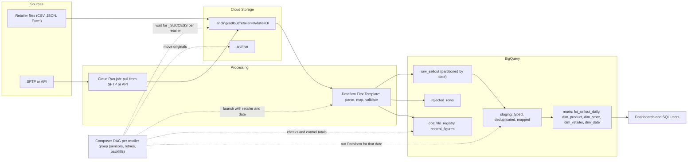

# System design: daily sell-out pipeline

> A guided answer to the most likely system design question for this role, plus a short supply chain variant. Practice it on a whiteboard (or a blank page) in 35–45 minutes: talk while you draw, and keep asking yourself "why this piece and not a simpler one?".

## The prompt

> "Design a daily sell-out ingestion and analytics pipeline for 50 retailers delivering files with variable quality."

The interviewer is not looking for a perfect architecture. They want to see that you **clarify before designing**, choose **simple tools with reasons**, and think about **quality, idempotency, security, cost and operations**, not only the happy path.

Suggested time split: clarifying questions (5 min), requirements and architecture (15), data model (5), quality, idempotency and backfill (8), security, cost and monitoring (5), evolution (2–5).

## Step 1: clarifying questions

Ask, write the answers down, and state assumptions out loud when they don't know.

**Sources**
- How do retailers deliver? SFTP, API, files dropped in a bucket, email? (Assume: files in a Cloud Storage bucket, or an SFTP that we mirror into one.)
- Which formats? CSV, JSON, Excel? One format per retailer, or a standard we impose? (Assume: each retailer has its own format; we define a per-retailer mapping.)
- Granularity: daily per store and product, or weekly totals? Do they send returns as negative units?
- How do they identify products and stores? EAN, their own codes, our SKUs?
- Do they ever resend corrected data for past periods (restatements)? How far back?

**Volume and timing**
- Rows per file and in total per day? History to load at the start?
- When do files arrive, and by when must the data be available? (Assume: files before 06:00, dashboards ready by 09:00.)

**Consumers**
- Who uses the data and how: dashboards, ad hoc SQL, other systems? At which level: daily by store, weekly by region?
- Which metrics matter: units, sales value, stock, sell-through? In which currency?

**Constraints**
- Any personal or commercially sensitive data? Can every analyst see every retailer?
- Existing stack, team skills, budget sensitivity?

## Step 2: requirements

**Functional**
1. Ingest a daily file per retailer (50 retailers, heterogeneous formats).
2. Validate each row; keep invalid rows with the reason, and report them back to the retailer.
3. Map retailer product and store codes to internal SKUs and stores.
4. Build a fact table of daily sell-out by date, retailer, store and product, plus dimensions.
5. Support restatements and backfills.

**Non-functional**
- **Freshness:** data ready by 09:00; a missing file is detected and alerted before then.
- **Correctness:** control totals reconcile for every file; no duplicates when reprocessing.
- **Cost:** proportional to the daily volume, not to the total history.
- **Operability:** one place to see the status of each retailer per day; reprocess one retailer and one date without touching the rest.
- **Security:** least privilege; retailer-level access restrictions if required.

## Step 3: architecture

Walk through it and justify each piece:
- **Cloud Storage landing**, one prefix per retailer and date: keeps the original file untouched for audit, reprocessing and disputes with the retailer. The date prefix makes reprocessing a day idempotent.
- **Cloud Run job** only for retailers that need to be pulled (SFTP or API); the others push files directly. It runs and exits, so there is no server to keep alive.
- **Dataflow batch (Flex Template)**: per-retailer parsing from a configuration (column mapping, date format, decimal separator), row validation, and a dead-letter output. It scales across 50 files in parallel. If all retailers sent a clean standard format, a BigQuery load job would be enough, and I'd say so.
- **BigQuery raw / staging / marts** with Dataform: ELT, SQL that analysts can read, assertions, documentation, and CI.
- **Composer**: there are 50 sources with different arrival times, dependencies, sensors, retries and backfills, which is exactly the case where an orchestrator pays off. One DAG with dynamic task mapping or a DAG factory per retailer group, not 50 hand-written DAGs.
- **ops tables**: `file_registry` (which file arrived, when, rows, status, version) and `control_figures` (manifest vs. valid plus rejected).

## Step 4: data model

**Fact: `fct_sellout_daily`**
- **Grain:** one row per `sale_date`, `retailer`, `store`, `product`.
- **Keys:** surrogate keys to the dimensions, plus `retailer_id` and `sale_date` kept as columns for partitioning and clustering.
- **Measures:** `units` (returns negative), `net_sales_local`, `currency`, `net_sales_reporting` (converted with a daily FX table), and optionally `stock_units` if retailers send inventory (better as a separate periodic snapshot fact).
- **Lineage columns:** `source_file`, `file_version`, `loaded_at`.
- **Physical design:** partition by `sale_date`, cluster by `retailer_id`, `store_key`, `product_key`. Require a partition filter.

**Dimensions**
- `dim_product`: SCD2 (brand, category, size can change), with an **EAN-to-SKU mapping table** that has validity dates.
- `dim_store`: SCD2 (format, region, open or closed); includes the retailer's own store code.
- `dim_retailer`: retailer attributes and its file configuration version.
- `dim_date`: calendar and retail (4-5-4) calendar, holidays, promotional periods.
- Each dimension has an **unknown member** so unmapped codes stay visible in totals.

## Step 5: quality and controls

| Layer | Check | On failure |
|---|---|---|
| Arrival | `_SUCCESS` (or manifest) per retailer and date before the deadline | Alert; the retailer's status in the registry shows "missing" |
| Parsing | Schema, types, mandatory fields, valid dates, numeric units | Row goes to `rejected_rows` with the reason |
| Reconciliation | Manifest rows = valid + rejected | DAG task fails; no publication for that retailer |
| Mapping | Share of rows that map to the unknown member | Warning above a threshold; daily report to master data owners |
| Model | `uniqueKey` on the grain, `nonNull` keys, referential integrity | Dataform assertion fails; dependent marts not rebuilt |
| Volume | Rows vs. the same weekday's recent median, per retailer | Warning or failure depending on the size of the deviation |
| Freshness | Latest `sale_date` per retailer in the mart | Alert |

Also: send each retailer its rejection report automatically. Quality improves fastest at the source.

## Step 6: idempotency, backfill and restatements

- **Unit of work = (retailer, date).** Every task is parameterized by both and only touches that slice.
- **Writes replace, never append:** for each (retailer, date), `DELETE` plus `INSERT` inside a transaction, or a `MERGE` keyed on the grain with a partition filter. Re-running gives the same result.
- **Backfill:** trigger runs for a date range and a set of retailers, with limited concurrency; validate a small range first; control totals per date.
- **Restatements:** the retailer resends a range of past dates. The file registry stores a new version; the pipeline reprocesses exactly those (retailer, date) slices and replaces them. The previous files stay in the archive. Downstream users are told that history changed (for example, a `restated_at` column or a changelog table).
- **Late files:** if a retailer sends yesterday's file today, it's just a run for (retailer, yesterday), with no special logic.

## Step 7: security and IAM

- One service account per component (`sa-ingest`, `sa-dataflow`, `sa-dataform`, `sa-composer`), each with the minimum roles on specific buckets and datasets.
- Retailers write only to their own landing prefix (or we pull from them); they never get access to BigQuery.
- Analysts read marts, not raw. If retailers' data must be segregated, use row-level access policies by `retailer_id` or authorized views.
- CI/CD with Workload Identity Federation: no service account keys. Infrastructure in Terraform, changed only through PRs.
- Separate projects for dev, qa and prod.

## Step 8: cost

Say where the money goes and how you'd keep it proportional to the daily volume:
- **BigQuery:** partition pruning everywhere (constant date filters), incremental models, clustering for the common filters, `MERGE` scoped to the touched partitions, and labels on every job. Measure with `total_bytes_billed`, not with dry runs.
- **Dataflow:** batch only, small workers, autoscaling with a max; no per-record logging.
- **Composer:** sized by concurrent tasks; deferrable sensors so waiting for 50 files doesn't need 50 worker slots. If the design ended up being just a few steps, Workflows or Cloud Scheduler would be cheaper.
- **Storage:** soft delete off on temp buckets; lifecycle to delete temp files and move old originals to a colder class.
- **Governance features:** quality scans and lineage only where someone uses them.

## Step 9: monitoring and operations

- **Alerts:** failed DAG, failed Dataflow job, control totals not balanced, missing file at the deadline, volume anomaly, freshness breach. Delivered through notification channels to the team.
- **A status view per retailer and day** built from `file_registry` and `control_figures`: arrived, loaded, rows, rejected, balanced. This is what you look at first every morning.
- **Runbook:** how to reprocess one (retailer, date), how to run a backfill, who to contact at each retailer.
- **Cost dashboard** from the billing export, grouped by `pipeline` and `retailer` labels.

## Step 10: evolution to near-real-time

If the business later needs intraday sell-out (for example, from the e-commerce channel or retailers with APIs):
- Events go to **Pub/Sub**. If they need no transformation, a **BigQuery subscription** writes them to a raw table (at-least-once, so deduplicate later); otherwise **Dataflow streaming** handles parsing, deduplication and windows, with a dead-letter topic.
- The daily batch remains the **reconciled source of truth**; the intraday flow gives an early view, and the daily file replaces those numbers when it arrives (same grain, same keys).
- Before building it, ask which decision needs minute-level data. Often hourly micro-batches are enough.

## Variant: supply chain OTIF dashboard

> "Design the data pipeline for an OTIF dashboard across our distribution centers and customers."

Shorter answer structure:

1. **Clarify the definition first.** On time against the requested or the confirmed date? Which tolerance window? In full per line or per order, with which quantity tolerance? Do partial deliveries count? This is where most OTIF projects fail.
2. **Sources:** orders (ERP), shipments (warehouse management), deliveries and proof of delivery (transport management or carriers), and master data for customers, products and distribution centers. Usually daily extracts or CDC into raw.
3. **Model:** an **accumulating snapshot** `fct_order_line_fulfillment`, one row per order line, with dates for ordered, confirmed, shipped, delivered; quantities ordered, shipped and delivered; and derived flags `on_time`, `in_full`, `otif`. The row is updated as milestones arrive (`MERGE` on the order line key).
4. **Late events:** a delivery confirmation can arrive days later, so the model must update past rows. Use a reprocessing window on recent orders, or update only the lines whose events changed.
5. **Quality:** every delivered line has a shipment; quantities are non-negative; dates follow the milestone order; reconcile line counts with the ERP.
6. **Serving:** OTIF by customer, distribution center, week and product, with drill-down to the failing lines and the reason (late, short, both), because the dashboard should lead to action.
7. **Orchestration:** a daily DAG, or near-real-time for deliveries if the operations team acts during the day.
