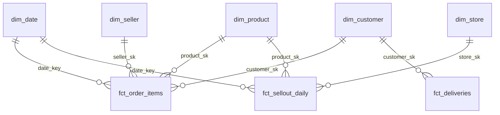

# Lab 03 · Modelado dimensional con Dataform

**Objetivo:** construir con SQL versionado (Dataform) la estrella del lab:
- dimensiones con miembro desconocido;
- un **SCD2** reconstruido desde el historial (y su alternativa incremental con MERGE, para comparar);
- un hecho transaccional, un *accumulating snapshot* y un hecho incremental;
- **assertions** de calidad y descripciones de columnas que llegan a BigQuery.

**Tiempo:** ~4 h · **Costo:** $0 (free tier) · **Docs:** [`05-modelado-dimensional`](../../docs/05-modelado-dimensional.md)

## El modelo

| Modelo | Tipo | Grano | Qué enseña |
|---|---|---|---|
| `fct_order_items` | transaccional | ítem de orden | join point-in-time a SCD2; por qué no se unen los pagos (fan-out) |
| `fct_deliveries` | accumulating snapshot | orden | una columna por hito, lead time, on-time |
| `fct_sellout_daily` | incremental (MERGE) | día × tienda × producto | `uniqueKey` + `updatePartitionFilter` |
| `dim_product` | SCD2 reconstruida con `LAG`/`LEAD` | versión de producto | historia de precio y marca; independiente del orden |
| `dim_store`, `dim_customer`, `dim_seller` | SCD1 | entidad | miembro desconocido `-1` |
| `stg_sellout_lines` | incremental (delete+insert) | `line_id` | dedup con `QUALIFY` e idempotencia por partición |

Código: [`definitions/`](../../definitions) e [`includes/constants.js`](../../includes/constants.js). Dataform exige `workflow_settings.yaml` **en la raíz del repo**.

## Pasos
```bash
source .env.lab && scripts/preflight.sh
```

### 1. Datasets y tablas "contrato"
Las tablas `raw_sellout.*` y `ops.control_figures` no las crea Dataform: las escriben Dataflow y Airflow. Su esquema es un contrato y vive en `infra/schemas/`.
```bash
labs/lab03-modelado-dataform/create_raw_tables.sh
```

### 2. Dataform CLI en local
```bash
echo "{\"projectId\": \"$PROJECT_ID\", \"location\": \"$REGION\"}" > .df-credentials.json   # en .gitignore; usa tu ADC
npx --yes @dataform/cli@3.1.4 compile                        # sin errores = el grafo es válido
npx --yes @dataform/cli@3.1.4 compile --json | python3 -c "import json,sys;d=json.load(sys.stdin);print(len(d['tables']),'tablas', len(d['assertions']),'assertions')"
```

### 3. SCD2: tres días de maestros
```bash
labs/lab03-modelado-dataform/scd2_demo.sh 2026-11-01 2026-11-02 2026-11-03
```
Resultado esperado:
- 2026-11-01: todo nace con `valid_from = 1900-01-01`.
- 2026-11-02 (lunes): ~34 productos cambian de precio o marca y nace una versión nueva.
- 2026-11-03: **0 cambios** (re-correr no crea versiones).

**Prueba el desorden.** Vuelve a correr un día viejo:
```bash
labs/lab03-modelado-dataform/scd2_demo.sh 2026-11-02
```
La tabla queda **idéntica**: `dim_product` se reconstruye desde *todos* los snapshots, así que el orden no importa. Ahora lee [`docs/snippets/scd2_merge_incremental.sql`](../../docs/snippets/scd2_merge_incremental.sql): con ese MERGE, este mismo paso habría corrompido la historia. Esa diferencia es una buena pregunta de entrevista.

Mira un producto con historia:
```bash
bq query --nouse_legacy_sql "
SELECT product_id, brand, list_price, valid_from, valid_to, is_current
FROM marts.dim_product
WHERE product_id IN (SELECT product_id FROM marts.dim_product GROUP BY 1 HAVING COUNT(*) > 1 LIMIT 1)
ORDER BY valid_from"
```

### 4. La estrella del canal e-commerce
```bash
npx --yes @dataform/cli@3.1.4 run --tags olist --vars run_date=2026-11-03
```
- Fíjate en el log de las **assertions**: `uniqueKey`, `nonNull`, `rowConditions` y las custom de `definitions/assertions/`.
- En BigQuery, abre `marts.fct_order_items` → **Schema**: las descripciones que escribiste en el `config {}` aparecen como documentación de la tabla.

### 5. Preguntas de negocio sobre tu estrella
```bash
bq query --nouse_legacy_sql "
SELECT c.state, COUNT(*) AS orders, ROUND(AVG(CAST(d.is_on_time AS INT64)) * 100, 1) AS pct_on_time,
       ROUND(AVG(d.lead_time_days), 1) AS avg_lead_time_days
FROM marts.fct_deliveries AS d JOIN marts.dim_customer AS c USING (customer_sk)
WHERE d.is_delivered
GROUP BY c.state ORDER BY orders DESC LIMIT 10"
```

### 6. Rompe algo a propósito
Ejemplos:
- en `stg_order_items.sqlx`, cambia `price >= 0` por `price > 100`;
- en `fct_order_items.sqlx`, haz un `JOIN` a `raw_olist.order_payments`.

Corre de nuevo y observa qué assertion falla y por qué. Revierte el cambio.

### 7. Repositorio gestionado (lo usa Airflow en el lab06)
En producción, Dataform no corre desde tu laptop: un **repositorio gestionado** en GCP clona tu rama `main` de GitHub, compila y ejecuta con una service account propia.

1. Crea un **fine-grained personal access token** en GitHub:
   - Settings → Developer settings → Fine-grained tokens.
   - Repository access: **solo tu repo**.
   - Permissions → Contents: **Read and write**.
   - Expiración: 30 días.
2. Corre el script; te pide el token sin mostrarlo:
   ```bash
   labs/lab03-modelado-dataform/managed_repo.sh
   ```
3. Prueba una ejecución gestionada:
   ```bash
   labs/lab03-modelado-dataform/invoke_managed.sh olist 2026-11-03
   ```

## Checkpoint
- `dim_product` tiene ~32 900 versiones vigentes y ~34 históricas.
- `assert_dim_product_one_current` pasa.
- `fct_order_items` tiene ~112 mil filas sin `product_sk` nulos.
- La invocación gestionada termina en `SUCCEEDED`.

## Limpieza
Nada: los marts se usan en los labs siguientes. Las vistas no cuestan; las tablas pesan unos pocos MB.

## Preguntas
1. ¿Cuál es el grano de `fct_deliveries` y por qué es un accumulating snapshot?
2. ¿Por qué la primera versión de cada producto tiene `valid_from = 1900-01-01`?
3. ¿Qué pasaría con un SCD2 **incremental (MERGE)** si procesas el 2026-11-02 **después** del 2026-11-03? ¿Por qué la versión reconstruida no tiene ese problema y cuál es su costo?
4. ¿Por qué `stg_sellout_lines` y `fct_sellout_daily` usan estrategias incrementales distintas (delete+insert vs MERGE)?
5. (EN) *What is a conformed dimension? Give an example from this lab.*
