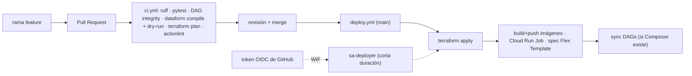

# Lab 07 · CI/CD y Terraform: que nada se despliegue a mano

**Objetivo:**
- **Adoptar** en Terraform todo lo que creaste a mano en los labs 01–06, con bloques `import`.
- Conectar GitHub Actions a GCP **sin llaves**, con Workload Identity Federation.
- Ver el ciclo completo: PR → CI (lint, tests, compile, plan) → merge → CD (apply, imágenes, job, template, DAGs).

**Tiempo:** ~5 h · **Costo:** ~$0 (GitHub Actions es gratis en repos privados hasta la cuota mensual del plan Free) · **Docs:** [`10-cicd-terraform`](../../docs/10-cicd-terraform.md)

## El flujo


## Pasos
```bash
source .env.lab && scripts/preflight.sh
gh auth status          # con TU cuenta de GitHub (la dueña de $GITHUB_REPO)
```

### 1. Bootstrap: lo que Terraform necesita para existir
Esto va fuera de Terraform: el bucket del state, la SA `sa-deployer`, el pool y el provider de WIF y las variables del repo en GitHub. Léelo antes de correrlo.
```bash
infra/bootstrap/bootstrap.sh
gh variable list --repo "$GITHUB_REPO"
```
**Por qué IDs numéricos en la condición de WIF:** si borras tu repo, alguien puede crear otro con el mismo nombre. El ID numérico no se reutiliza.

### 2. Terraform en local: adoptar lo existente
```bash
cp infra/terraform/lab.tfvars.example infra/terraform/lab.tfvars     # edita project_id y github_repo
scripts/tf.sh init -backend-config="bucket=$TFSTATE_BUCKET"
cp infra/terraform/imports.tf.example infra/terraform/imports.tf
scripts/tf.sh plan -var-file=lab.tfvars
```
Lee el plan con calma:
- **"to import"**: lo que creaste a mano (buckets, datasets, tablas, SAs, Artifact Registry, secreto, repo de Dataform). ✔️
- **"to add"**: sobre todo bindings de IAM y lo que no existía. ✔️
- **"to change"**: diferencias entre lo que hiciste a mano y el código (labels, una regla de lifecycle, la limpieza del registro). Es **drift**: el código gana. ✔️
- **"to destroy"** o **"must be replaced"**: ⛔ **PARA**. Una tabla que se reemplaza **pierde sus datos**. Busca qué atributo difiere (partición, clustering) y alinea el código o el recurso antes de aplicar.

```bash
scripts/tf.sh apply -var-file=lab.tfvars
rm infra/terraform/imports.tf          # los imports son de una sola vez
scripts/tf.sh plan -var-file=lab.tfvars   # debe decir "No changes"
```

### 3. CI en un Pull Request
```bash
git switch -c feature/descripcion-columna
# un cambio chico: p. ej. mejora la descripción de una columna en definitions/marts/fct_sellout_daily.sqlx
git commit -am "docs(dataform): describe net_sales en fct_sellout_daily"
git push -u origin HEAD
gh pr create --fill
gh pr checks --watch
```
Abre la pestaña **Checks** del PR y busca:
- el `terraform plan` dentro del log;
- el dry-run de Dataform;
- el test de integridad del DAG.

### 4. Merge → deploy
```bash
gh pr merge --squash --delete-branch
gh run watch "$(gh run list --workflow deploy --limit 1 --json databaseId --jq '.[0].databaseId')"
gcloud run jobs describe sellout-generator --region "$REGION" --format="value(spec.template.spec.template.spec.containers[0].image)"
```
La imagen del job ahora tiene como tag el **SHA del commit**: sabes exactamente qué código corre.

### 5. Drift: alguien cambia algo "a mano"
```bash
gcloud storage buckets update "gs://$ARCHIVE_BUCKET" --update-labels=owner=alguien
```
Abre otro PR cualquiera y mira el `plan` de CI: propone **quitar** ese label. El próximo deploy lo revierte. Lección: en un entorno con IaC, los cambios se hacen por PR.

### 6. (Opcional, cuesta) Composer gestionado por CI
```bash
gh variable set ENABLE_COMPOSER --repo "$GITHUB_REPO" --body true && gh workflow run deploy --repo "$GITHUB_REPO"
# ...~25 min: Terraform crea el entorno y el job "dags" sube orchestration/dags a su bucket...
gh variable set ENABLE_COMPOSER --repo "$GITHUB_REPO" --body false && gh workflow run deploy --repo "$GITHUB_REPO"
```
Al apagarlo, borra el bucket del entorno como en el lab06 (B4).

## Checkpoint
- El plan después del apply dice **"No changes"**.
- Hay un PR con todos los checks en verde y un deploy exitoso en `main`.
- Ningún secreto en GitHub: solo **variables**, porque WIF no necesita llaves.

## Limpieza
Al terminar el curso: `scripts/teardown.sh` borra el proyecto completo. Después:
- borra el PAT de GitHub;
- borra las variables del repo: `gh variable delete ... --repo "$GITHUB_REPO"`.

## Preguntas
1. ¿Por qué el bucket del state y el WIF no los crea el mismo Terraform?
2. ¿Qué ventaja tiene WIF sobre guardar una llave JSON en un secret de GitHub?
3. Terraform quiere *reemplazar* una tabla de BigQuery. ¿Qué haces?
4. ¿Por qué `deploy.yml` tiene `cancel-in-progress: false`?
5. (EN) *How do you prevent a pull request from a fork from deploying to production?*
